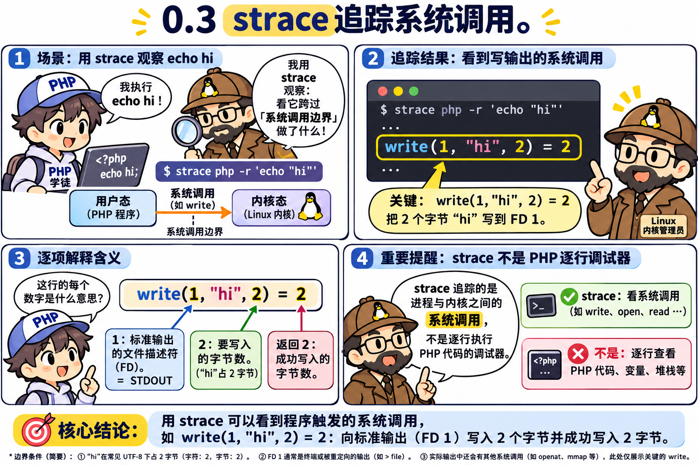
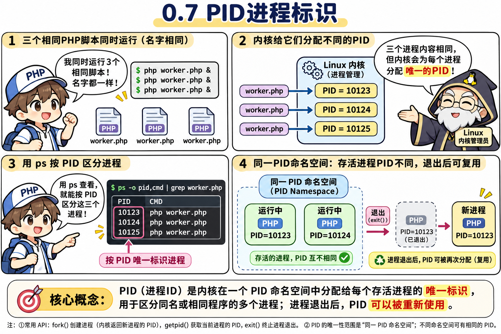

# 第 0 章：基地点火 —— 从“一行代码怎么让屏幕发光”推导出系统调用与进程

> **本章核心灵魂**：忘掉枯燥的教科书概念！我们从最简单的一行 `echo "Hello Linux!\n";` 出发，站在 Linux 操作系统设计者的视角，通过问答一步步推导出为什么要分“用户态”和“内核态”、什么是“系统调用（Syscall）”、为什么算术运算不用找内核、以及静态代码文件是怎么变成活体“进程（Process）”的！

---

## 🟢 第一幕（关卡 0.1 ~ 0.3）：为什么 PHP 不能直接点亮屏幕像素？


### 💬 师徒苏格拉底对话录 1：用户态、内核态与系统调用
- **🤔 祖师爷的困境（背景铺垫）**：
  我们在 [`01_echo.php`](file:///d:/Workerman/chapters/chapter00_kernel_and_process/01_echo.php) 里写下了全课程的第一行代码：
  ```php
  <?php
  echo "Hello Linux!\n";
  ```
  你的目的是想让显示器屏幕上的像素发光，显示出这几个字母。
  **但是，假如你是 Linux 操作系统的发明者**：你敢允许一个普通 PHP 程序员写的脚本，直接去操作显卡硬件、直接去改写物理内存条上的任意地址吗？如果允许的话，万一新手写错了一行代码，岂不是能把整个操作系统的内存覆盖掉（当场死机），或者直接去偷看内存里别人正在运行的微信聊天记录和银行密码？
- **🤔 导师提问**：
  > “为了防止普通程序闯祸，你是操作系统设计师，你会把电脑里的权限划分成哪两个区域？当 PHP 想要往屏幕上印字时，它自己不能碰显卡，它应该怎么做？”
- **🎯 你的思考与回答**：
  > **“分成两个区域：用户 / 内核，它要调用内核提供的接口去显卡显示。”**
- **👏 深度复盘（满分直觉！）**：
  你一句话就道破了现代操作系统的基石！Linux 将 CPU 和内存权限严格切分为两个世界：
  1. **用户态（User Space）**：我们写的 PHP 脚本、Nginx、浏览器等普通软件，全都被关在这个受限的“安全房间”里，绝对不允许直接触碰任何硬件。
  2. **内核态（Kernel Space）**：Linux 操作系统内核独占的“装甲保安亭”，掌控着整台电脑的所有硬件（显卡、网卡、磁盘、内存分配、进程生杀大权）。
  3. **系统调用（System Call，简称 Syscall）**：就是你说的“内核提供的接口”！当用户态的 PHP 想要在屏幕上打印字、或者往网卡发数据时，它必须走到内核保安亭窗口，递交一张标准格式的“办事申请单”，由内核代为操作硬件！


### 🧪 实验铁证：用 `strace` 透视镜抓捕 PHP 递交的申请单
为了亲眼看到 PHP 到底向内核递交了哪张申请单，我们请出了 Linux 系统编程的第一神器 —— **`strace`（系统调用追踪器）**。



> [!TIP]
> **【👉 本关亲手实操任务（第一幕：0.1 ~ 0.3）】**
> - **终端命令**：
>   ```powershell
>   wsl strace -e trace=write php /mnt/d/Workerman/chapters/chapter00_kernel_and_process/01_echo.php
>   ```
> - **观察靶标**：在终端末尾亲自抓到 `write(1, "Hello Linux!\n", 13) = 13`。
> - **改错/对比实验**：尝试把 `"Hello Linux!\n"` 改成 `"Hi\n"` 或再执行 `wsl strace -e trace=write php -r '$x = 1 + 1;'`，观察只有 3 字节与“完全没有 `write` 记录”的区别！
#### 内核真实执行输出：
```text
write(1, "Hello Linux!\n", 13) = 13
+++ exited with 0 +++
```
#### 💡 逐词拆解这行天机：
- **`write(...)`**：这就是 Linux 内核提供的 C 语言系统调用接口名字！原来 PHP 的 `echo` 本身根本不会画屏幕，它只是转身向内核调用了 `write`！
- **`1`**：第一个参数代表“往 1 号管子（标准输出屏幕）里写”（这是我们在第 2 章揭秘的文件描述符 FD）。
- **`"Hello Linux!\n"`**：要写入的内容。
- **`13`**：要写入的字节长度（12 个字母符号 + 1 个换行符 `\n`）。
- **`= 13`**：内核保安办完事后，给你盖章返回的结果：“我已经成功帮你写进去了 13 个字节！”

---

## 🟢 第二幕（关卡 0.4 ~ 0.8）：算术运算要找保安吗？怎么抓住一闪而过的进程？

### 💬 师徒苏格拉底对话录 2：CPU 寄存器 vs 系统调用，静态文件 vs 活体进程
- **🤔 导师追问**：
  > “假如我把代码改成纯算术计算（不 `echo`）：
  > ```php
  > $a = 100 + 200;
  > $b = $a * 2;
  > ```
  > 1. 你觉得计算 `$a = 100 + 200;` 这行代码时，PHP 需要去敲内核保安亭的窗户（发起系统调用 Syscall）吗？为什么？
  > 2. 如果我现在想要在另一个终端里用 `ps` 命令看一眼这个 PHP 程序在内存里长什么样，结果我一运行 `php 01_echo.php`，再去敲 `ps` 却什么都找不到！为什么找不到了？怎么加 **1 行代码** 让它乖乖停在内存里被我们抓到？”
- **🎯 你的思考与回答**：
  > **“1. 应该不需要，但是感觉也需要，因为加法是在寄存器内发生的，所以我不确定。”**
  > **“2. sleep 吗？不确定。”**
- **👏 深度复盘（为什么你的犹豫非常有水平！）**：
  你居然想到了“加法是在 CPU 寄存器里发生的”！那为什么碰了 CPU 寄存器却**不需要**找内核保安呢？
  因为如果连算个 `1 + 1` 都要敲窗户找内核保安填表，那电脑跑一个循环算一亿次加法，得切换一亿次内核态，电脑直接慢成蜗牛了！
  所以 CPU 硬件设计师把硬件分成了两类：
  1. **人畜无害的“私人草稿纸”（普通通用算术寄存器 `RAX/RBX` + 进程自己的内存变量）**：当轮到你的 PHP 进程使用 CPU 时，你在草稿纸上算 `100 + 200`，就算你算错了，也只是你自己的变量算错了，**绝对伤不到别的程序，也伤不到操作系统**！因此，**纯 CPU 算术计算、循环、if 判断、变量赋值，100% 在【用户态】直接由 CPU 算完，零系统调用，快如闪电！**
  2. **公共危险设施（网卡、磁盘、屏幕、申请睡眠定时器）**：这些一旦乱碰就会出乱子，CPU 在电路上锁死了特权级，必须通过系统调用切入 **【内核态】**！


### 🧪 实验验证：一万次加法 vs `sleep(2)`（[`02_math_and_sleep.php`](file:///d:/Workerman/chapters/chapter00_kernel_and_process/02_math_and_sleep.php)）
我们写下这段代码验证你的两个答案：
```php
<?php
$sum = 0;
for ($i = 0; $i < 10000; $i++) {
    $sum += $i; // 纯用户态寄存器计算，零系统调用！
}
sleep(2); // 你猜的 sleep！请求内核保安让自己挂起睡觉 2 秒！
echo "Sum is: $sum\n";
```
> [!TIP]
> **【👉 本关亲手实操任务（第二幕：0.4 ~ 0.6）】**
> - **终端命令**：
>   ```powershell
>   wsl strace -e trace=clock_nanosleep,write php /mnt/d/Workerman/chapters/chapter00_kernel_and_process/02_math_and_sleep.php
>   ```
> - **观察靶标**：命令会停顿整整 2 秒才吐出结果，且 `strace` 只有 1 条 `clock_nanosleep` 和 1 条 `write`，10,000 次加法没有任何系统调用！
> - **改错/对比实验**：把 `$i < 10000` 改成 `$i < 1000000`，再运行看 `strace` 行数是否依然纹丝不动！


#### 内核真实输出：
```text
clock_nanosleep(CLOCK_REALTIME, 0, {tv_sec=2, tv_nsec=0}, ...) = 0
write(1, "Sum is: 49995000\n", 17) = 17
```
1. **验证第 1 题**：10,000 次加法瞬间算出 `49995000`，在 `strace` 里没有任何记录！
2. **验证第 2 题**：你猜的 `sleep(2)` 完全正确！没有 `sleep` 时，程序 0.001 秒就跑完退出了，躺在硬盘上的 `01_echo.php` 只是一具静态尸体（**程序 Program**）；加上 `sleep` 后，它向内核发起了 `clock_nanosleep` 系统调用，活生生地停在了内存里，变成了有血有肉的 **进程（Process）**！

---

## 🟢 第三幕（关卡 0.7 ~ 0.8）：在内存里活捉进程，认识 `PID` 与睡眠态 `S+`

趁着进程 `sleep(3)` 正在内存里睡觉，我们用 `ps aux` 给它拍了一张活体照片：




> [!TIP]
> **【👉 本关亲手实操任务（第三幕：0.7 ~ 0.8）】**
> - **方式一（单终端后台抓拍）**：
>   ```powershell
>   wsl bash -c "php -r 'sleep(3);' & sleep 0.5; ps aux | grep 'sleep(3)' | grep -v grep; wait"
>   ```
> - **方式二（双终端真实观测）**：终端 1 运行 `wsl php -r 'sleep(20);'`，终端 2 运行 `wsl ps aux | grep php`。
> - **观察靶标**：重点看 `PID` 列与 `STAT` 列的 **`S` / `S+`**（休眠等待队列）以及 `%CPU = 0.0`。
> - **对比实验**：在另一个终端跑一个死循环 `wsl php -r 'while(true){}'` 并用 `ps aux | grep php` 抓拍，你会立刻看到状态变成 **`R+`（Running）** 且 `%CPU` 飙到 **`100%`**（跑完立刻按 `Ctrl+C` 杀掉）。
#### 抓拍结果：
```text
jiangfei     391  1.9  0.2  48000 22044 pts/0    S+   23:17   0:00 php -r sleep(3);
```
#### 💡 从这张照片里读懂三个 Linux 核心内功：
1. **`jiangfei`（USER 列）**：派发这个进程的 Linux 用户名。
2. **`391`（PID 列，Process ID）**：**为什么内核要发明 PID？** 因为如果你同时开了 3 个窗口运行 `php test.php`，它们的名字一模一样，内核保安为了不认错人，必须给每个活体进程发一张全系统唯一的数字身份证号（`391`）！
3. **`S+`（STAT 状态列）**：**正在 `sleep` 的进程占不占 CPU？** 看这里的状态是 **`S`（Sleeping 睡眠等待态）**，而不是 **`R`（Running 运行态）**！当进程调用阻塞式系统调用（如 `sleep`、或者后面等网络数据的 `select`）时，内核会把它移出 CPU 放到睡眠等待队列里休息，此时 **CPU 占用率是 0.0%**！

---

### 📖 Workerman 源码真迹初探：启动安检门 `checkSapiEnv()`

虽然阶段 0 偏操作系统基础，但 Workerman 在启动第一步就已经把“环境武器库安检”写死在源码里！打开 [`workerman-source/src/Worker.php#L638-L651`](file:///d:/Workerman/workerman-source/src/Worker.php#L638-L651)：

```php
protected static function checkSapiEnv(): void
{
    // Only for cli, micro and embed.
    if (!in_array(PHP_SAPI, ['cli', 'micro', 'embed'])) {
        exit("Only run in command line mode" . PHP_EOL);
    }
    // Check pcntl and posix extension for unix.
    if (DIRECTORY_SEPARATOR === '/') {
        foreach (['pcntl', 'posix'] as $name) {
            if (!extension_loaded($name)) {
                exit("Please install $name extension" . PHP_EOL);
            }
        }
    }
```
- 为什么 Workerman 绝不允许在 Apache/PHP-FPM（`fpm-fcgi`）网页模式下跑，而必须要在 Linux `cli` 命令行模式下运行？因为后续所有系统调用（`pcntl_fork` 生孩子、`posix_getpid` 查户口、`stream_socket_server` 常驻监听）全都需要一个独立活体常驻进程！

---

## 🗂️ 本章 Anki 闪卡复习沉淀

本章核心知识点已提炼为 **8 张** 深度原子问答卡：
- 📂 **本章专属牌组**：[`anki_cards.txt`](file:///d:/Workerman/chapters/chapter00_kernel_and_process/anki_cards.txt)
- 🌐 **全课程汇总牌组**：[`d:/Workerman/anki/workerman_anki_cards.txt`](file:///d:/Workerman/anki/workerman_anki_cards.txt)
- 📖 **导入教程与牌组说明**：[`d:/Workerman/anki/README.md`](file:///d:/Workerman/anki/README.md)
