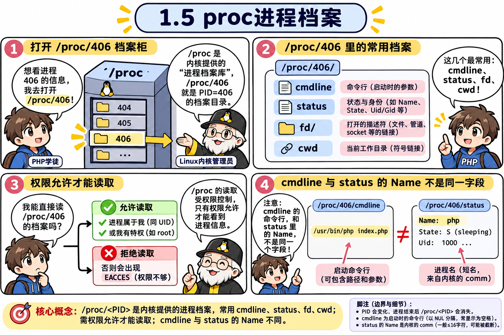
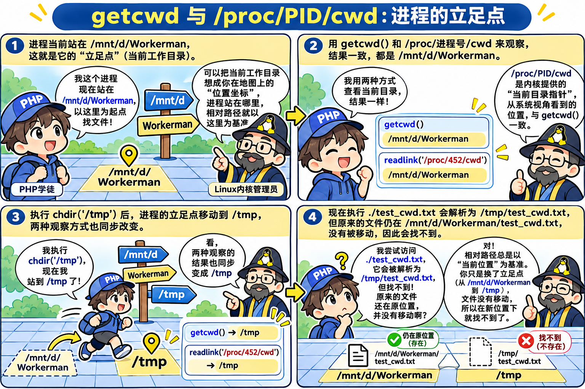
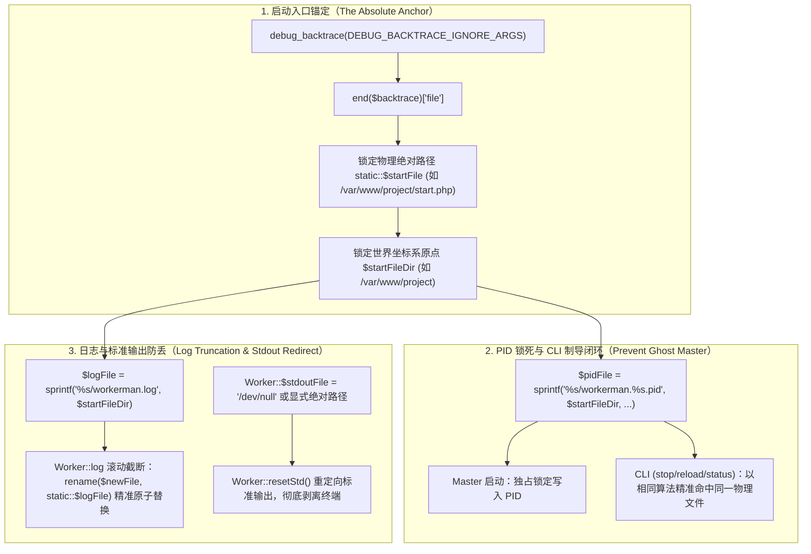
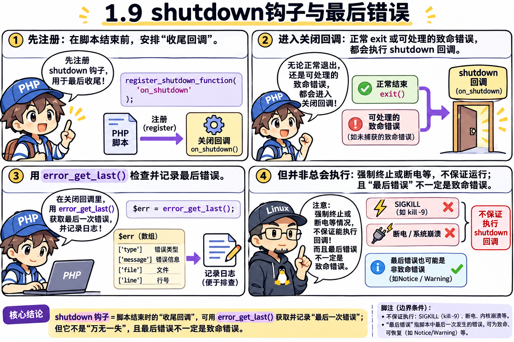

# 第 1 章：解剖进程户口本 —— 从“我是谁、我从哪来”推导出 `/proc`、权限与退出码

> **本章核心灵魂**：在搞复杂的多进程之前，我们先用几行代码把 **1 个进程** 在 Linux 里的全套档案（身份证号 `PID`、老爹 `PPID`、改名卡、内存活体文件夹 `/proc`、进程工作目录 `cwd`、皇上降权为平民的先后顺序、以及咽气前的临终遗言）彻底摸透，并完成我们人生中前三次 **Workerman 源码真迹核对**！

---

## 🟢 第一幕（关卡 1.1 ~ 1.3）：我是谁？我爹是谁？怎么改掉户口本上的名字？

### 🤔 三个现实工程痛点
1. **痛点 1（我是谁 `PID`）**：在第 0 章我们在外面用 `ps` 看到了进程的 PID。但是，**PHP 进程自己在代码内部，怎么知道自己分到了几号身份证？**（比如 Workerman 主进程启动时，必须把自己的 PID 写进一个 `workerman.pid` 文件里锁起来，以后你敲 `php start.php stop` 时才能找到它并关掉它）。
2. **痛点 2（我爹是谁 `PPID`）**：进程不是石头缝里蹦出来的。在 Linux 里，任何进程都是由另一个“父进程（Parent Process）”生出来的。我们在命令行敲 `php 01.php` 时，到底是谁生出了 PHP？
3. **痛点 3（进程改名卡）**：假如服务器上跑了主进程、网关进程、业务进程十几个 PHP 进程，运维用 `ps aux` 一看，满屏幕全叫 `php start.php`，想杀掉其中一个或者看谁内存高，眼都看花了！怎么让每个进程在 `ps` 里显示自己专属的名字？

### 🧪 4 行代码搞定身份三连（[`01_identity.php`](file:///d:/Workerman/chapters/chapter01_process_identity/01_identity.php)）


```php
<?php
cli_set_process_title("modern-worker: master"); // 给自己换个帅气的名字！
echo "我的身份证号 (PID) 是: " . posix_getpid() . "\n";
echo "我老爹的身份证号 (PPID) 是: " . posix_getppid() . "\n";
sleep(2);
```
> [!TIP]
> **【👉 本关亲手实操任务（第一幕：1.1 ~ 1.3）】**
> - **终端命令**：
>   ```powershell
>   wsl bash -c "php /mnt/d/Workerman/chapters/chapter01_process_identity/01_identity.php & sleep 0.5; ps -ef | grep -E 'modern-worker|bash' | grep -v grep; wait"
>   ```
> - **观察靶标**：核对脚本打印的 `PID`/`PPID` 与 `ps -ef` 第 2、3 列是否一致，且最后一列进程名已变为 `modern-worker: master`。
> - **改错/对比实验**：把 `sleep(2);` 改成 `sleep(10);` 后在第二个终端手动运行 `wsl pstree -p` 或 `wsl ps -ef | grep modern-worker`，亲眼看到它的父进程就是当前窗口的 `bash`！
#### 终端真实输出：
```text
我的身份证号 (PID) 是: 406
我老爹的身份证号 (PPID) 是: 305
jiangfei     406     305  2 23:19 pts/0    00:00:00 modern-worker: master
```
- **发现 1**：`posix_getpid()` 打印的 `406`，与 `ps -ef` 第 2 列的 PID 分毫不差！
- **发现 2**：`posix_getppid()` 打印的老爹 `305`，对应的正是你当前黑窗口的命令行解释器 **`bash`**！原来你在终端敲下回车的那一刻，就是让 `bash` 作为老爹生出了 `php` 这个儿子！
- **发现 3**：`ps` 最后一列的名字真的变成了 `modern-worker: master`！

### 📖 Workerman 源码真迹印证（第 1 次源码核对）
打开原版源码 [`Workerman/src/Worker.php` 第 1861~1866 行](file:///d:/Workerman/workerman-source/src/Worker.php#L1861-L1866) 与 [第 1792 行](file:///d:/Workerman/workerman-source/src/Worker.php#L1792)：
```php
protected static function setProcessTitle(string $title): void
{
    set_error_handler(static fn (...$args): bool => true);
    cli_set_process_title($title);
    restore_error_handler();
}
```
> **💡 大师源码细节解读**：为什么 walkor 在调用 `cli_set_process_title($title)` 前后要包一层 `set_error_handler` 吃掉报错？因为在一些古老的 macOS 或特殊容器环境里，系统不允许进程修改自己的名字，直接调用会抛出 PHP Warning。用空错误处理函数包裹后，能保证在任何系统下都静默优雅！

---

## 🟢 第二幕（关卡 1.4 ~ 1.5）：假如你是 Linux 作者，你怎么设计 `/proc` 活体档案室？

### 💬 师徒苏格拉底对话录 1：揭秘 `/proc` 伪文件系统
- **🤔 祖师爷的设计难题**：
  刚才我们改了进程名，也查了 PID。但是进程的名字、PID、老爹 PPID、吃了多少内存，这些数据全都存在 Linux 内核的内存变量里。
  假如你是 Linux 内核作者，外面的管理员（或者 `ps`、`top` 命令）想查看 406 号进程的内部信息：
  - **笨办法**：为每一种查询写一个专门的系统调用（`get_process_name(406)`、`get_process_memory(406)`……写几百个函数！）。
  - **祖师爷的天才办法**：既然 Linux 哲学是**“一切皆文件”**，干脆把内核里每个活着的进程，直接伪装成 **`/proc/身份证号/`** 下的一个文件夹！把它的名字、状态、内存全伪装成里面的普通文本文件！这样管理员直接用最简单的 `ls` 和 `cat` 就能看穿进程的五脏六腑！
- **🤔 导师提问**：
  > “1. 如果一个进程的 PID 是 `406`，我去读 `/proc/406/cmdline` 能看到它的名字；那如果 **2 秒后这个进程执行完毕退出了（死了）**，我再去访问 `/proc/406/` 这个文件夹，你觉得这个文件夹还在不在？为什么？
  > 2. 刚才我们用 `cli_set_process_title("modern-worker: master")` 改了进程名字，你猜它其实是修改了 `/proc/PID/` 下面的哪一个文件的内容，才骗过了 `ps` 命令的？”
- **🎯 你的思考与回答**：
  > **“1. 我觉得应该会不在了。”**
  > **“2. name 文件？两个都是猜的。”**
- **👏 深度复盘（为什么你猜得这么准！）**：
  1. **第 1 题（100 分）**：完全正确！`/proc` 根本不是硬盘上的真实文件夹，而是内核用内存数据实时变出来的“海市蜃楼（`procfs` 伪文件系统）”。进程活着，文件夹就在；进程一死，内核释放了该进程的内存结构体，`/proc/406/` 文件夹在 0.0001 秒内瞬间凭空蒸发！
  2. **第 2 题（90 分）**：非常接近！在 `/proc/PID/` 下面，确实有两个管名字的地方：
     - 一个叫 **`cmdline`** 文件：存放完整的启动命令行字符串（`cli_set_process_title` 涂改的就是这里，所以骗过了 `ps aux` 的最后一列！）。
     - 另一个在 **`status`** 文件的第一行，字段名真的就叫 **`Name:`**（存放程序原本的短名 `php`）！

### 🧪 6 行代码让 PHP 自己偷看自己的 `/proc` 档案袋（[`02_proc_explore.php`](file:///d:/Workerman/chapters/chapter01_process_identity/02_proc_explore.php)）




```php
<?php
cli_set_process_title("modern-worker: master");
$pid = posix_getpid();

echo "1. 进程改名后，/proc/$pid/cmdline 的内容是: " . file_get_contents("/proc/$pid/cmdline") . "\n\n";
echo "2. /proc/$pid/status 里的户口本前 6 行:\n";
$lines = array_slice(file("/proc/$pid/status"), 0, 6);
echo implode("", $lines);
```
> [!TIP]
> **【👉 本关亲手实操任务（第二幕：1.4 ~ 1.5）】**
> - **终端命令**：
>   ```powershell
>   wsl php /mnt/d/Workerman/chapters/chapter01_process_identity/02_proc_explore.php
>   wsl ls /proc/刚才打印的PID
>   ```
> - **观察靶标**：第 1 条命令看到 `State: R (running)`，第 2 条命令立刻报 `No such file or directory`（进程死亡，`/proc/PID` 瞬间蒸发）。
> - **进阶探究**：运行 `wsl bash -c 'php -r "sleep(10);" & p=$!; sleep 0.2; grep VmRSS /proc/$p/status; wait'`，亲眼读取活体进程的物理内存占用！
#### 终端真实输出：
```text
1. 进程改名后，/proc/310/cmdline 的内容是: modern-worker: master                                                        

2. /proc/310/status 里的户口本前 6 行:
Name:	php
Umask:	0022
State:	R (running)
Tgid:	310
Ngid:	0
Pid:	310
```
> **💡 意外收获**：你看第 3 行的 `State: R (running)`！在第 0 章我们抓拍 `sleep` 进程时状态是 `S (sleeping)`，而这里因为 PHP 正在 actively 执行读取文件的代码，所以抓拍到的状态是 **`R`（正在 CPU 上狂奔）**！而且当脚本一结束，再敲 `ls /proc/310` 立刻提示 `No such file or directory`，验证了你的第 1 个猜测！

---

## 🟢 第三幕（关卡 1.6）：为什么我的程序写 fopen("./a.txt") 时好好的，变成后台守护进程就莫名其妙报错找不到文件了？

### 💬 师徒苏格拉底对话录 2：认识进程的立足点 —— `cwd` 与 `chdir()` 的陷阱
- **🤔 生产环境诡异车祸**：
  许多新手写 PHP 脚本时习惯用相对路径：
  ```php
  $config = file_get_contents("./config.json");
  ```
  自己在项目根目录下手动执行 `php index.php` 调试时，一切正常！
  可一旦把程序写成后台守护进程，或者配置进 Linux 的 crontab 定时任务里跑，程序直接暴毙：
  `Warning: file_get_contents(./config.json): Failed to open stream: No such file or directory`！
  为什么代码一个字都没改，文件明明就在那，进程却像瞎了一样看不见？
- **🤔 导师提问**：
  > “1. 在 Linux 中，相对路径 `./` 到底相对于谁？是相对于**这行代码文件所在的物理目录**，还是相对于**终端启动该进程时用户所站的当前目录**？
  > 2. 如果 Linux 允许你随时查看进程当前‘脚踩在哪里’，你猜在 `/proc/PID/` 下面会有个什么名字的软链接指向它？如果要用 PHP 函数掌控自己脚下的目录，应该调哪个函数？”
- **🎯 核心推理与顿悟**：
  - **立足点真相**：`./` 永远相对于进程的**当前工作目录（Current Working Directory, 简称 `cwd`）**！
  - **档案室探秘**：在 Linux 内核里，`/proc/PID/cwd` 就是一个符号链接（软链接），清清楚楚指向该进程当前的立足点！
  - **控制立足点**：PHP 提供了 `getcwd()` 获取立足点，以及 `chdir($dir)` 改变立足点！
  - **致命误区**：很多人把 `./` 当作 `__DIR__`！
    - `__DIR__`：是**编译期常量**，写死在哪个文件里就永远代表该文件在硬盘上的绝对物理路径。
    - `./`：是**运行期相对路径**，完全被进程当时的 `cwd` 牵着鼻子走！

### 🧪 4 行代码揭示立足点漂移与惨案复现（[`03_cwd_and_chdir.php`](file:///d:/Workerman/chapters/chapter01_process_identity/03_cwd_and_chdir.php)）




```php
<?php
$pid = posix_getpid();
echo "PHP 函数 getcwd(): " . getcwd() . "\n";
echo "Linux 内核 /proc/$pid/cwd 指向: " . readlink("/proc/$pid/cwd") . "\n";

// 致命漂移：把立足点切到 /tmp
chdir('/tmp');
echo "chdir('/tmp') 后，新 getcwd(): " . getcwd() . "\n";
echo "再次访问 ./test.txt：惨遭报错！因为进程已经跑到 /tmp 去了！\n";
```
> [!TIP]
> **【👉 本关亲手实操任务（第三幕：1.6）】**
> - **终端命令**：
>   ```powershell
>   wsl php /mnt/d/Workerman/chapters/chapter01_process_identity/03_cwd_and_chdir.php
>   ```
> - **对比实验**：先在 `d:\Workerman` 下运行，再切到 `wsl bash -c "cd /tmp && php /mnt/d/Workerman/chapters/chapter01_process_identity/03_cwd_and_chdir.php"` 跑一次，观察为什么连第 2 步也会找不到相对路径 `./test_cwd.txt`，而用 `__DIR__ . '/test_cwd.txt'` 则永远稳如泰山！


#### 终端真实输出：
```text
=== 1. 探秘进程当前立足点 (cwd) ===
PHP 函数 getcwd() 结果: /mnt/d/Workerman
Linux 内核 /proc/452/cwd 软链接指向: /mnt/d/Workerman

=== 2. 尝试用相对路径访问 ./test_cwd.txt ===
✅ 成功找到文件: 我在原工作目录下！

=== 3. 改变进程立足点: chdir('/tmp') ===
新的 getcwd(): /tmp
新的 /proc/452/cwd 软链接指向: /tmp

=== 4. 再次尝试用相对路径访问同一个 ./test_cwd.txt ===
❌ 惨剧发生！找不到 ./test_cwd.txt 了！
原因：相对路径 ./ 永远相对于进程的 cwd（当前在 /tmp），而不是代码所在的目录！
正解：守护进程常驻或引入文件，务必使用绝对路径或 __DIR__！
```

### 📖 Workerman 源码真迹印证：工作目录生死攸关与源码级“防漂移”全景透视

在关卡 1.6 中，我们亲手通过 `03_cwd_and_chdir.php` 见证了 `chdir('/tmp')` 后，原本好端端的相对路径 `./test_cwd.txt` 瞬间断裂惨死。但在真实的工业级服务器编程中，工作目录（CWD）的水远比这要深得多！

---

#### 🔍 深度透视 1：为什么在标准 Unix 守护进程规范（APUE）中，工作目录如此生死攸关？

在 UNIX 圣经《UNIX 环境高级编程》（APUE）第 13 章关于守护进程（Daemon）的规范中，祖师爷 W. Richard Stevens 提出了著名的守护进程编写铁律：
> **“将当前工作目录更改为根目录 `chdir('/')`。”**

为什么非要这一步？为什么守护进程不能安安心心地留在启动时的目录？

1. **Linux 内核底层机制：VFS 与 `task_struct->fs->pwd` 的引用锁**
   - 在 Linux 内核中，每个进程在内核空间都有一个 `task_struct` 进程控制块。
   - `task_struct->fs` 指向一个 `struct fs_struct`，其中的核心成员 `pwd`（Path of Working Directory）直接持有该进程当前所在目录项（`struct dentry`）和所属挂载点（`struct vfsmount`）。
   - **内核在挂载点上维护着一个活跃引用计数（`mnt_count`）**。只要有一个存活进程的 `pwd` 踩在这个挂载点（或其下任何子目录）上，该挂载点的引用计数就无法清零！
2. **生产环境惨案一：存储热卸载死锁 —— `EBUSY (Device or resource busy)`**
   - 想象真实场景：你的多进程长连接服务部署在一个独立挂载的数据盘（如 `/data` 或挂载的 NAS / NFS / AWS EBS 卷 / 运维维护用的移动硬盘）下。
   - 某天深夜，系统运维需要对这块磁盘做扩容、文件系统坏道修复（`fsck`）或迁移卸载，于是敲下了命令：
     ```bash
     umount /data
     ```
   - Linux 内核立刻无情拒绝并抛出经典报错：
     ```text
     umount: /data: target is busy.
     (In some cases useful info about processes that use the device is found by lsof(8) or fuser(1))
     ```
   - 运维用 `lsof /data` 或 `fuser -m /data` 一查：**原来是你那个常驻后台跑了 3 个月的后台守护进程，双脚还稳稳当当地“踩”在 `/data/project` 下！**
   - 即使你的服务此刻完全没有读写磁盘，哪怕它正在高并发处理纯内存的 TCP 消息，但因为进程的 `cwd` 踩在挂载点上，内核坚决不准卸载！如果运维暴力执行 `umount -l`（Lazy Unmount），会导致新命令找不到该挂载点，而原进程向已脱钩的文件系统句柄写数据，极易造成静默数据损毁！
3. **生产环境惨案二：Core Dump（崩溃核心转储）丢失与权限黑洞**
   - 如果一个后台守护进程是在某个普通开发者的家目录（比如 `/home/developer_tom/`）下敲命令启动的。
   - 几个月后，开发人员 Tom 离职，运维删除了 `/home/developer_tom` 目录，或者收回了该目录的写权限。
   - 此时常驻后台的守护进程的工作目录（`cwd`）瞬间变成了**悬空目录（Dangling CWD）**！当程序偶发段错误（Segmentation fault）或致命崩溃时，Linux 内核试图在进程当前工作目录下生成用于排障的 `core` 内存转储文件，结果因目录不存在或 `Permission denied` 直接失败！
   - 最终现象：服务崩溃暴毙，案发现场连一滴血迹（Core 文件）都没留下，运维排障完全陷入两眼一抹黑的绝境！
4. **祖师爷的避风港设计：为什么偏偏是 `chdir('/')`？**
   - 在 Linux 体系中，根文件系统（`/`）是操作系统启动时挂载的基石。
   - 只要系统不关机断电，**根分区是绝对不可能、也坚决不允许被单独卸载（umount）的**！
   - 将工作目录切换到根目录 `chdir('/')`，相当于解开了进程踩在任何外接分区、独立数据盘上的“物理绳索”，赋予了守护进程在操作系统全局常驻的纯粹修养。

---

#### 🤔 深度透视 2：世纪两难！为什么 Workerman 没有简单粗暴地执行 `chdir('/')`？

既然 Unix 标准规范要求守护进程 `chdir('/')`，那为什么打开 Workerman 源码查看 `Worker::daemonize()` 时，压根找不到 `chdir('/')` 这行代码？

打开 [`Workerman/src/Worker.php` 第 1465~1487 行 (`Worker::daemonize`)](file:///d:/Workerman/workerman-source/src/Worker.php#L1465-L1487)：
```php
protected static function daemonize(): void
{
    if (!static::$daemonize || DIRECTORY_SEPARATOR !== '/') {
        return;
    }
    umask(0);
    $pid = pcntl_fork();
    if (-1 === $pid) {
        throw new RuntimeException('Fork fail');
    } elseif ($pid > 0) {
        exit(0);
    }
    if (-1 === posix_setsid()) {
        throw new RuntimeException("Setsid fail");
    }
    // Fork again avoid SVR4 system regain the control of terminal.
    $pid = pcntl_fork();
    if (-1 === $pid) {
        throw new RuntimeException("Fork fail");
    } elseif (0 !== $pid) {
        exit(0);
    }
}
```
你看：这里有两次 `fork`，有 `posix_setsid()` 脱离控制终端，有 `umask(0)` 清除掩码，**唯独没有 `chdir('/')`！**

为什么 walkor（Workerman 作者）不加上这行标准规范代码？

- **💥 现实残酷原因：PHP 生态与动态脚本语言的“相对路径沉疴”**
  - C 语言编译出的守护进程（如 Nginx、Redis）通常在编译期或通过命令行传入固定绝对配置文件路径（如 `/etc/nginx/nginx.conf`），内部资源完全不依赖相对路径。
  - 但在 PHP 业务开发中，开发者大量写出这样的代码：
    ```php
    // 业务常见写法
    require './config/database.php';
    $cert = file_get_contents('./cert/server.key');
    ```
  - **灾难推演**：
    1. 开发者在终端输入 `php start.php start`（调试模式）。此时没有调用 `daemonize()`，进程 cwd 在 `/var/www/myproject`，相对路径 `./config/database.php` 读取成功，服务完美运行！
    2. 开发者满意地按下 `Ctrl+C`，准备上线部署，输入 `php start.php start -d`（开启守护进程模式）。
    3. 如果 Workerman 在 `daemonize()` 内部自作主张执行了 `chdir('/')`：
       - `getcwd()` 在一微秒之内从 `/var/www/myproject` 突变到了 Linux 根目录 `/`！
       - 下一行业务代码执行 `require './config/database.php'` 时，PHP 就会去读 `/config/database.php`！
       - 结果瞬间触发致命崩溃：`Fatal error: Failed opening required './config/database.php'`！
    4. 开发者当场抓狂：“为什么不加 `-d` 跑得好好的，加了 `-d` 框架就找不到我的配置文件了？！辣鸡框架！”

- **💡 架构抉择**：
  Workerman 必须保持**调试模式（Debug）**与**守护模式（Daemon）**下业务代码执行环境的**绝对一致性**！绝不能为了盲从标准而砸碎数万开发者的饭碗。

---

#### 🛡️ 深度透视 3：Workerman 源码级“防漂移架构（Anti-Drifting Architecture）”深度解剖

既然 Workerman 放弃了在底层粗暴调用 `chdir('/')`，这就带来了一个极其严峻的工程挑战：
> **如果运维在各种不同的路径下随心所欲敲命令，或者有第三方扩展在运行期偷偷调用了 `chdir()`，Workerman 自己的核心资产（PID 进程管理锁、主从日志文件、标准输出流重定向）如何确保 100% 绝对不走样、不丢失、不写偏？**

这就是 Workerman 源码中令人拍案叫绝的 **“防漂移三道核心防线”**！



---

##### 🎯 防线一：入口文件的“时空原点锚定” —— `debug_backtrace` 绝技

- **源码出处**：[`Worker.php` 第 755~760 行 (`Worker::init`)](file:///d:/Workerman/workerman-source/src/Worker.php#L755-L760)
```php
// Start file.
$backtrace = debug_backtrace(DEBUG_BACKTRACE_IGNORE_ARGS);
static::$startFile = static::$startFile ?: end($backtrace)['file'];
$startFilePrefix = basename(static::$startFile);
$startFileDir = dirname(static::$startFile);
```

- **显微镜级逐行机制拆解**：
  1. **为什么不用 `$argv[0]`？**
     - 场景测试：如果运维站在 `/home/ubuntu` 目录下敲命令：
       ```bash
       cd /home/ubuntu
       php /var/www/project/start.php start -d
       ```
     - 或者更离谱的相对路径命令：
       ```bash
       cd /var/log
       php ../www/project/start.php start -d
       ```
     - 在这种情况下，`$argv[0]` 是有毒的！它可能只是 `../www/project/start.php`。一旦进程启动后目录发生变化，相对路径立刻失效；如果是通过 PATH 环境变量或全局软链接执行，`$argv[0]` 甚至只包含符号链接名！
  2. **为什么不用 `$_SERVER['SCRIPT_FILENAME']`？**
     - 在 CLI 模式、Swoole/FPM 混合嵌入环境，或者某些特定的 PHP 编译参数下，`$_SERVER['SCRIPT_FILENAME']` 可能会被上层调用者污染或篡改，行为不可靠。
  3. **Workerman 祖师爷的绝技：`debug_backtrace(DEBUG_BACKTRACE_IGNORE_ARGS)`**
     - `debug_backtrace()` 获取整个 PHP 脚本从启动以来的调用栈。
     - `end($backtrace)['file']` 提取调用栈**最深、最底层的第一个入口文件**！
     - 这是 PHP 解释器内核（Zend Engine）在最开始编译装载文件时赋予的**真实物理绝对路径（Canonical Absolute Path）**！
     - 无论运维站在 `/root`、`/tmp` 还是宇宙尽头敲命令，`end($backtrace)['file']` **必定 100% 绝对解析出 `/var/www/project/start.php`**！
     - `dirname(static::$startFile)` 瞬间提取出 `$startFileDir`（`/var/www/project`）。
     - **从此，Workerman 拥有了一个绝对不可动摇的“世界坐标系原点”！**

---

##### 🎯 防线二：PID 文件的“发射与制导闭环” —— 彻底杜绝幽灵进程与端口冲突

- **源码出处**：
  - 初始化锁死：[`Worker.php` 第 770~772 行](file:///d:/Workerman/workerman-source/src/Worker.php#L770-L772)
    ```php
    // Pid file.
    static::$pidFile = static::$pidFile ?: sprintf('%s/workerman.%s.pid', $startFileDir, $startFilePrefix);
    ```
  - CLI 控制命令读取：[`Worker.php` 第 1146 行 (`Worker::parseCommand`)](file:///d:/Workerman/workerman-source/src/Worker.php#L1146)
    ```php
    $masterPid = is_file(static::$pidFile) ? (int)file_get_contents(static::$pidFile) : 0;
    ```
  - Master 保存自身 PID：[`Worker.php` 第 1544 行 (`Worker::saveMasterPid`)](file:///d:/Workerman/workerman-source/src/Worker.php#L1544)
    ```php
    if (false === file_put_contents(static::$pidFile, static::$masterPid)) {
        throw new RuntimeException('can not save pid to ' . static::$pidFile);
    }
    ```

- **惨案推导：如果 PID 路径发生漂移会怎样？**
  - 假想 Workerman 使用普通的相对路径 `static::$pidFile = 'workerman.pid'`：
    1. 运维在 `/root` 下启动了服务：`php /var/www/project/start.php start -d`
       - 此时进程立足点在 `/root`，PID 文件被悄悄写到了 `/root/workerman.pid`，里面记录 Master PID = 10001。
    2. 下午项目发布，CI/CD 自动化部署脚本进入项目目录准备热重启：
       - `cd /var/www/project && php start.php reload`
       - 此时命令行的 cwd 是 `/var/www/project`，Workerman 按照相对路径去找 `/var/www/project/workerman.pid`！
       - 结果：**文件不存在！** 终端直接冰冷地输出：
         ```text
         Workerman[start.php] not run
         ```
       - 部署脚本以为服务没在跑，立刻执行 `start -d`！
       - 新 Master 进程尝试启动并监听端口，当场暴毙：
         ```text
         Fatal error: Uncaught Exception: stream_socket_server(): Unable to bind to ... Address already in use
         ```
       - 而后台原来的 10001 进程因为 PID 文件失联，无法用 `php start.php stop` 杀死，彻底变成了游荡在内存中的**“孤儿幽灵进程（Ghost Process）”**！
  - **Workerman 的防漂移设计**：
    - 因为在 `Worker::init()` 中，`$pidFile` 在第一秒就由绝对基准目录 `$startFileDir` 拼接完成（`/var/www/project/workerman.start.php.pid`）。
    - 启动时写入的是这个绝对路径；
    - 执行 `stop` / `reload` / `status` 时，即使你在根目录 `/` 下执行 `php /var/www/project/start.php stop`，CLI 脚本算出来的 PID 文件绝对路径和 Master 当初写下的完全分毫不差！
    - **启动者与管理者通过绝对路径锁定了同一个物理抽屉，信号制导 100% 命中！**

---

##### 🎯 防线三：日志文件（Log）与标准输出（Stdout）的“防丢”与“轮转原子性”

- **源码出处**：
  - 日志绝对路径锁定：[`Worker.php` 第 778~788 行 (`Worker::init`)](file:///d:/Workerman/workerman-source/src/Worker.php#L778-L788)
    ```php
    // Log file.
    static::$logFile = static::$logFile ?: sprintf('%s/workerman.log', $startFileDir);

    if (static::$logFile !== '/dev/null' && !is_file(static::$logFile) && !str_contains(static::$logFile, '://')) {
        // if /runtime/logs default folder not exists
        if (!is_dir(dirname(static::$logFile))) {
            mkdir(dirname(static::$logFile), 0777, true);
        }
        touch(static::$logFile);
        chmod(static::$logFile, 0644);
    }
    ```
  - 日志写入与滚动截断防漂移：[`Worker.php` 第 2391~2434 行 (`Worker::log`)](file:///d:/Workerman/workerman-source/src/Worker.php#L2391-L2434)
    ```php
    file_put_contents(static::$logFile, sprintf("%s pid:%d %s\n", date('Y-m-d H:i:s'), $pid, $msg), FILE_APPEND | LOCK_EX);

    // 超过 10MB 自动轮转截断
    if (!empty(static::$logFileMaxSize) && ($fileSize = filesize(static::$logFile)) > static::$logFileMaxSize) {
        // ...
        $newFile = static::$logFile . '.tmp';
        $destination = fopen($newFile, 'w');
        // ... 拷贝后半截日志到 $newFile ...
        rename($newFile, static::$logFile);
        // ...
    }
    ```
  - 标准输出重定向彻底脱钩：[`Worker.php` 第 1519~1530 行 (`Worker::resetStd`)](file:///d:/Workerman/workerman-source/src/Worker.php#L1519-L1530)
    ```php
    $stdOutStream = fopen(static::$stdoutFile, 'a');
    ```

- **机制深度透视**：
  1. **防止日志写丢**：
     - 在常驻内存的多进程程序中，难免引入各种第三方 Composer 扩展包（比如某些图像处理库、PDF 生成库、加密库）。这些底层包在执行系统调用时，经常会在内部调用 `chdir('/tmp')` 来处理临时文件。
     - 如果 `static::$logFile` 是相对路径 `'workerman.log'`：
       - 当第三方库执行了 `chdir('/tmp')` 后，Worker 进程产生的日志瞬间被写到了 `/tmp/workerman.log`！
       - 开发者查看项目目录下的 `workerman.log`，发现日志戛然而止，以为进程卡死了，实际上日志完全“写丢”到了 `/tmp`！
  2. **日志轮转（Log Rotation）的原子替换防漂移**：
     - Workerman 内置了单文件最大 10MB（`$logFileMaxSize = 10_485_760`）的自动平滑截断保护，防止磁盘被日志撑爆。
     - 当日志超过 10MB 时，Workerman 将后半部分写入临时文件 `$newFile = static::$logFile . '.tmp'`，最后调用 `rename($newFile, static::$logFile)` 实现原子替换。
     - **如果这两个路径是相对路径**，一旦在读写期间进程的 cwd 发生了瞬时改变，`rename()` 将找不到源文件或把日志移动到错误的目标目录，导致宝贵的高并发生产排障日志彻底丢失！
     - 正因为在 `Worker::init()` 阶段，`static::$logFile` 已经被死死锁为 `/var/www/project/workerman.log`，底层 VFS 系统调用无论何时执行 `rename()`，都拥有绝对不变的物理目标！

---

#### 🏛️ 深度透视 4：架构师的高阶修养 —— 生产环境如何真正实现“运行时与挂载点脱钩”？

现在你已经掌握了全貌：
1. **标准 Unix 守护进程**：为了防止挂载盘 `EBUSY` 无法卸载，要求必须 `chdir('/')`；
2. **Workerman 框架权衡**：为了保护业务代码中的相对路径不崩塌，没有强加 `chdir('/')`，而是采用 `debug_backtrace` 锁死绝对路径的**防漂移架构**。

那么，作为一名资深的架构师，在极严苛的金融级、电信级生产环境中，**如果我们既要让 Workerman 享受绝对路径的安全，又要彻底解除对项目所在数据磁盘的挂载占用，达到标准 Unix 守护进程的最高修养，应该怎么做？**

Workerman 在源码设计中早就给架构师留出了优雅的高级配置接口！

##### 👉 生产级架构标准配置：显式脱钩到系统根分区
在你的服务入口脚本（`start.php`）中，**在调用 `Worker::runAll()` 之前**，显式配置绝对系统目录：

```php
use Workerman\Worker;

// 1. 将 PID 文件挂载到 Linux 根分区的专用运行时内存文件系统 (tmpfs)
// 机器重启自动清理，且完全脱离业务项目所在磁盘
Worker::$pidFile = '/var/run/my_cluster_worker.pid';

// 2. 将框架日志存放在系统专用的日志目录 /var/log 中
Worker::$logFile = '/var/log/my_cluster_worker.log';

// 3. 将标准输出重定向到系统黑洞或专用输出日志
Worker::$stdoutFile = '/dev/null'; // 或 '/var/log/my_cluster_stdout.log';

// 4. 【铁律】在所有业务代码中，杜绝一切裸露的相对路径！
// ❌ 危险写法（随 cwd 漂移）：require './config.php';
// ✅ 安全写法（编译期绝对路径）：require __DIR__ . '/config.php';

Worker::runAll();
```

通过这一套组合拳：
- **PID 锁在 `/var/run/`**，系统命令随时精准寻址；
- **日志写在 `/var/log/`**，自带 logrotate 运维集成；
- **业务代码全部使用 `__DIR__` 锁定绝对物理位置**；
- 哪怕未来你将整个服务放在独立云盘 `/data/myproject` 下，并在启动后执行了 `chdir('/')`，系统也绝不会丢失任何文件或阻碍任何磁盘卸载！这才是 Linux 系统编程与 Workerman 源码融会贯通后的最高境界！

---

---

## 🟢 第四幕（关卡 1.7）：皇上占完 80 端口后，怎么自废武功变成平民？

### 💬 师徒苏格拉底对话录 3：权限降级与 `setgid` / `setuid` 的先后死穴
- **🤔 生产环境安全大危机**：
  在 Linux 里，**1 ~ 1023 号端口**（比如网站用的 `80` 和 `443` 端口）是“特权端口”，内核规定：**只有最高统治者皇上 `root`（`UID = 0`）启动的进程，才有资格监听 80 端口！**
  于是你用 `sudo php start.php`（以 `root` 身份）启动了服务器。结果第二天，业务代码里有个小漏洞被黑客注入了一行 `exec("rm -rf /")`。因为你的 PHP 进程现在是至高无上的 `root` 皇上身份，黑客瞬间把整台服务器删库跑路了！
  为了破局，Workerman 采取了**“先借用皇上身份占下 80 端口，占完端口后立刻自废武功，把自己降权成普通平民百姓（`www-data`, `UID=33, GID=33`）”**的策略。
- **🤔 导师提问（细节暴击题）**：
  > “在 Linux 里，每个人既有‘用户身份证（`UID`）’，又有‘所属部门/用户组（`GID`）’。只有皇上（`UID=0`）才有权力修改别人的身份和部门。
  > 现在进程是皇上（`UID=0, GID=0`），要把自己变成平民（`UID=33, GID=33`），需要调用两个函数：
  > - `posix_setuid(33)`（把自己的用户变成平民）
  > - `posix_setgid(33)`（把自己的部门变成平民部门）
  > **你觉得这两个函数，必须先调用哪一个，后调用哪一个？如果顺序反了会发生什么搞笑的 Bug？**”
- **🎯 你的思考与回答**：
  > **“我觉得先把部门变成平民，再变用户，不然如果用户变了，其实变不了部门。”**
- **👏 深度复盘（满分神级逻辑！）**：
  这个顺序连许多工作多年的老手第一次写都会写反，你居然一眼就推出来了！
  因为检查“你有没有权力改部门（`setgid`）”看的是你当前的 **`UID` 是不是 `0`（皇上）**！
  - 如果你先调了 `posix_setuid(33)`，你当场就变成了普通平民百姓（`UID=33`），手里的尚方宝剑瞬间消失！下一行你再去调 `posix_setgid(33)` 想改部门时，内核保安冷笑一声：“你一个平民百姓，哪来的权限改部门？Permission denied！”结果你的进程虽然用户变成了平民，却还赖在皇室贵族部门（`GID=0`）里，留下了严重的安全隐患！
  - 所以铁律必须是：**趁着自己还是皇上（`UID=0`），先把部门降为平民（`posix_setgid(33)`），最后一步才把自己的用户身份降为平民（`posix_setuid(33)`）！**

### 🧪 实验验证（[`04_drop_privilege.php`](file:///d:/Workerman/chapters/chapter01_process_identity/04_drop_privilege.php)）


```php
<?php
echo "初始身份: UID=" . posix_getuid() . ", GID=" . posix_getgid() . "\n";

// 按照你推导的正确顺序：1. 先趁着还是皇上(UID=0)，把部门(GID)降为平民(33 www-data)
$gidOk = posix_setgid(33);
// 2. 最后再把自己的用户身份(UID)彻底降为平民(33 www-data)
$uidOk = posix_setuid(33);

echo "降权结果: setgid=" . ($gidOk ? '成功' : '失败') . ", setuid=" . ($uidOk ? '成功' : '失败') . "\n";
echo "当前身份: UID=" . posix_getuid() . ", GID=" . posix_getgid() . "\n";
echo "如果现在已经是平民了，再试图改回皇上部门(GID=0): " . (posix_setgid(0) ? '成功' : '失败！没权限了！') . "\n";
```
> [!TIP]
> **【👉 本关亲手实操任务（第四幕：1.7）】**
> - **终端命令（以 `root` 启动测试降权）**：
>   ```powershell
>   wsl -u root php /mnt/d/Workerman/chapters/chapter01_process_identity/04_drop_privilege.php
>   ```
> - **观察靶标**：输出 `初始身份: UID=0, GID=0` → `当前身份: UID=33, GID=33` → 最后试图改回 `GID=0` 失败。
> - **改错实验**：临时把 `posix_setuid(33)` 放到 `posix_setgid(33)` 前面跑一次，亲眼见证 `setgid=失败` 且 `GID` 依然危险地留在 `0`（改完记得恢复原顺序）！
#### 终端真实输出：
```text
初始身份: UID=0, GID=0
降权结果: setgid=成功, setuid=成功
当前身份: UID=33, GID=33
如果现在已经是平民了，再试图改回皇上部门(GID=0): 失败！没权限了！
```

### 📖 Workerman 源码真迹印证（第 2 次源码核对）
打开原版源码 [`Workerman/src/Worker.php` 第 1848~1852 行 (`setUserAndGroup`)](file:///d:/Workerman/workerman-source/src/Worker.php#L1848-L1852)：
```php
// Set uid and gid.
if ($uid !== posix_getuid() || $gid !== posix_getgid()) {
    if (!posix_setgid($gid) || !posix_initgroups($userInfo['name'], $gid) || !posix_setuid($uid)) {
        static::log("Warning: change gid or uid fail.");
    }
}
```
你看第 1849 行那个 `if` 条件里的调用顺序：
1. 先调 `posix_setgid($gid)`（改主部门）
2. 再调 `posix_initgroups(...)`（改附加部门）
3. **排在最后压轴调用的**，正是 `posix_setuid($uid)`！和你推导的顺序 100% 吻合！

---

## 🟢 第五幕（关卡 1.8 ~ 1.10）：进程的临终遗言（退出状态码）与临终抢救函数

### 🤔 为什么进程死的时候要留一个数字？
后面我们的主进程（老爹 Master）会生出 4 个子进程（儿子 Worker）去干活。如果某天 2 号儿子突然退出了，老爹怎么知道这个儿子是**“正常关机下班（不用管它）”**，还是**“因为代码写错了半路出车祸暴毙的（需要报警写日志并立刻补生一个新儿子）”**？
Linux 规定：任何进程在退出时（`exit($code)`），都可以给老爹留下一句 **`0 ~ 255` 之间的数字遗言（Exit Status Code）**！全世界通用规矩：
- **`0`**：寿终正寝，圆满完成任务！
- **非 `0`（如 `1`, `250`, `255`）**：异常暴毙！不同的数字代表不同的死因！

而如果 PHP 代码写错了（比如调用了不存在的函数触发 Fatal Error），代码当场崩溃，连后面的日志代码都来不及执行怎么办？PHP 提供了一个**“临终遗嘱钩子”：`register_shutdown_function()`**——不管进程是因为正常 `exit` 还是因为致命错误暴毙，在它咽下最后一口气之前，一定会先执行这里面的遗嘱函数！

### 🧪 实验代码（[`05_exit_and_shutdown.php`](file:///d:/Workerman/chapters/chapter01_process_identity/05_exit_and_shutdown.php)）




```php
<?php
register_shutdown_function(function () {
    $err = error_get_last();
    echo "[临终遗言] 进程 (PID=" . posix_getpid() . ") 即将咽气！最后错误: " . ($err['message'] ?? '无致命错误，主动退出') . "\n";
});

echo "进程正在干活，突然决定带着状态码 250 退出...\n";
exit(250);
```
> [!TIP]
> **【👉 本关亲手实操任务（第五幕：1.8 ~ 1.10）】**
> - **终端命令**：
>   ```powershell
>   wsl php /mnt/d/Workerman/chapters/chapter01_process_identity/05_exit_and_shutdown.php
>   echo $LASTEXITCODE
>   ```
> - **观察靶标**：先打印 `[临终遗言]`，紧接着在 PowerShell/Bash 里捕获到进程真实遗言退出码 **`250`**。
> - **改错实验**：在 `exit(250);` 之前故意调用一个不存在的函数 `boom_crash();`，再运行一次，观察 `error_get_last()` 如何在进程暴毙前精准抓到致命死因！


#### 终端真实输出：
```text
进程正在干活，突然决定带着状态码 250 退出...
[临终遗言] 进程 (PID=417) 即将咽气！最后错误: 无致命错误，主动退出
250
```

### 📖 Workerman 源码真迹印证（第 3 次源码核对）
打开原版源码 [`Workerman/src/Worker.php` 第 1773 行](file:///d:/Workerman/workerman-source/src/Worker.php#L1773)、[第 1801 行](file:///d:/Workerman/workerman-source/src/Worker.php#L1801) 与 [第 2348~2363 行 (`checkErrors`)](file:///d:/Workerman/workerman-source/src/Worker.php#L2348-L2363)：
```php
// 1. 子进程启动时注册临终抢救函数 (第 1773 行)
register_shutdown_function(static::checkErrors(...));

// 2. 如果事件循环意外退出，带着 250 状态码退出 (第 1801 行)
exit(250);

// 3. 临终检查死因并记入日志 (第 2348 行)
public static function checkErrors(mixed ...$args): void
{
    if (static::STATUS_SHUTDOWN !== static::$status) {
        $errorMsg = 'Worker[' . posix_getpid() . '] process terminated';
        $errors = error_get_last();
        if ($errors && ($errors['type'] === E_ERROR || ...)) {
            $errorMsg .= ' with ERROR: ' . ...;
        }
        static::log($errorMsg);
    }
}
```
你看，Workerman 里的 `checkErrors()` 和 `exit(250)`，被我们用短短 6 行代码彻底扒光了底裤！

---

## 🗂️ 本章 Anki 闪卡复习沉淀

本章核心知识点已提炼为深度原子问答卡（涵盖 PID/PPID、进程改名、Workerman 源码防报错设计、`/proc` 伪文件系统、进程当前工作目录 `cwd` 与 `chdir()`、特权端口与降权生死顺序、退出码与临终抢救）：
- 📂 **本章专属牌组**：[`anki_cards.txt`](file:///d:/Workerman/chapters/chapter01_process_identity/anki_cards.txt)
- 🌐 **全课程汇总牌组**：[`d:/Workerman/anki/workerman_anki_cards.txt`](file:///d:/Workerman/anki/workerman_anki_cards.txt)
- 📖 **导入教程与牌组说明**：[`d:/Workerman/anki/README.md`](file:///d:/Workerman/anki/README.md)
