# 第 3 章：苏格拉底架构推导（一） —— 从“写死代码”推导出 `$onMessage` 事件回调架构

> **本章核心灵魂**：为什么 Workerman 要设计成 `$worker->onMessage = function($msg) { ... }`？本章我们还不碰复杂的网络，直接用第 2 章刚学的 **`0` 号键盘管子（`STDIN`）**，从最直白的 5 行 `while` 死循环出发，让你亲手经历三次“需求撞墙”，一步一步靠自己的代码重构，把 **`handleMessage` $\rightarrow$ `$callback` 函数参数 $\rightarrow$ `class Worker` 的 `$onMessage` 属性插座** 给重新发明出来！

---

## 🟢 第一幕（关卡 3.1 ~ 3.3）：从“一锅粥代码”推导出 `handleMessage($msg)`

### 🔨 第一步：最直白、最笨的 v0.1 写法（[`v01_hardcoded.php`](file:///d:/Workerman/chapters/chapter03_socratic_onmessage/v01_hardcoded.php)）

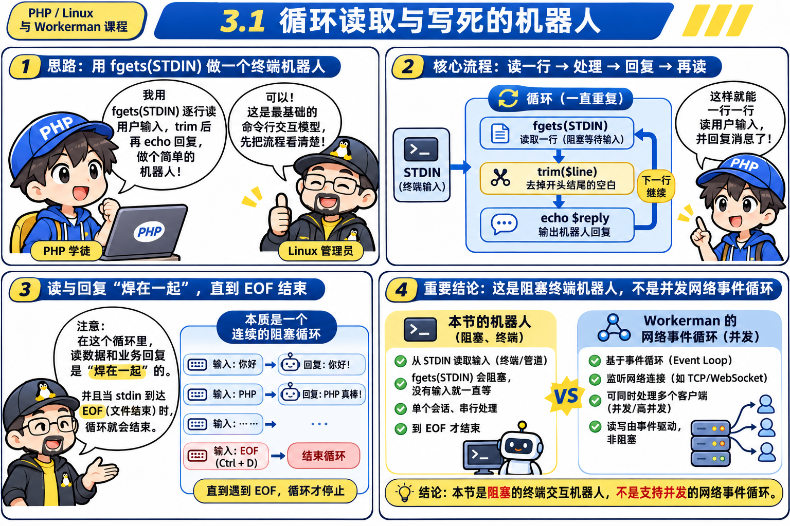

老板让你写一个命令行客服机器人，不断从 `0` 号管子（键盘 `STDIN`）读取用户敲进来的话，然后回复他。最不假思索的写法只有 5 行：
```php
<?php
// v0.1 最笨直觉版：把“读取管子”和“业务处理”死死焊在一起
while (($msg = fgets(STDIN)) !== false) {
    $msg = trim($msg);
    echo "【客服机器人回复】您刚才说的是: " . $msg . "\n";
}
```
> [!TIP]
> **【👉 本关亲手实操任务（第一幕：3.1 ~ 3.3）】**
> - **终端命令**：
>   ```powershell
>   wsl php /mnt/d/Workerman/chapters/chapter03_socratic_onmessage/v01_hardcoded.php
>   ```
> - **交互测试**：输入 `你好` 回车；再按 `Ctrl+D`（Linux 发送 EOF 信号）优雅结束。
> - **观察靶标**：体验阻塞式 `fgets(STDIN)` 与死耦合代码；接着运行 `wsl bash -c 'echo "hi" | php /mnt/d/Workerman/chapters/chapter03_socratic_onmessage/v02_extract_function.php'` 对比抽取函数后的解耦效果。


### 💬 师徒苏格拉底对话录 1：剥离底座与业务
- **💥 撞墙痛点 1**：
  仔细看上面这 5 行代码，它其实把**两件完全不同性质的事**搅在了一锅粥里：
  1. **底层苦力活（框架底座）**：`while (($msg = fgets(STDIN)) !== false) { $msg = trim($msg); ... }` —— 负责死循环盯着 0 号管子吸数据、去掉回车符。
  2. **上层脑力活（业务逻辑）**：`echo "【客服机器人回复】..."` —— 拿到字符串 `$msg` 后到底要干嘛。
  如果现在业务逻辑变成了 50 行（查数据库、判断 VIP、过滤脏话），全塞进 `while` 循环里，底层读取代码和业务代码就彻底烂成一团了！
- **🤔 导师提问**：
  > “如果我们想把‘拿到 `$msg` 后怎么处理’的那行 `echo` 从 `while` 循环里抽出来，放进一个名叫 **`handleMessage($msg)`** 的独立函数里，那么代码改完之后应该长什么样？”
- **🎯 你亲手写出的 v0.2 代码（[`v02_extract_function.php`](file:///d:/Workerman/chapters/chapter03_socratic_onmessage/v02_extract_function.php)）**：
  ```php
  <?php
  function handleMessage($msg){
       echo "【客服机器人回复】您刚才说的是: " . $msg . "\n";
  }
  while (($msg = fgets(STDIN)) !== false) {
      $msg = trim($msg);
      handleMessage($msg);
  }
  ```

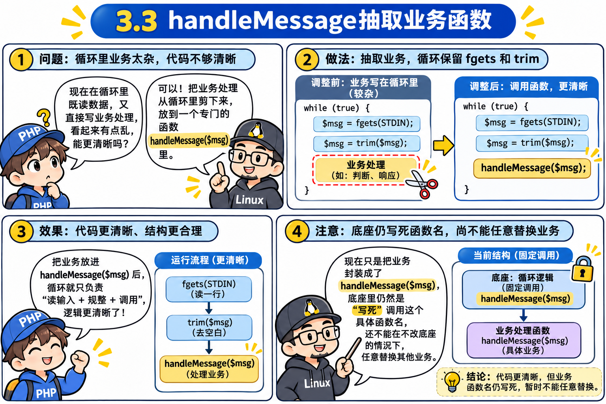

---

## 🟢 第二幕（关卡 3.4 ~ 3.6）：从“写死函数名”推导出 `$callback` 控制反转！

### 💬 师徒苏格拉底对话录 2：如何让底座 `runWorker` 与具体业务彻底解绑？
- **💥 撞墙痛点 2**：
  在 `v0.2` 里，你把业务抽成了 `handleMessage($msg)`，看起来清爽多了。

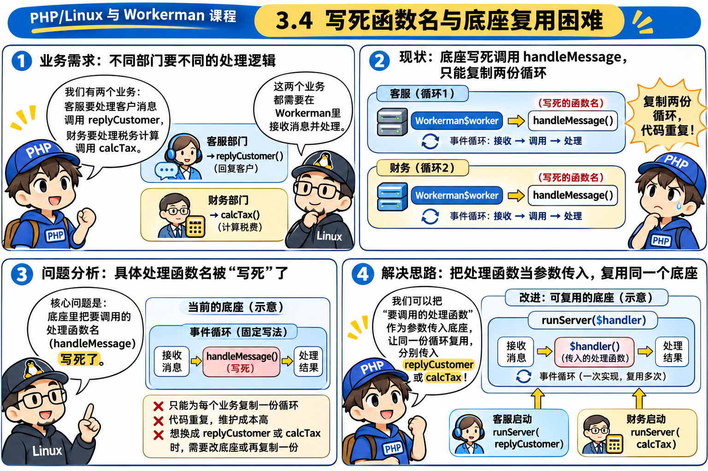
  但如果你现在想把下面的 `while` 循环封装成一个全公司通用的公共底座函数 `runWorker()`：
  ```php
  function runWorker() {
      while (($msg = fgets(STDIN)) !== false) {
          $msg = trim($msg);
          handleMessage($msg); // ❌ 惨了！这里写死了只能调 handleMessage！
      }
  }
  ```
  一旦写死了 `handleMessage($msg)`，客服部想调 `replyCustomer($msg)` 用不了，订单部想调 `createOrder($msg)` 也用不了！底座跟 `handleMessage` 还是死死绑在一起的！
- **🤔 导师提问**：
  > “平时我们写函数不想把数字写死，会把数字当成参数传进去。那现在我们在 `runWorker()` 里不想把‘要调用的业务函数’写死成 `handleMessage`，能不能给 `runWorker` 加一个参数 `function runWorker($callback)`，把你的 `handleMessage` 当成变量传进去？”
- **🎯 你亲手写出的 v0.3 里程碑代码（[`v03_pass_callback.php`](file:///d:/Workerman/chapters/chapter03_socratic_onmessage/v03_pass_callback.php)）**：
  ```php
  <?php
  function handleMessage($msg){
       echo "【客服机器人回复】您刚才说的是: " . $msg . "\n";
  }
  $onMessage = "handleMessage";

  // 公共底座函数（假设放在框架库里，不允许业务程序员修改！）
  function runWorker($callback) {
      while (($msg = fgets(STDIN)) !== false) {
          $msg = trim($msg);
          $callback($msg); // ✅ 传给我什么函数，我就调什么函数！
      }
  }

  runWorker($onMessage);
  ```
- **👏 深度复盘（软件工程最核心的跃迁：回调 Callback 与控制反转 IoC）**：
  你在没有任何提示的情况下，自己写出了 `$onMessage = "handleMessage";` 并传给了 `runWorker($onMessage)`！
  看第 11 行的 `$callback($msg);`：从此以后，`runWorker` 底座彻底变成了“瞎子”——它只管底层的脏活累活（从 FD 管子里读出 `$msg`），至于拿到 `$msg` 后到底干什么，完全由外部传进来的 `$onMessage` 决定！这就叫**业务与底层彻底解耦**！

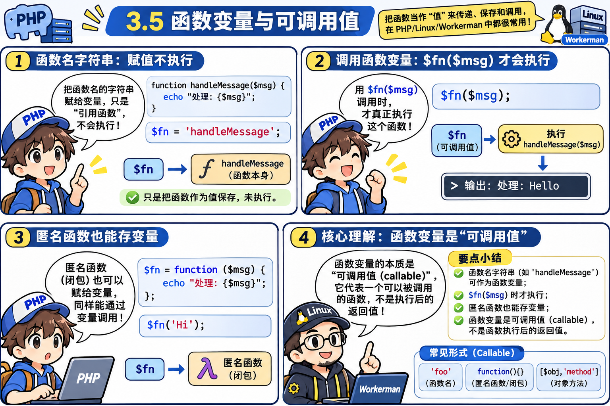
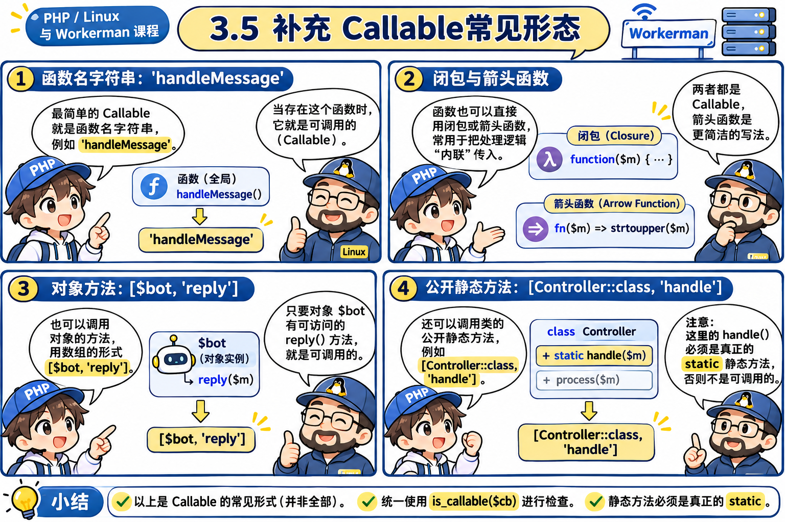
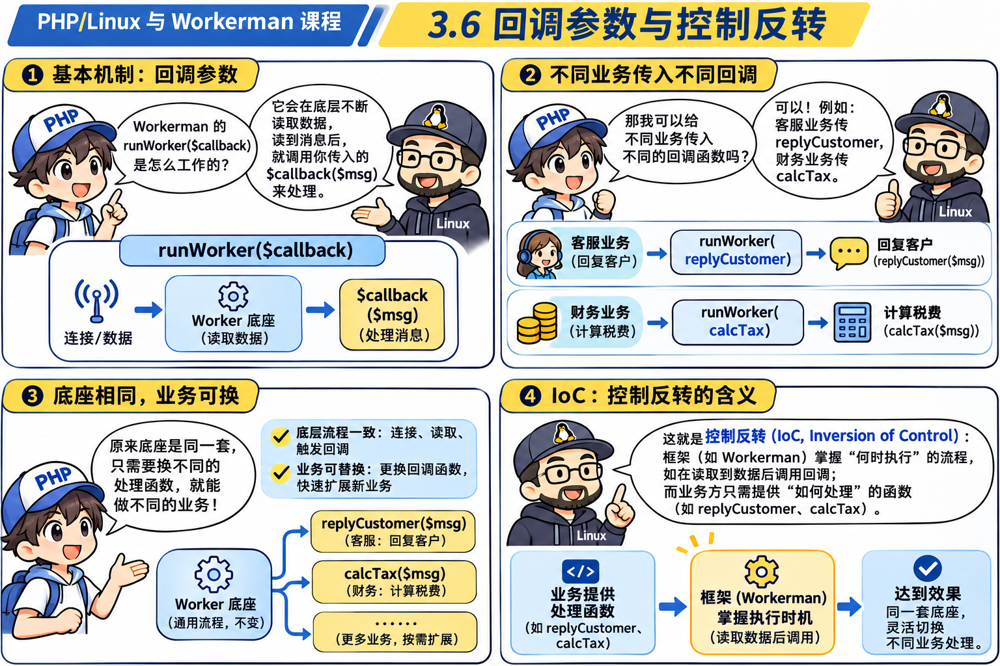

> [!TIP]
> **【👉 本关亲手实操任务（第二幕：3.4 ~ 3.6）】**
> - **终端命令**：
>   ```powershell
>   wsl bash -c 'echo "测试回调反转" | php /mnt/d/Workerman/chapters/chapter03_socratic_onmessage/v03_pass_callback.php'
>   ```
> - **改写实验**：在 `v03_pass_callback.php` 中尝试把 `$onMessage = "handleMessage";` 改成匿名函数 `function($msg) { echo strtoupper($msg) . "\n"; }`，体会不改底座 `runWorker` 一行代码却彻底换掉业务的“控制反转”魔力！


---

## 🟢 第三幕（关卡 3.7 ~ 3.10）：用 `class Worker` 封装多事件插座，发明工业级框架！

### 💬 师徒苏格拉底对话录 3：从参数泥潭到面向对象插座
- **💥 撞墙痛点 3**：
  在 `v0.3` 中，我们用 `runWorker($onMessage)` 实现了单事件解耦。
  但随着系统越来越大，大家提出了更多生命周期的需求：
  1. 服务启动时（进入循环前）：调 `$onWorkerStart` 初始化数据库。
  2. 收到消息时：调 `$onMessage` 处理业务。
  3. 服务停止时：调 `$onWorkerStop` 保存日志。
  4. 以后网络通了还有：连接建立时调 `$onConnect`、断开时调 `$onClose`……
  如果还用函数参数传递，调用方就得写出极其恶心的代码：
  ```php
  runWorker(null, null, $onMessage, null, null); // ❌ 必须数准逗号和 null 的数量，极易错位！
  ```


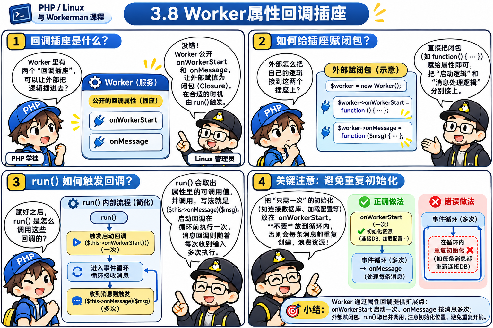
- **🤔 导师提问**：
  > “为了消灭数 `null` 的参数泥潭，如果用面向对象的盒子 `class Worker` 把底座包起来：
  > 1. 我们在类里定义 `public $onWorkerStart = null;` 和 `public $onMessage = null;` 作为公开插座。
  > 2. 用户在外面想插哪个就给哪个属性赋值。
  > 3. 在类内部的 `run()` 方法里，怎么去调用这两个插座？”
- **🎯 你亲手写出的 v0.4 框架骨架代码**：
  ```php
  class Worker {
      public $onWorkerStart = null;
      public $onMessage = null;
      
      public function run() {
          while (($msg = fgets(STDIN)) !== false){
              ($this->onWorkerStart)();
              ($this->onMessage)($msg);
          }
      }
  }

  $woker = new Worker();
  $woker->onWorkerStart = function () {
      echo "=== 机器人启动成功，准备接客！===\n";
  };
  $woker->onMessage = function ($msg) {
      echo "【客服机器人回复】您刚才说的是: " . $msg . "\n";
  };
  $woker->run();
  ```

### 🔍 工业级细节打磨与最终成果（[`v04_worker_class.php`](file:///d:/Workerman/chapters/chapter03_socratic_onmessage/v04_worker_class.php)）
在你的代码基础上，我们一起推导出了两处生命周期细节：
1. **执行时机**：`onWorkerStart` 是服务初始化的生命周期钩子，应该放在 `while` 死循环 **外部/前面** 执行（否则每收到一句话就会重复初始化一次！）。
2. **防御性编程**：加上 `if ($this->onWorkerStart)` 和 `if ($this->onMessage)` 检查，防止用户没传回调时抛出空调用错误。

#### 最终完整代码：
```php
<?php
class Worker {
    public $onWorkerStart = null;
    public $onMessage = null;
    
    public function run() {
        // 1. 服务启动时，触发一次生命周期初始化
        if ($this->onWorkerStart) {
            ($this->onWorkerStart)();
        }

        // 2. 消息驱动循环泵
        while (($msg = fgets(STDIN)) !== false) {
            $msg = trim($msg);
            if ($this->onMessage) {
                ($this->onMessage)($msg);
            }
        }
    }
}

// 业务使用代码
$worker = new Worker();
$worker->onWorkerStart = function () {
    echo "=== 机器人启动成功，准备接客！===\n";
};
$worker->onMessage = function ($msg) {
    echo "【客服机器人回复】您刚才说的是: " . $msg . "\n";
};
$worker->run();
```

> [!TIP]
> **【👉 本关亲手实操任务（第三幕：3.7 ~ 3.8）】**
> - **终端命令**：
>   ```powershell
>   wsl bash -c '{ echo "hello"; echo "workerman"; } | php /mnt/d/Workerman/chapters/chapter03_socratic_onmessage/v04_worker_class.php'
>   ```
> - **观察靶标**：`=== 机器人启动成功，准备接客！===`（`$onWorkerStart`）只打印了 **1 次**，而 `【客服机器人回复】` 触发了 **2 次**。

### 📖 Workerman 源码真迹印证

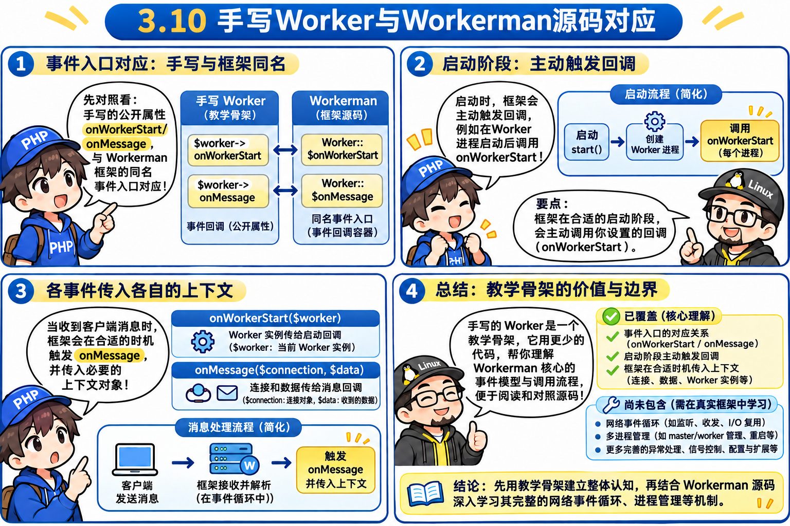
打开原版源码 [`Workerman/src/Worker.php`](file:///d:/Workerman/workerman-source/src/Worker.php)：
1. **属性定义（第 235~248 行）**：
   ```php
   public $onWorkerStart = null;
   public $onMessage = null;
   ```
2. **触发调用（第 2545~2553 行）**：
   ```php
   if ($this->onWorkerStart) {
       try {
           ($this->onWorkerStart)($this);
       } catch (Throwable $e) {
           static::stopAll(250, $e);
       }
   }
   ```
你亲自推导出的这套设计，与官方生产级源码的逻辑结构 **完全吻合**！

---

## 🟢 第四幕（关卡 3.9 ~ 3.10 进阶）：工业级底座的 4 大防御细节与异常安全网

虽然 `v0.4` 已经具备了框架插座的雏形，但在真实高并发生产环境中，它还存在 **4 个致命的工程漏洞**，我们在 [`v05_robust_worker.php`](file:///d:/Workerman/chapters/chapter03_socratic_onmessage/v05_robust_worker.php) 中完成了彻底加固：

### 1. 致命漏洞：业务代码抛异常，常驻进程直接暴毙！
- **传统 Web（PHP-FPM）机制**：业务代码里写了个 `$db->query()` 报错抛出 Exception，当前 HTTP 请求返回 500 报错，但 PHP-FPM 进程会自动清理内存，继续接待下一个用户，整个服务器不会倒。
- **常驻进程（CLI 守护进程）灾难**：如果你的 `Worker` 在处理某一条消息时抛出了未被捕获的 `Throwable`，**整个 PHP 进程会直接退出终结（Exit）！所有的并发连接当场全被切断！**
- **破局之道**：底座必须用 `try { ... } catch (\Throwable $e)` 死死焊住每一个回调调用的外层！无论业务代码抛出什么级别的异常或 Fatal Error，全部拦截并记录日志，誓死捍卫事件循环主进程存活！

### 2. 上下文注入：为什么必须传 `($this->onWorkerStart)($this)`？
- 用户写 `$worker->onWorkerStart = function($worker) { echo $worker->name; };`
- 如果底座只调用 `($this->onWorkerStart)()`，闭包内就拿不到当前 Worker 对象，必须笨拙地写 `use ($worker)`。但在工厂模式或批量创建多进程时，`use` 很容易导致闭包引用混淆或循环引用内存泄漏。
- 框架把 `$this` 作为第一个参数主动递进闭包，这就是现代框架标准的**上下文依赖注入（Context Injection）**！

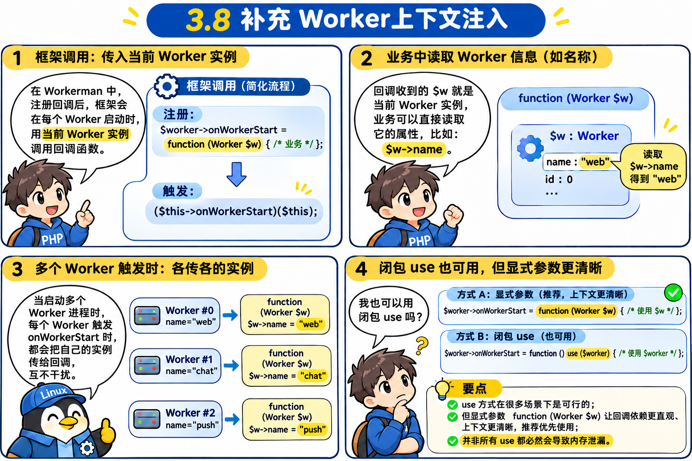

### 3. 严格校验：`is_callable()` 替代单纯的 `if ($this->onMessage)`
单纯用 `if ($this->onMessage)` 只能判断非空，如果用户粗心传了个整数（`$worker->onMessage = 123;`）或拼错了函数名字符串，执行时依然会引发致命的语法错误。使用 `is_callable()` 才能确保无论用户传的是闭包、字符串函数、还是面向对象数组，都能安全调度。

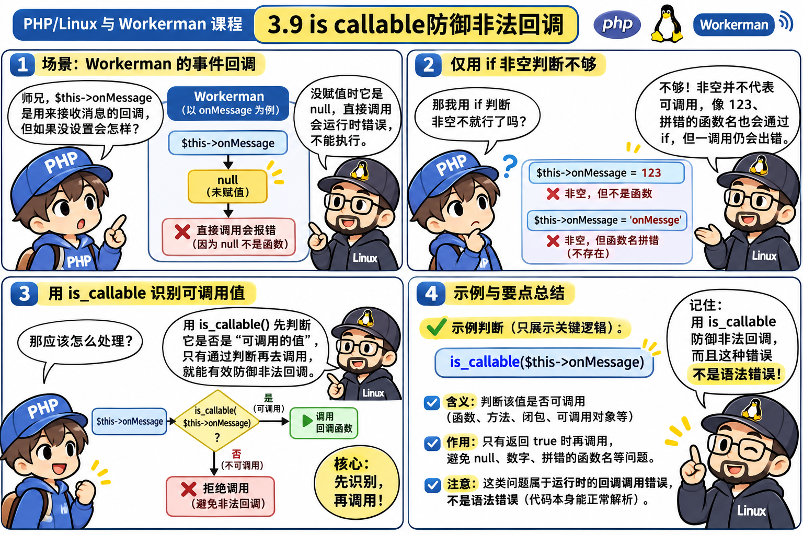
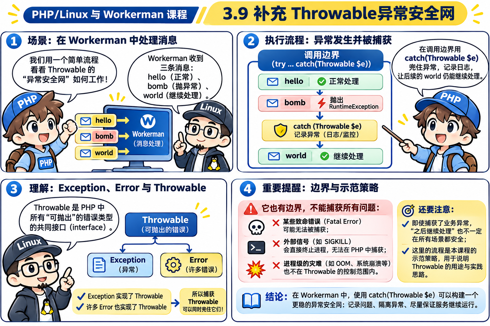


### 4. 面向对象的多样化回调支持：`[$controller, 'action']`
在真实的复杂大型项目（如 MVC 架构）中，业务逻辑通常写在控制器类中。PHP 的回调机制天然支持用数组语法 `[$bot, 'reply']` 传入类的实例方法。

---

### 🧪 工业级健壮版代码验证（[`v05_robust_worker.php`](file:///d:/Workerman/chapters/chapter03_socratic_onmessage/v05_robust_worker.php)）
```php
<?php
class Worker {
    public string $name = 'ChatRobotWorker';
    public $onWorkerStart = null;
    public $onMessage = null;
    public $onError = null;

    public function run(): void {
        // 1. 服务初始化：注入 $this 上下文
        if (is_callable($this->onWorkerStart)) {
            try {
                ($this->onWorkerStart)($this);
            } catch (\Throwable $e) {
                $this->triggerError($e);
            }
        }

        // 2. 消息事件循环泵
        while (($msg = fgets(STDIN)) !== false) {
            $msg = trim($msg);
            if ($msg === '') continue;

            if (is_callable($this->onMessage)) {
                // 工业级防护核心：绝不允许用户业务代码抛出的异常杀死常驻进程！
                try {
                    ($this->onMessage)($msg);
                } catch (\Throwable $e) {
                    $this->triggerError($e);
                }
            }
        }
    }

    protected function triggerError(\Throwable $e): void {
        echo "⚠️ [Worker 安全网拦截] 业务代码发生异常，但底座已被保护不崩溃: " . $e->getMessage() . "\n";
    }
}
```

> [!TIP]
> **【👉 本关亲手实操任务（第四幕：3.9 ~ 3.10 异常安全网）】**
> - **终端命令（模拟业务抛异常测试）**：
>   ```powershell
>   wsl bash -c '{ echo "hello"; echo "bomb"; echo "world"; } | php /mnt/d/Workerman/chapters/chapter03_socratic_onmessage/v05_robust_worker.php'
>   ```
> - **观察靶标**：收到 `"bomb"` 时抛出异常被安全网拦截，随后 `"world"` 依然被顺利处理！
> - **改错实验**：临时把 `v05_robust_worker.php` 里的 `try { ... } catch (\Throwable $e)` 注释掉再跑同一条命令，亲眼看进程如何在 `"bomb"` 处当场暴毙，连 `"world"` 都收不到（验证后改回）。
#### 终端真实输出：
```text
=== ChatRobotWorker (PID: 435) 启动成功，准备接客！===
【客服回复】您发送的消息是: hello
⚠️ [Worker 安全网拦截] 业务代码发生异常，但底座已被保护不崩溃: 💥 数据库连接超时！
【客服回复】您发送的消息是: world
```
> **💡 奇迹时刻**：在收到 `"bomb"` 触发严重异常后，进程不仅没有崩溃退出，反而从容拦截异常并继续成功处理了下一条消息 `"world"`！这就是 Workerman 工业级健壮性的立足之本！

---

## 🌉 承上启下：迈入阶段 4 前的灵魂之问

仔细看阶段 3 我们发明的 `$onMessage($msg)`，它只有一个参数：
```php
$worker->onMessage = function($msg) { ... };
```
**为什么第 4 章一旦接入网络编程，Workerman 的 `$onMessage` 必须变成 2 个参数？**
```php
$worker->onMessage = function(TcpConnection $connection, $data) { ... };
```
- **0 号键盘世界**：输入通道只有 1 个（你的键盘），输出通道也只有 1 个（你的屏幕）。框架把 `$msg` 给你，你直接 `echo` 就能回复。
- **网络 Socket 世界**：同时有 **10,000 个远程客户端** 连在服务器上！当框架收到一段数据 `$data` 时，如果不把**“这是哪位客人的通信插座（`$connection`）”**一并告诉你，你怎么知道要把回信寄给谁？！
- 这就是我们下一阶段要推导的内核——**从 0 号本地文件迈向 3 号网络 Socket 文件！**

---

## 🗂️ 本章 Anki 闪卡复习沉淀

本章核心知识点已提炼为 **6 张** 深度原子问答卡（涵盖控制反转 IoC、面向对象插座设计、`$this` 上下文注入、`\Throwable` 异常安全网、4 种 Callback 形态与单参数到双参数的网络演进）：
- 📂 **本章专属牌组**：[`anki_cards.txt`](file:///d:/Workerman/chapters/chapter03_socratic_onmessage/anki_cards.txt)
- 🌐 **全课程汇总牌组**：[`d:/Workerman/anki/workerman_anki_cards.txt`](file:///d:/Workerman/anki/workerman_anki_cards.txt)
- 📖 **导入教程与牌组说明**：[`d:/Workerman/anki/README.md`](file:///d:/Workerman/anki/README.md)
