# 番外篇：深入骨髓的 TCP/IP 协议与内核状态机大揭秘

> **核心目标**：参考《图解TCP/IP (第5版)》，不搞枯燥的死记硬背，而是用 `tcpdump` 亲手抓出 16 进制原始报文，现场制造 `CLOSE_WAIT` 生产事故，配合全套高清架构图解与 Mermaid 动态时序图，解密 `TIME_WAIT`、`TCP_NODELAY` 与 Workerman 底层核心 Socket 配置的直接映射关系。

---

## 目录
- [第一幕：用十六进制彻底扒掉四层协议栈的外衣](#第一幕用十六进制彻底扒掉四层协议栈的外衣)
  - [图解：TCP/IP 四层模型与包裹封装切片](#图解tcpip-四层模型与包裹封装切片)
  - [逐字节切片拆解](#逐字节切片拆解)
- [第二幕：三次握手抓包与两大底层谜题](#第二幕三次握手抓包与两大底层谜题)
  - [图解：三次握手时序与数学序号演进](#图解三次握手时序与数学序号演进)
  - [疑问 1：为什么初始序号 seq 是随机大数？](#疑问-1为什么初始序号-seq-是随机大数)
  - [疑问 2：为什么 SYN 长度为 0 却吃掉 1 个 seq？](#疑问-2为什么-syn-长度为-0-却吃掉-1-个-seq)
- [第三幕：四次挥手与亲手制造 CLOSE_WAIT 生产事故](#第三幕四次挥手与亲手制造-close_wait-生产事故)
  - [图解：四次挥手与 CLOSE_WAIT 泄漏现场](#图解四次挥手与-close_wait-泄漏现场)
  - [10 行 PHP 制造 CLOSE_WAIT](#10-行-php-制造-close_wait)
  - [ss -tan 实测内核证据](#ss--tan-实测内核证据)
  - [Workerman 源码对比：如何毫秒级消除 CLOSE_WAIT](#workerman-源码对比如何毫秒级消除-close_wait)
- [第四幕：TIME_WAIT 与 2MSL 的哲学守候](#第四幕time_wait-与-2msl-的哲学守候)
  - [图解：TIME_WAIT 为什么必须死等 2MSL？](#图解time_wait-为什么必须死等-2msl)
  - [灾难 ①：最后的 ACK 丢失引发 RST 惨案](#灾难-最后的-ack-丢失引发-rst-惨案)
  - [灾难 ②：迷路的幽灵包串台污染](#灾难-迷路的幽灵包串台污染)
- [第五幕：Nagle 算法与 Delayed ACK 的 40ms 延迟惨案](#第五幕nagle-算法与-delayed-ack-的-40ms-延迟惨案)
  - [图解：世纪大撞车 40ms 延迟死锁](#图解世纪大撞车-40ms-延迟死锁)
  - [Workerman 的解法：TCP_NODELAY](#workerman-的解法tcp_nodelay)
- [第六幕：TCP Keepalive 55 秒与应用层心跳](#第六幕tcp-keepalive-55-秒与应用层心跳)
  - [图解：内核保活与进程脑死亡的差异](#图解内核保活与进程脑死亡的差异)
- [第七幕：Workerman 核心 Socket 源码全景对照](#第七幕workerman-核心-socket-源码全景对照)

---

## 第一幕：用十六进制彻底扒掉四层协议栈的外衣

### 💬 师徒苏格拉底对话录 1：5 个字节的 `"hello"` 为什么在网线里膨胀成 57 字节？

- **🤔 徒弟的疑惑**：我在 PHP 里只写了一句 `fwrite($client, "hello")`，明明只有 5 个字母，怎么在网络里一抓包却变成了 57 个字节？多出来的 52 字节是谁塞进去的？
- **💡 师父点拨**：你寄顺丰快递只装了一支口红（5 克），快递站难道光秃秃把口红扔上货车吗？必须外面套纸箱、贴运单（收发件人地址与端口 = **TCP/IP 首部**），上高速还得记车牌（**链路层帧头**）！把 [`01_send_hello.php`](file:///d:/Workerman/chapters/chapter04_extra_tcp_deep_dive/01_send_hello.php) 跑起来抓一眼 16 进制源码，一切黑盒瞬间透明！

### 图解：TCP/IP 四层模型与包裹封装切片

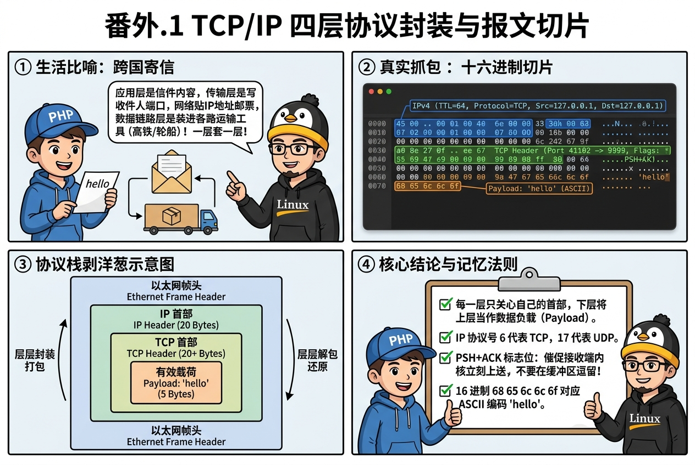

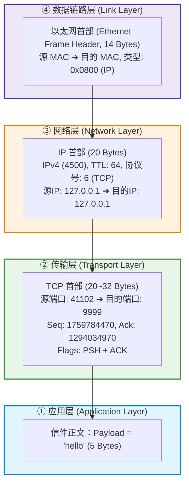

我们写了一个简单的发送端 `01_send_hello.php`，向 `127.0.0.1:9999` 发送 `"hello"`。
在 WSL2 中通过 `tcpdump -i lo -nn -X port 9999` 抓取到的真实报文：

```text
0x0000:  4500 0039 cb20 4000 4006 7192 7f00 0001  E..9..@.@.q.....
0x0010:  7f00 0001 a08e 270f 68e4 4e16 4d21 681a  ......'.h.N.M!h.
0x0020:  8018 0200 8b29 0000 0101 080a 5928 b481  .....)......Y(..
0x0030:  5928 b481 6865 6c6c 6f                   Y(..hello
```

### 逐字节切片拆解：

1. **IP 首部（网络层，前 20 字节）**：
   - `45`：IPv4，首部长度 5 个 32位字（即 20 字节）。
   - `00`：服务类型 (TOS)。
   - `0039`：总长度 57 字节 (0x0039 = 57 字节)。
   - `4006`：TTL = 64 (`0x40`)，协议号 = 6 (`0x06` 代表 TCP 协议！如果是 UDP 则是 17)。
   - `7f00 0001`：源 IP 地址 `127.0.0.1`。
   - `7f00 0001`：目的 IP 地址 `127.0.0.1`。

2. **TCP 首部（传输层，第 20~52 字节）**：
   - `a08e`：源端口 `41102` (0xa08e = 41102)。
   - `270f`：目的端口 `9999` (0x270f = 9999)！
   - `68e4 4e16`：序列号 `seq = 1759784470`。
   - `4d21 681a`：确认号 `ack = 1294034970`。
   - `8018`：
     - `8` (0x80)：首部长度为 32 字节（含 Options 选项）。
     - `18` (0x00011000)：TCP 标志位，**PSH (Push) + ACK (Acknowledgment)**，通知接收端内核立刻把数据上送给上层 PHP 进程，不要在内核缓冲区逗留！

3. **数据负载（应用层 Payload）**：
   - `6865 6c6c 6f`：ASCII 码转换：
     - `0x68` = `'h'`
     - `0x65` = `'e'`
     - `0x6c` = `'l'`
     - `0x6c` = `'l'`
     - `0x6f` = `'o'`

> [!TIP]
> **【👉 本关亲手实操任务（番外 第一幕）】**
> - **终端 1（开启抓包显微镜）**：`wsl sudo tcpdump -i lo -nn -X port 9999`
> - **终端 2（运行发包脚本）**：`wsl php chapters/chapter04_extra_tcp_deep_dive/01_send_hello.php`
> - **观察靶标**：在终端 1 的 16 进制输出末尾找到 `6865 6c6c 6f`（即 `hello`），并对照前面的 `270f`（十进制 `9999` 目的端口）与 `7f00 0001`（`127.0.0.1`）。
> - **改错/扩展实验**：把 `01_send_hello.php` 中的 `"hello"` 改成 `"Workerman!"`（10 字节）再抓一次，验证 IP 首部总长度字段是否从 `0x0039`（57）精准涨到 `0x003e`（62）！

---

## 第二幕：三次握手抓包与两大底层谜题

### 💬 师徒苏格拉底对话录 2：为什么序号不从 `0` 开始？SYN 明明没带数据为啥耗 1 个序号？

- **🤔 徒弟的疑惑**：看三次握手抓包时我发现了两个怪现象：第一，客户端上来发的 `seq` 是一串十位数的天文数字，干嘛不从 `0` 或 `1` 开始？第二，`SYN` 包长度是 `0`，怎么服务端回复的 `ack` 却加了 `1`？
- **💡 师父反问**：假设上次连接的包在公网迷路 3 秒后才抵达，如果每次新连接都从 `seq=0` 开始，新连接岂不是把上辈子的幽灵残包当成今天的新数据吸进去？至于 `SYN` 为啥占 1 个序号——**凡是需要让对方确认收到的标记，都必须占一个门牌号！**

### 图解：三次握手时序与数学序号演进

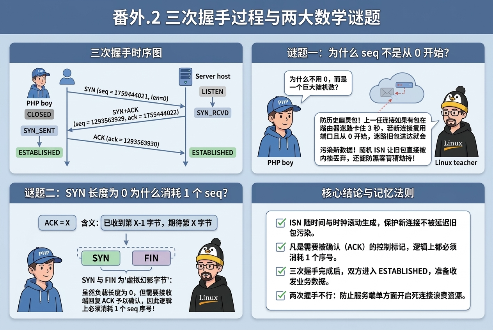

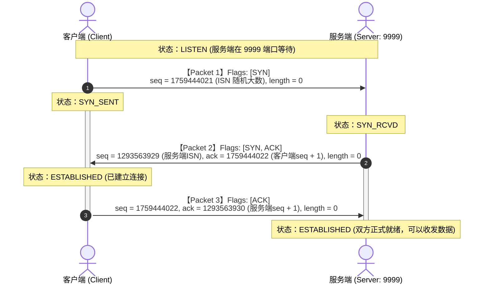

### 疑问 1：为什么初始序号 seq 是随机大数？
- **防止历史幽灵包串台污染新连接**：  
  如果每次都从 0 开始，假设第 1 次连接建立后，有个序号为 5 的包在某个老旧路由器迷路堵塞了 3 秒。此时第 1 次连接关闭，双方紧接着以相同四元组（同IP、同端口）重开新连接，同样从 0 开始。那个迷路 3 秒的幽灵包突然送达，新连接就会把老连接的数据当成自己的第 5 号字节吸进去，导致数据完全错乱！采用基于高精时钟和哈希波动的随机 ISN，旧幽灵包的 seq 会远远落在新连接的接收窗口之外，直接被内核丢弃。
- **防止黑客盲注与劫持 (TCP Spoofing / RST Attack)**：  
  如果序号固定或简单递增，黑客无需抓包就能盲猜到有效 Seq，伪造 RST 包强行掐断连接或注入恶意指令。

### 疑问 2：为什么 SYN 长度为 0 却吃掉 1 个 seq？
- **TCP 铁律**：**凡是需要被对端确认（ACK）的控制标记，在逻辑上都必须消耗 1 个序号！**
- `ACK = X` 的数学定义是：“*序号为 X-1 之前的字节我都已收妥，我期待你下一次发送序号为 X 的字节*”。
- 若 SYN 长度为 0 且不占序号，服务端回 `ack = 1759444021`，发送端根本分不清服务端是在说“*我收到了你的 SYN*”，还是在说“*我还在催你重发 1759444021*”。
- 因此，SYN 和 FIN 被设计为一个**“虚拟幽灵字节”**，占用了 1 个逻辑字节的位置。

---

## 第三幕：四次挥手与亲手制造 CLOSE_WAIT 生产事故

### 💬 师徒苏格拉底对话录 3：为什么生产环境服务器会出现成千上万个 `CLOSE_WAIT`？

- **🤔 徒弟的疑惑**：网上总听说“服务器出现大量 `CLOSE_WAIT` 导致句柄耗尽崩溃”，这到底是 Linux 内核的 Bug 还是网络丢包？
- **💡 师父破案**：恰恰相反，**`CLOSE_WAIT` 是内核在替粗心程序员擦屁股！** 当对端发来 `FIN`（第 1 次挥手），Linux 内核自动回一个 `ACK`（第 2 次挥手）后，会把连接放进 `CLOSE_WAIT`，死等上层 PHP 代码确认“我这边数据也发完了”并亲手调用 `fclose($conn)`，它才敢发出第 3 次挥手 `FIN`！下面用 [`02_close_wait_bug.php`](file:///d:/Workerman/chapters/chapter04_extra_tcp_deep_dive/02_close_wait_bug.php) 亲手把案发现场复现出来！

### 图解：四次挥手与 CLOSE_WAIT 泄漏现场

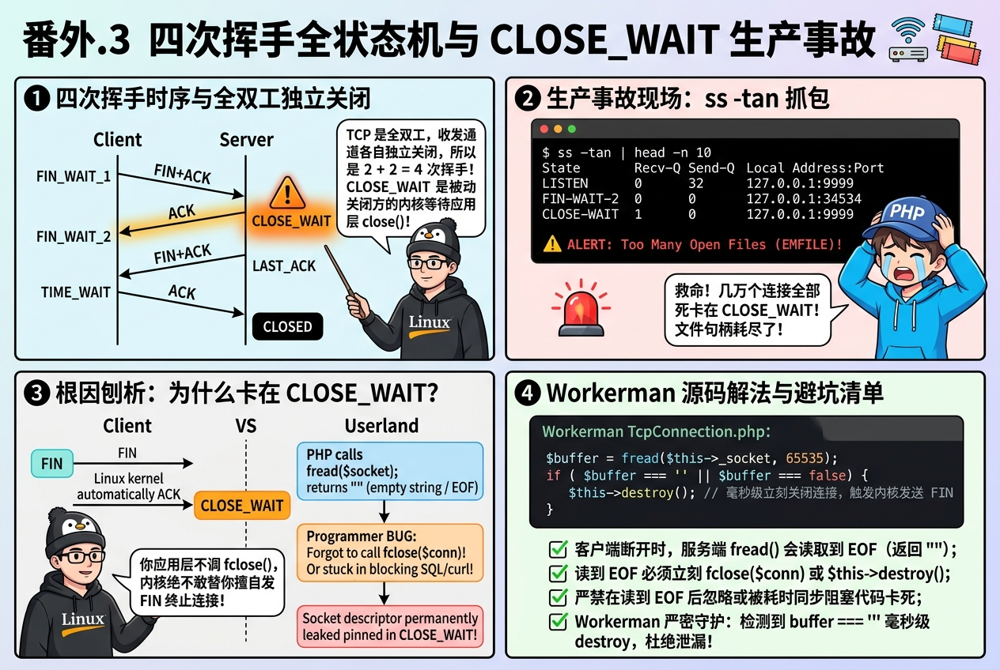

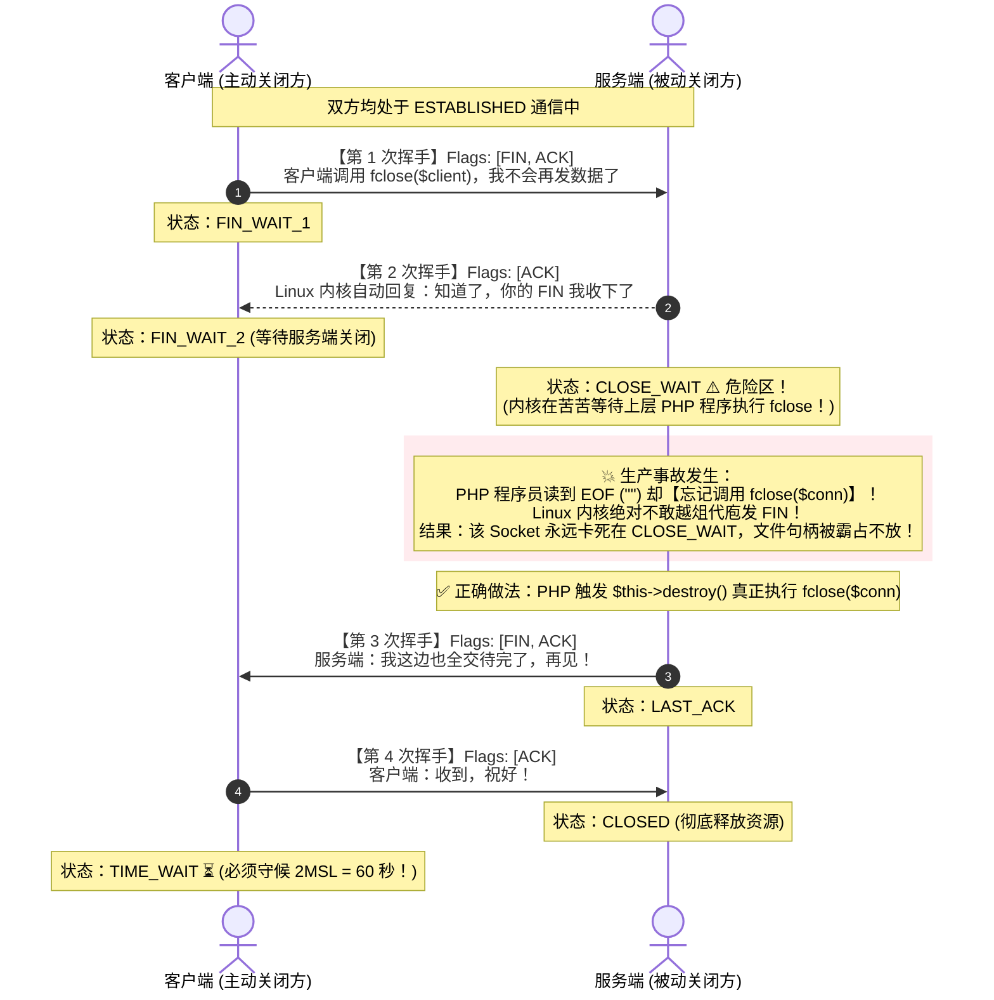

### 10 行 PHP 制造 CLOSE_WAIT (`02_close_wait_bug.php`)
```php
<?php
$server = stream_socket_server('tcp://127.0.0.1:9999', $errno, $errstr);
$conn = stream_socket_accept($server);

// 读取客户端数据：客户端主动调用 fclose 退出时，fread 会返回 "" (EOF)
$data = fread($conn, 1024);

// 模拟程序员疏忽或业务阻塞，故意【不写 fclose($conn)】！
sleep(60);
```

### ss -tan 实测内核证据
```text
State      Recv-Q Send-Q Local Address:Port  Peer Address:Port 
LISTEN     0      32         127.0.0.1:9999       0.0.0.0:*    
FIN-WAIT-2 0      0          127.0.0.1:34534    127.0.0.1:9999 
CLOSE-WAIT 1      0          127.0.0.1:9999     127.0.0.1:34534
```
- **客户端**：卡在 `FIN-WAIT-2` 等待对端挥手。
- **服务端**：内核收到 FIN 自动回复了 ACK，进入 **`CLOSE-WAIT`**。
- **后果**：由于 PHP 代码没有调用 `fclose`，Linux 内核无法发出最后的 FIN。连接数打满后，整个服务报错 `Too many open files` 崩溃瘫痪！

### Workerman 源码对比：如何毫秒级消除 CLOSE_WAIT
Workerman 在 [`src/Connection/TcpConnection.php` (Line 718-723)](file:///d:/Workerman/workerman-source/src/Connection/TcpConnection.php#L718-L723) 严格监控读取：
```php
if ($buffer === '' || $buffer === false) {
    if ($checkEof && (!is_resource($socket) || feof($socket) || $buffer === false)) {
        $this->destroy();
        return;
    }
}
```
并在 `destroy()` 中调用 `@fclose($this->socket)`，瞬间让内核向客户端发出第 3 次挥手的 FIN，终结连接，杜绝了任何一个连接卡死在 `CLOSE_WAIT`！

> [!TIP]
> **【👉 本关亲手实操任务（番外 第三幕）】**
> - **终端 1（运行泄漏服务端）**：`wsl php chapters/chapter04_extra_tcp_deep_dive/02_close_wait_bug.php`
> - **终端 2（连入并主动断线）**：运行 `wsl nc 127.0.0.1 9999`，连上后直接按 `Ctrl+C` 模拟客户端主动挥手关闭。
> - **终端 3（抓现场）**：立刻运行 `wsl ss -tan | grep 9999`
> - **观察靶标**：在 60 秒睡眠窗口内，亲眼看到服务端 `127.0.0.1:9999` 变成醒目的 **`CLOSE-WAIT`**，而客户端变成 `FIN-WAIT-2`！
> - **改错恢复实验**：在 `02_close_wait_bug.php` 的 `sleep(60);` 前加上 `fclose($conn);` 再跑一次，观察 `CLOSE-WAIT` 瞬间消失！

---

## 第四幕：TIME_WAIT 与 2MSL 的哲学守候

### 图解：TIME_WAIT 为什么必须死等 2MSL？

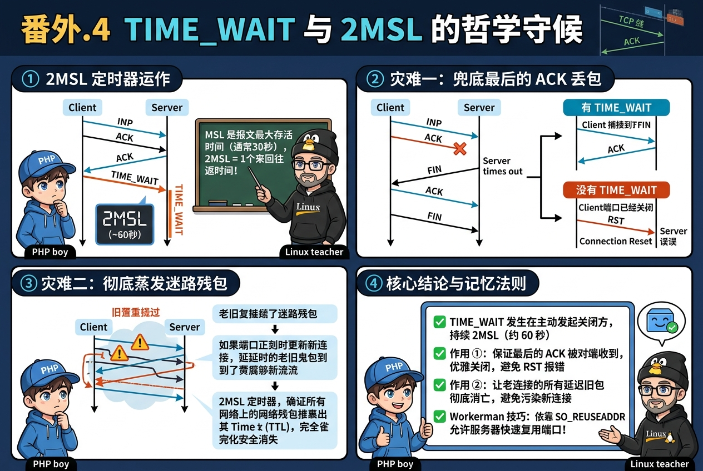

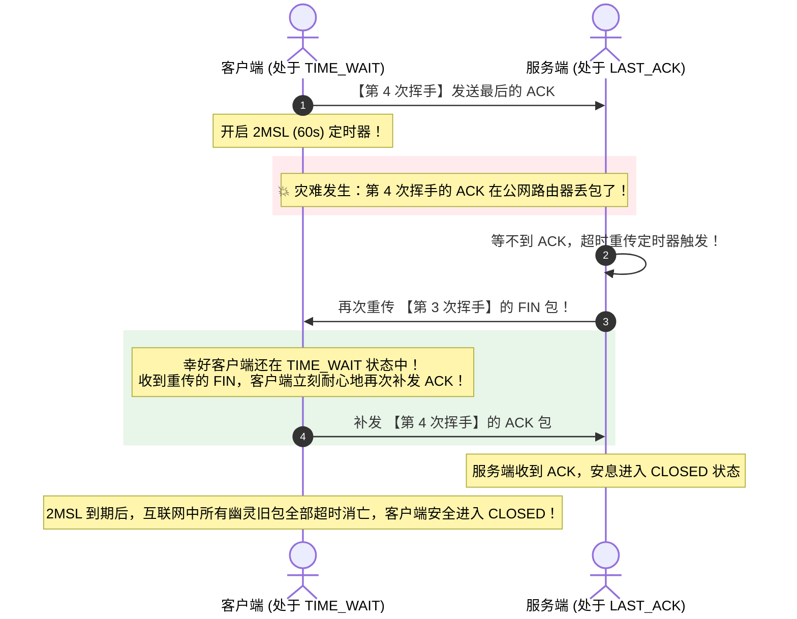

### 灾难 ①：最后的 ACK 丢失引发 RST 惨案
若最后的 ACK 在网络中丢包，被动方会超时重发 FIN。如果主动方发完立刻进入 `CLOSED` 销毁连接，收到对端重发的 FIN 时，内核只能冷冰冰地回复 `RST` 强行重置，对端会抛出 `Connection reset by peer` 异常报错！保持 2MSL 的 `TIME_WAIT` 能让主动方有机会接收重发的 FIN 并补发 ACK，保证优雅关闭。

### 灾难 ②：迷路的幽灵包串台污染
若主动方不等 2MSL 立刻释放端口，新应用极短时间内用同端口建立新连接（相同四元组）。老连接中在网络中堵塞数秒的迷路残包突然送达，新连接会误当成自己的数据吸收，破坏整个通讯。2MSL 保证老连接在公网所有路由器里的残留数据包（TTL）全部超时死亡。

---

## 第五幕：Nagle 算法与 Delayed ACK 的 40ms 延迟惨案

### 💬 师徒苏格拉底对话录 4：高并发微包为什么会莫名其妙卡顿 40ms？

- **🤔 徒弟的疑惑**：局域网延迟明明不到 0.2ms，为什么有时连续发两次小数据，中间平白无故卡死 40 毫秒？
- **💡 师父揭秘**：那是两个好心办坏事的优化机制撞车了——发送端的 **Nagle** 想“攒一攒小包再发”，接收端的 **Delayed ACK** 想“等 40ms 看有没有回信一起捎带确认”，结果两人大眼瞪小眼互相死等 40ms！Workerman 果断用 `TCP_NODELAY` 一刀切掉 Nagle。

### 图解：世纪大撞车 40ms 延迟死锁

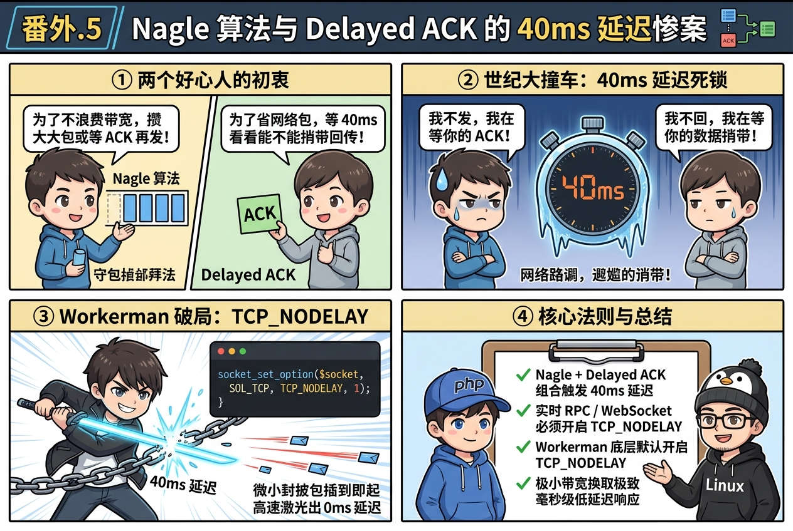

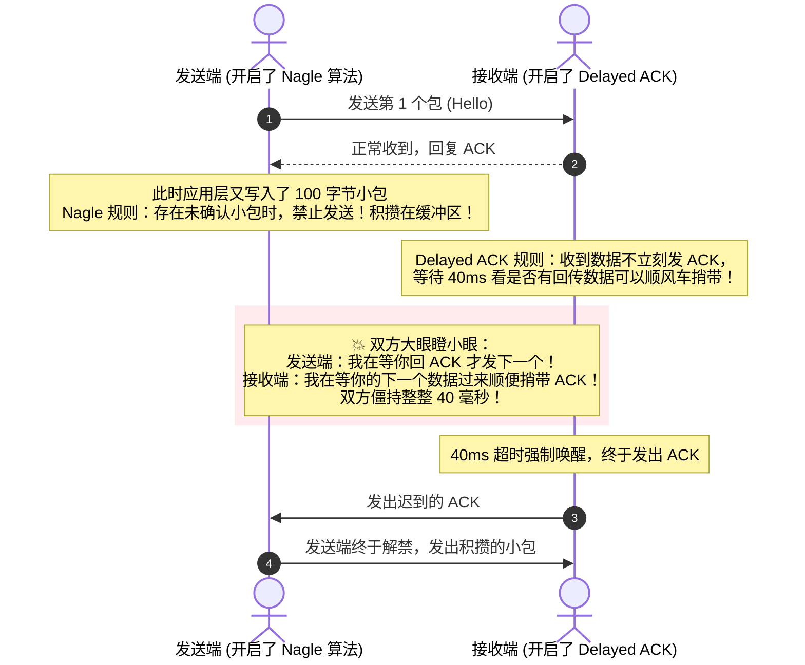

### Workerman 的解法：TCP_NODELAY
Workerman 配置 `socket_set_option($socket, SOL_TCP, TCP_NODELAY, 1);` 直接禁用 Nagle 算法，哪怕 1 个字节也毫秒级光速发出，消灭一切 40ms 延迟！

---

## 第六幕：TCP Keepalive 55 秒与应用层心跳

### 图解：内核保活与进程脑死亡的差异

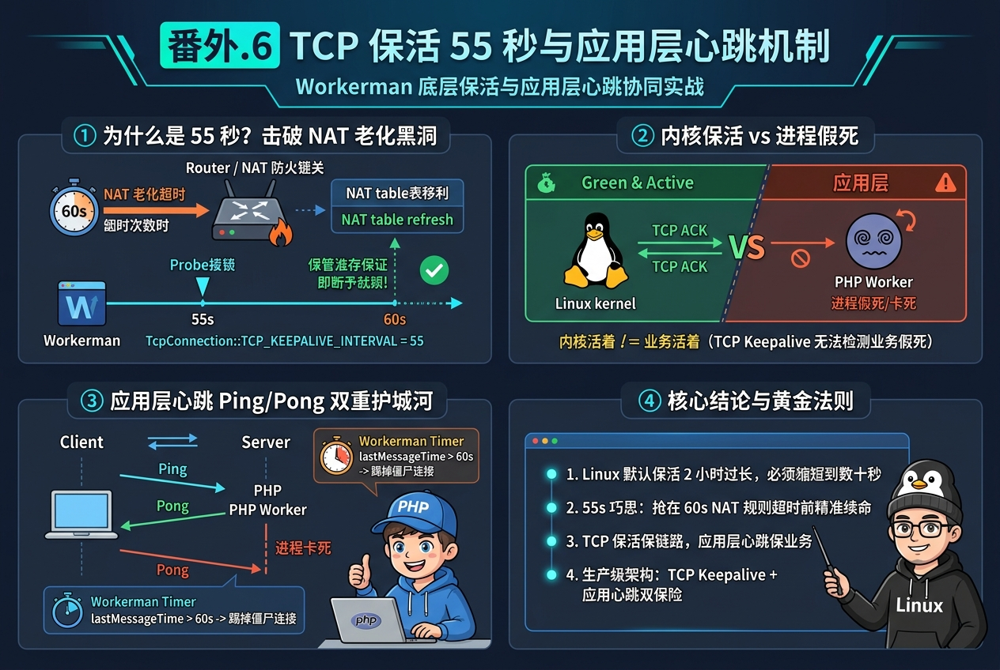

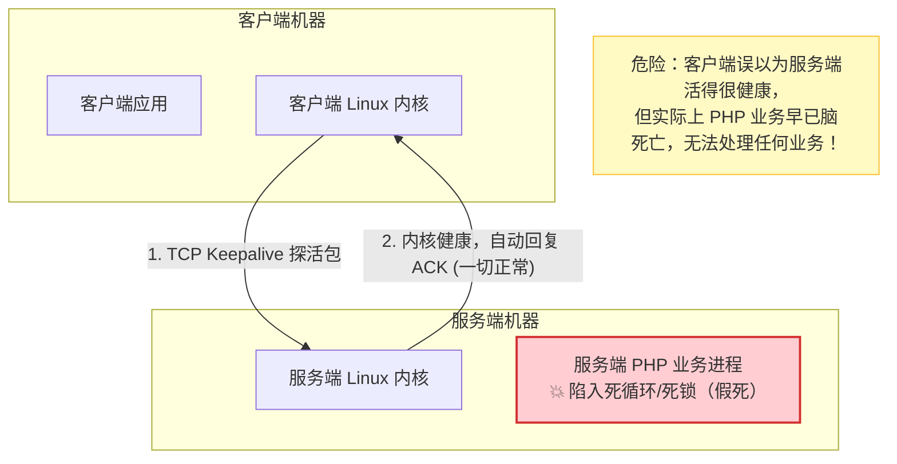

1. **TCP Keepalive**：工作在操作系统内核层，探测机器是否断网断电。Linux 默认时间长达 7200 秒（2小时），Workerman 将其调优为 55 秒。
2. **为什么 55 秒？**：大部分路由器与 NAT 代理设备会将 60 秒无数据的空闲连接从 NAT 映射表中删除。55 秒发一次探针刚好完美保活！
3. **为什么还需要应用层心跳？**：若 PHP 进程死锁或死循环，内核依然会正常响应 TCP Keepalive 探针，但上层业务已经“脑死亡”。必须有应用层心跳（Ping/Pong）确认进程活着。

---

## 第七幕：Workerman 核心 Socket 源码全景对照

打开 Workerman 源码 [`src/Worker.php` (Line 2520-2534)](file:///d:/Workerman/workerman-source/src/Worker.php#L2520-L2534)：

```php
// Try to open keepalive for tcp and disable Nagle algorithm.
if (function_exists('socket_import_stream') && self::BUILD_IN_TRANSPORTS[$this->transport] === 'tcp') {
    set_error_handler(static fn (...$args): bool => true);
    $socket = socket_import_stream($this->mainSocket);
    
    // 开启内核级 TCP Keepalive
    socket_set_option($socket, SOL_SOCKET, SO_KEEPALIVE, 1);
    
    // 禁用 Nagle 算法，干掉 40ms 延迟！
    socket_set_option($socket, SOL_TCP, TCP_NODELAY, 1);
    
    // 55秒探活，击破 NAT 60秒老化黑洞
    if (defined('TCP_KEEPIDLE') && defined('TCP_KEEPINTVL') && defined('TCP_KEEPCNT')) {
        socket_set_option($socket, SOL_TCP, TCP_KEEPIDLE, TcpConnection::TCP_KEEPALIVE_INTERVAL);
        socket_set_option($socket, SOL_TCP, TCP_KEEPINTVL, TcpConnection::TCP_KEEPALIVE_INTERVAL);
        socket_set_option($socket, SOL_TCP, TCP_KEEPCNT, 1);
    }
    restore_error_handler();
}
```

至此，TCP/IP 协议栈所有核心机制已无任何黑盒，全部在 Workerman 底层源码中找到真实归宿！
