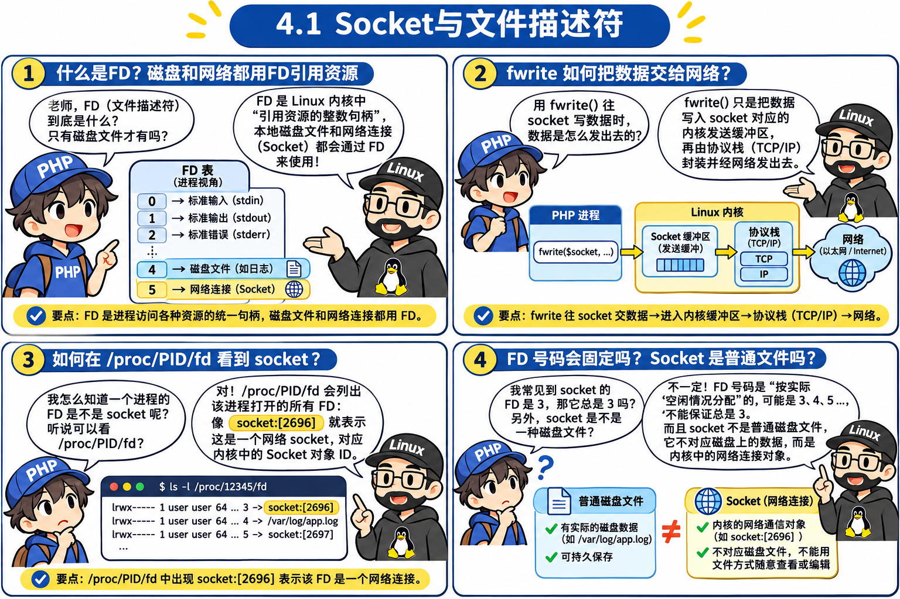
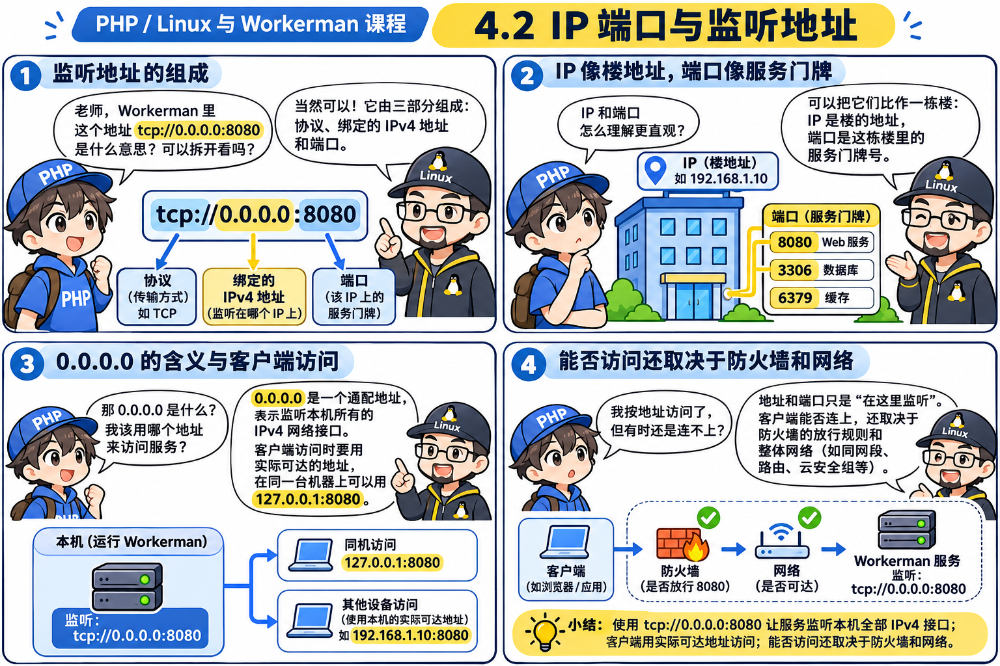
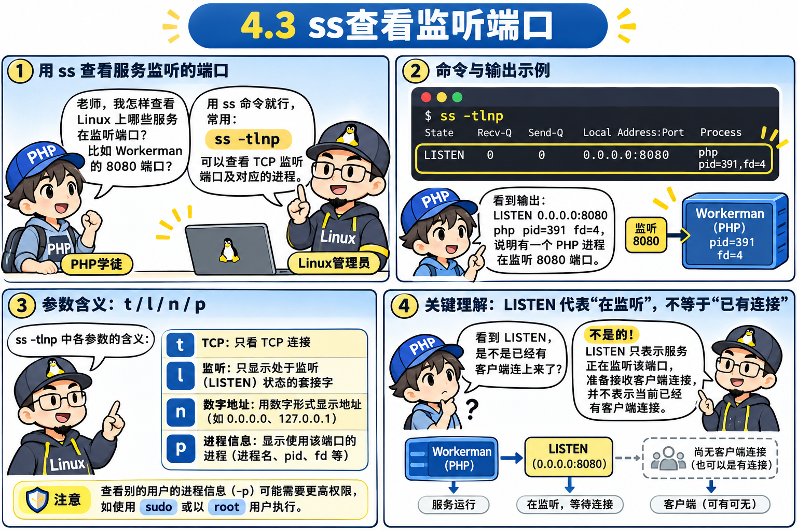
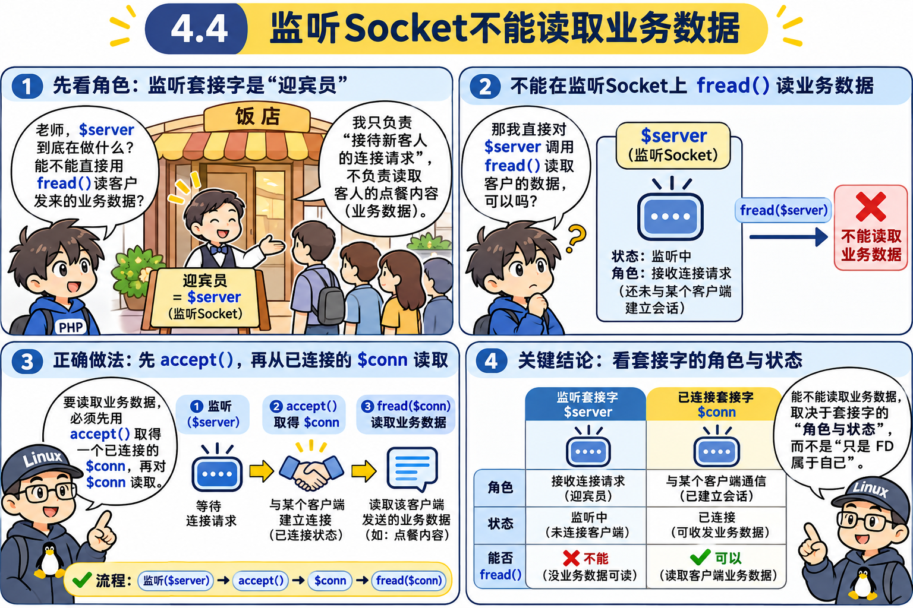
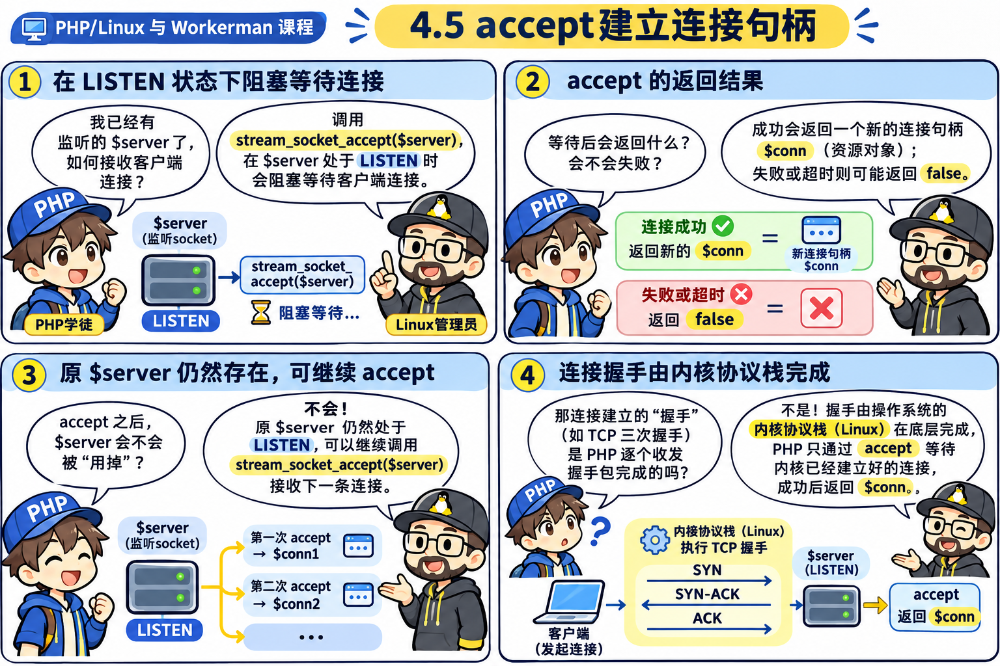
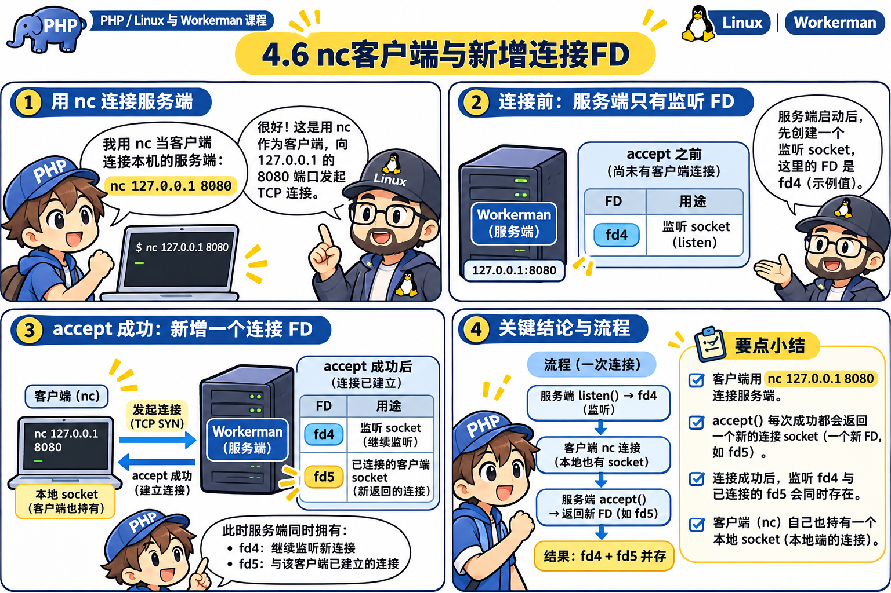
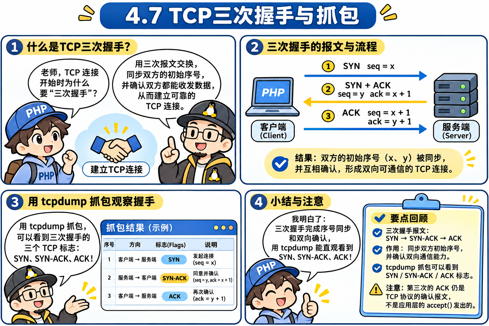
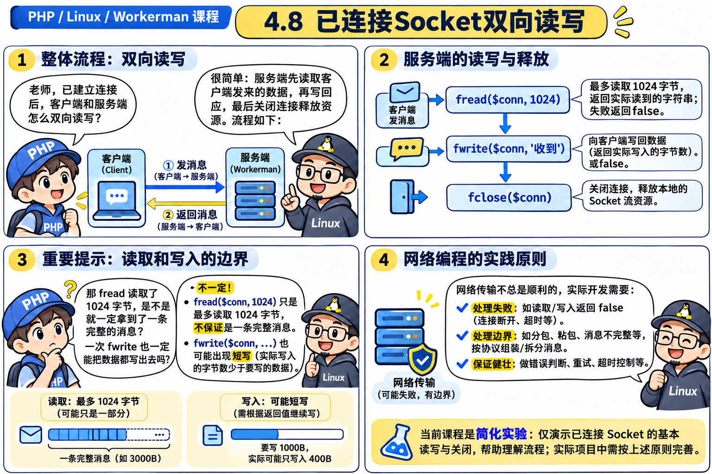
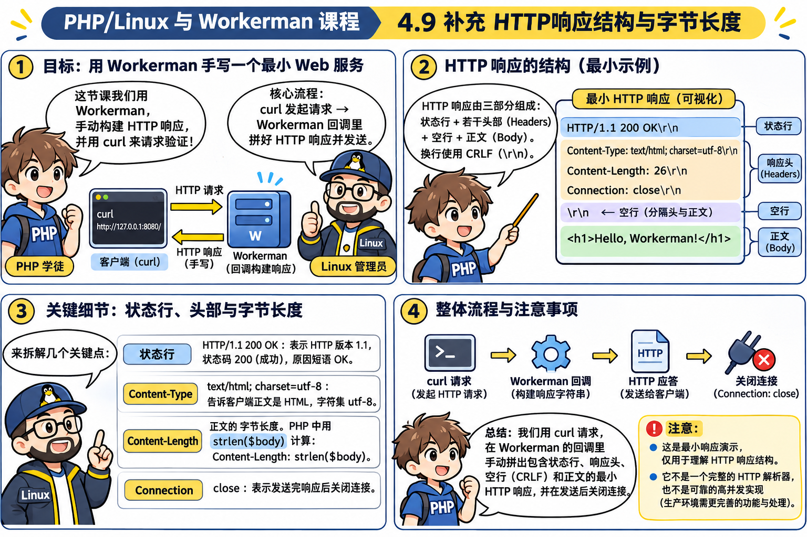
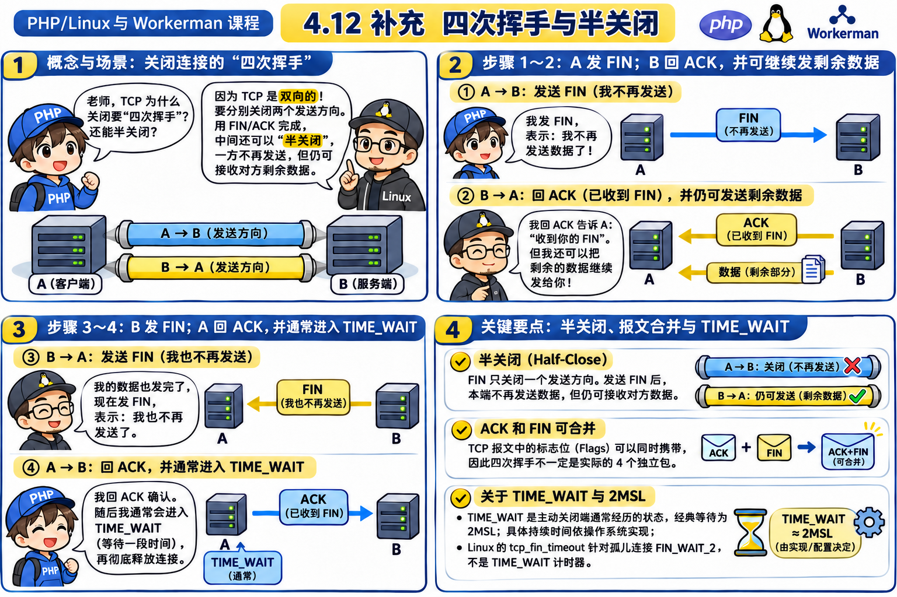

# 第 4 章：网络 Socket 与 HTTP —— 从“本地终端水管”一步步推导出跨主机 TCP 服务与生命周期插座

> [!IMPORTANT]
> 本章打通阶段 4（关卡 `4.1 ~ 4.12`）：核心任务是把第 3 章只能在本地键盘敲字的 [`Worker`](file:///d:/Workerman/chapters/chapter03_socratic_onmessage/v05_robust_worker.php)，真正插上 Linux 内核网卡，推导出**门卫迎宾句柄 vs 专职服务员句柄**、TCP 三次握手/四次挥手、HTTP 报文边界、`onConnect`/`onMessage`/`onClose` 生命周期，以及重启端口冲突救星 `SO_REUSEADDR`。

---

## 🟢 第一幕（关卡 4.1 ~ 4.4）：网络 Socket 也是文件描述符 FD！监听句柄为什么不能 `fread`？

### 💬 师徒苏格拉底对话录 1：从 `/dev/pts/0` 键盘管子到网卡 `socket:[inode]`

- **🤔 徒弟的困惑**：第 3 章里我们的 `Worker` 只能用 `fgets(STDIN)` 陪自己玩。现实里用户都在千里之外的浏览器和手机上，怎么让另一台电脑连进我们的 PHP 进程里？
- **💡 师父点拨**：先别被“网络编程”四个字吓住，还记得第 2 章“一切皆文件”的铁律吗？键盘是一根管子（`FD 0`），硬盘文件是一根管子（`FD 3`）。Linux 祖师爷同样把**网卡与网络连接**也做成了一根插在进程肚子里的“管子”，给它编个整数号 —— 它依然是个 **FD（文件描述符）**，只不过类型叫 `socket:[编号]`！
- **🤔 徒弟追问**：太爽了！那我用 `stream_socket_server("tcp://0.0.0.0:8080")` 拿到 `$server` 这根管子后，是不是就能直接像键盘那样 `fread($server, 1024)` 等客人发消息过来了？
- **💡 师父反问**：你想想看，如果有 **1000 个客人同时连到 `0.0.0.0:8080` 饭店门口**，你全用同一根 `$server` 管子去读数据：张三说一句“加个鸡腿”，李四说一句“结账”，字符全混在同一根管子里怎么区分谁是谁？而且你回一句话，到底是回给张三还是李四？
- **🎯 顿悟**：**门卫（监听 Socket `$server`）只负责站在门口接待新客人，不负责伺候某个具体客人聊天！**




### 🔬 关卡 4.1 ~ 4.3 显微镜实验：亲眼抓住 `socket:[inode]` 与端口状态（[`01_socket_is_fd.php`](file:///d:/Workerman/chapters/chapter04_network_socket/01_socket_is_fd.php)）

```php
$server = stream_socket_server("tcp://0.0.0.0:8080");
$pid = posix_getpid();

foreach (scandir("/proc/$pid/fd") as $fd) {
    if ($fd >= 3) {
        echo "  内核 FD [$fd] -> " . @readlink("/proc/$pid/fd/$fd") . "\n";
    }
}
```

- **机制拆解**：
  1. `0.0.0.0:8080`：`0.0.0.0` 代表绑定本机**所有网卡**（包括 `127.0.0.1` 回环网卡和局域网/公网网卡），`8080` 是端口号。如果只写 `127.0.0.1:8080`，则外网机器无法连入。
  2. 执行 `stream_socket_server()` 时，PHP 会依次向 Linux 内核发起 3 个系统调用：**`socket()`**（申请一个空白网络插口） → **`bind()`**（钉死 `0.0.0.0:8080` 门牌号） → **`listen()`**（把门牌挂出去，进入 `LISTEN` 监听队列状态）。
  3. 去 `/proc/PID/fd` 偷看，你会发现新增的 `FD 4` 指向 **`socket:[xxxx]`** —— 在 Linux 内核眼里，它与硬盘文件并无本质区别！



### 💥 关卡 4.4 撞墙实验：强行对 `$server` 调用 `fread()` 会发生什么？（[`03_fread_listen_crash.php`](file:///d:/Workerman/chapters/chapter04_network_socket/03_fread_listen_crash.php)）

我们在 [`03_fread_listen_crash.php`](file:///d:/Workerman/chapters/chapter04_network_socket/03_fread_listen_crash.php) 中让客户端先连上 `8080` 并发送 `"hello\n"`，然后故意跳过 `accept` 直接对监听句柄调用 `fread($server, 1024)`：

```text
=== 1. 监听已启动 (PID: 440)，查看 /proc/440/fd ===
  内核 FD [3] -> /mnt/d/Workerman/chapters/chapter04_network_socket/03_fread_listen_crash.php
  内核 FD [4] -> socket:[9093]

=== 2. 客户端已连接并发送了 6 字节 "hello\n" ===
错误尝试：直接调用 fread($server, 1024)...
  -> 返回值: false
  -> 内核态度: 内核 recv 返回 -1 (ENOTCONN: Transport endpoint is not connected)

=== 3. 正确做法：经 stream_socket_accept($server) 拿到 $conn 后再 fread($conn) ===
  -> 成功读到客户端消息: "hello\n"
```

通过 `strace -f -e trace=recvfrom,accept` 抓出来的内核铁证如下：
```text
recvfrom(4, ..., 8192, 0, NULL, NULL) = -1 ENOTCONN (Transport endpoint is not connected)
accept(4, {sa_family=AF_INET, sin_port=htons(43668), sin_addr=inet_addr("127.0.0.1")}, [128 => 16]) = 6
recvfrom(6, "hello\n", 8192, MSG_DONTWAIT, NULL, NULL) = 6
```
- **真相大白**：处于 `LISTEN` 状态的 `FD 4` 根本没有绑定对端连接，直接 `recvfrom(4, ...)` 只会得到内核拒绝：**`ENOTCONN`（未连接传输端点）**；必须先经过 `accept(4)` 裂变出一根全新专职的 **`FD 6`（`$conn`）**，才能从中读出 `"hello\n"`！



> [!TIP]
> **【👉 本关亲手实操任务（第一幕：4.1 ~ 4.4）】**
> 1. **双终端抓取内核 FD 与 LISTEN 状态**：
>    - **终端 1**：`wsl php chapters/chapter04_network_socket/01_socket_is_fd.php`（可以把脚本最后 `sleep(2)` 临时改成 `sleep(30)` 再运行）
>    - **终端 2**：趁它在睡，运行 `wsl ss -tlnp | grep 8080`
>    - **观察靶标**：看到终端 2 显示 `LISTEN` 与进程 `PID`、`fd=4`，与终端 1 打印的 `/proc/$pid/fd` 编号严丝合缝。
> 2. **亲眼抓包看 `ENOTCONN` 系统调用错误**：
>    - 运行命令：`wsl strace -f -e trace=recvfrom,accept php chapters/chapter04_network_socket/03_fread_listen_crash.php`
>    - **改错实验**：如果把 `03_fread_listen_crash.php` 里的 `stream_set_blocking($server, false);` 注释掉再跑一次，观察为什么进程会在 `fread($server, 1024)` 处彻底卡死挂起（记得按 `Ctrl+C` 退出，并改回原样）。

---

## 🟢 第二幕（关卡 4.5 ~ 4.8）：推导出 `accept` 迎宾分身术、三次握手与双向读写！

### 💬 师徒苏格拉底对话录 2：一个门卫 + N 个专职服务员

- **🤔 徒弟理解了**：原来 `$server` 只负责在门口迎接客人！那新客人一来，`stream_socket_accept($server)` 到底干了一件什么事？
- **💡 师父揭秘**：`accept()` 会从内核已经完成**三次握手**的全连接队列（Accept Queue）里抱出一个新客人，在当前进程的 FD 户口本里新开一个编号（比如 `FD 5`），返回给 PHP 作为专职连接句柄 `$conn`！
  - `$server`（`FD 4`）：永远只站在大门迎宾，负责继续等下一拨客人。
  - `$conn`（`FD 5`）：1 对 1 绑定这唯一位客人的四元组 `(源IP, 源端口, 目标IP, 目标端口)`，既能读（`fread`），也能回话（`fwrite`）！




### 🧪 关卡 4.5 ~ 4.8 实战代码拆解（[`02_accept_and_waiter.php`](file:///d:/Workerman/chapters/chapter04_network_socket/02_accept_and_waiter.php)）

```php
$server = stream_socket_server("tcp://0.0.0.0:8080"); // 大门迎宾员 (FD 4)
$conn = stream_socket_accept($server);                // 阻塞等待并接回专职服务员 (FD 5)

$msg = fread($conn, 1024);                            // 只用专职服务员读取该客户的话
fwrite($conn, "服务端回复: 已经收到您的信息!\n");      // 同一根全双工水管写回给客户

fclose($conn);                                        // 挂断该客户，归还 FD 5
fclose($server);
```

- **关卡 4.7 TCP 三次握手内功**：为什么 `nc` 还没发一个字，`stream_socket_accept($server)` 就醒了？因为客户端与内核在后台已经悄悄完成了 **三次握手（SYN → SYN+ACK → ACK）**，把连接推进了全连接队列！具体十六进制报文与 ISN 随机序号原理，详见番外篇：[TCP 协议栈深度抓包指南](file:///d:/Workerman/chapters/chapter04_extra_tcp_deep_dive/README.md)。
- **关卡 4.8 双向全双工字节流伏笔**：注意 TCP 管子就像自来水管——写入的每段字节在内核里会合并/拆分，**没有天然的消息边界**（第 8 章会彻底用 `ProtocolInterface` 解决粘包半包）。





> [!TIP]
> **【👉 本关亲手实操任务（第二幕：4.5 ~ 4.8）】**
> 1. **亲眼见证 FD 裂变与双端通讯**：
>    - **终端 1**：`wsl php chapters/chapter04_network_socket/02_accept_and_waiter.php`（此时阻塞在 `stream_socket_accept`）
>    - **终端 2**：`wsl nc 127.0.0.1 8080`，连上后先发呆 2 秒再输入 `hello` 回车。
>    - **观察靶标**：连上的瞬间终端 1 立刻醒来并打印两个不同的 Socket FD（例如 `FD [4]` 是监听，`FD [5]` 是专职服务员）；输入 `hello` 回车后，终端 2 收到服务端回复并结束。
> 2. **用 `tcpdump` 抓看一次真实本地三次握手（可选进阶）**：
>    - **终端 1（抓包）**：`wsl sudo tcpdump -i lo port 8080 -nn -S`
>    - **终端 2 & 3**：按上面同样步骤运行 `02_accept_and_waiter.php` 和 `nc 127.0.0.1 8080`。
>    - **观察靶标**：在抓包输出中找出 `[S]`（SYN）、`[S.]`（SYN+ACK）、`[.]`（ACK）三行握手帧。

---

## 🟢 第三幕（关卡 4.9 ~ 4.12）：组装网络版 `Worker`、HTTP 报文规范、全生命周期插座与 `SO_REUSEADDR`！

### 💬 师徒苏格拉底对话录 3：为什么浏览器访问会转圈报错？为什么重启服务报端口被占？

- **🤔 徒弟的疑惑 1（关卡 4.9）**：我用第 3 章的 `Worker` 改造成网络版后，用 `nc` 测试收到了 `"服务端回复"`，可为什么用 Chrome 浏览器访问 `http://127.0.0.1:8080` 却报错 `ERR_INVALID_HTTP_RESPONSE`？
- **💡 师父点拨**：`nc` 是原始管道工，你给啥字节它直接往屏幕上吐；浏览器是**讲规矩的 HTTP 翻译官**，它期待的是一份带“快递面单”的标准响应报文——必须包含**状态行（`HTTP/1.1 200 OK\r\n`）**、**响应头（如 `Content-Length: 49\r\n`）**、**空行（`\r\n`）**，然后才是正文字节！少写一个 `\r\n` 或 `Content-Length` 算错字节数，浏览器都会拒收或死等！
- **🤔 徒弟的疑惑 2（关卡 4.11 ~ 4.12）**：我想在客人刚敲门时做鉴权/统计人数、客人离开时清理在线列表，还要把事件名跟 Workerman 源码对齐；另外为什么有时刚 `Ctrl+C` 重启服务器就报错 `Address already in use`？
- **💡 师父揭秘**：
  1. 在 `$onWorkerStart`、`$onMessage` 之外，再插两个关键生命周期插座：**`$onConnect`**（刚 `accept` 建连成功时触发）和 **`$onClose`**（连接 `fclose` 挂断后触发）。
  2. 至于重启端口被占，是因为主动关闭的一方按 TCP 铁律进入 **2MSL（60 秒）的 `TIME_WAIT`** 守候期！如果不开启 **`SO_REUSEADDR`** 端口复用，这 60 秒内操作系统绝不允许新进程重用该端口！




### 🔬 关卡 4.9 ~ 4.12 核心代码逐行拆解（[`04_worker_network.php`](file:///d:/Workerman/chapters/chapter04_network_socket/04_worker_network.php)）

```php
// 1. 关卡 4.12：开启 SO_REUSEADDR，绕开 TIME_WAIT 端口占坑锁
$context = stream_context_create([
    'socket' => [
        'so_reuseaddr' => 1,
        'backlog'      => 1024,
    ],
]);
$server = stream_socket_server(
    $this->socketName,
    $errno,
    $errstr,
    STREAM_SERVER_BIND | STREAM_SERVER_LISTEN,
    $context
);

// 2. 关卡 4.11：全生命周期回调串联（accept -> onConnect -> fread -> onMessage -> fclose -> onClose）
$conn = @stream_socket_accept($server, -1, $remoteAddress);
if (is_callable($this->onConnect)) {
    try { ($this->onConnect)($conn, $remoteAddress); } catch (\Throwable $e) { $this->handleException($e); }
}

$msg = fread($conn, 65535);
if ($msg !== false && $msg !== '' && is_callable($this->onMessage)) {
    try { ($this->onMessage)($conn, $msg); } catch (\Throwable $e) { $this->handleException($e); }
}

fclose($conn);
if (is_callable($this->onClose)) {
    try { ($this->onClose)($conn, $remoteAddress); } catch (\Throwable $e) { $this->handleException($e); }
}
```




### 📖 Workerman 官方源码真迹对照

打开原版源码 [`workerman-source/src/Worker.php`](file:///d:/Workerman/workerman-source/src/Worker.php)：
1. **构造 `socketContext` 上下文与 `backlog`**：[`Worker.php#L583-L595`](file:///d:/Workerman/workerman-source/src/Worker.php#L583-L595) 创建并保存 `$this->socketContext = stream_context_create($socketContext)`。
2. **创建监听与设置底层选项**：[`Worker.php#L2485-L2538`](file:///d:/Workerman/workerman-source/src/Worker.php#L2485-L2538) 中的 `listen()` 调用 `stream_socket_server($localSocket, $errNo, $errMsg, $flags, $this->socketContext)`，并进一步开启 `SO_KEEPALIVE` 与 `TCP_NODELAY`（PHP 底层 `stream_socket_server` 在创建服务端 TCP Socket 时已默认注入 `SO_REUSEADDR`，而多进程争抢端口还可通过 `$this->reusePort` 设置 `so_reuseport`）。
3. **`acceptTcpConnection()` 与 `$onConnect` / `$onClose` 注入**：[`Worker.php#L2748-L2780`](file:///d:/Workerman/workerman-source/src/Worker.php#L2748-L2780) 中 `stream_socket_accept($socket, 0, $remoteAddress)` 拿到 `$newSocket` 后，把 `$this->onMessage`、`$this->onClose` 等回调插座转交给新建的连接对象，并在 `try { ($this->onConnect)($connection); } catch (Throwable $e)` 安全网内触发建连回调！

> [!TIP]
> **【👉 本关亲手实操任务（第三幕：4.9 ~ 4.12）】**
> 1. **用真实浏览器或 `curl` 触发 HTTP 与全生命周期**：
>    - **终端 1（服务端）**：`wsl php chapters/chapter04_network_socket/04_worker_network.php`
>    - **终端 2（客户端）**：`wsl curl -i http://127.0.0.1:8080`（或直接在 Windows 浏览器打开 `http://127.0.0.1:8080`）
>    - **观察靶标**：终端 1 严格按 `🚀 onWorkerStart` → `🟢 onConnect` → `📩 onMessage`（打印出真实 HTTP 请求头 `GET / HTTP/1.1...`）→ `🔴 onClose` 的顺序吐出日志；终端 2 收到完整 `HTTP/1.1 200 OK` 响应并正常退出。
> 2. **改错破坏实验（验证 HTTP `Content-Length` 边界铁律）**：
>    - 把 `04_worker_network.php` 里的 `"Content-Length: " . strlen($body)` 改成 `"Content-Length: 999"`（骗客户端后面还有 999 字节），重启服务端再用 `curl -v --max-time 3 http://127.0.0.1:8080` 访问，观察 `curl` 是如何因少收到字节而报错挂起的！验证完毕记得改回 `strlen($body)`。

---

## 🌉 承上启下：通往第 5 章并发风暴的伏笔

在第 4 章的 [`04_worker_network.php`](file:///d:/Workerman/chapters/chapter04_network_socket/04_worker_network.php) 里，有一个极其致命的隐患：
- **一次只能接待一个客人**！如果客人 A 用 `nc 127.0.0.1 8080` 连进来后一直不说话也不退出，我们的 `fread($conn, 65535)` 就会像木头人一样死等客人 A，客人 B、C、D 全都被拒之门外在门口罚站！
- 下一章（[第 5 章：并发大危机与事件循环](file:///d:/Workerman/chapters/chapter05_concurrency_and_eventloop/README.md)）我们将用**非阻塞 I/O + `stream_select()` 事件循环**彻底击碎单客阻塞瓶颈！

---

## 🗂️ 本章 Anki 闪卡复习沉淀

- 本章全部精华考点（Socket FD、门卫 vs 服务员、`ENOTCONN`、三次握手与 ISN、四次挥手与 `CLOSE_WAIT`/`TIME_WAIT`、`SO_REUSEADDR`、`onConnect`/`onClose`、Nagle 与 Delayed ACK 40ms 碰撞、TCP Keepalive 55 秒）已统一沉淀至总库：[workerman_anki_cards.txt](file:///d:/Workerman/anki/workerman_anki_cards.txt)。
- 导入 Anki 后，直接搜索 **`tag:Chapter04`** 即可精准抽取本章全套闪卡复习！
