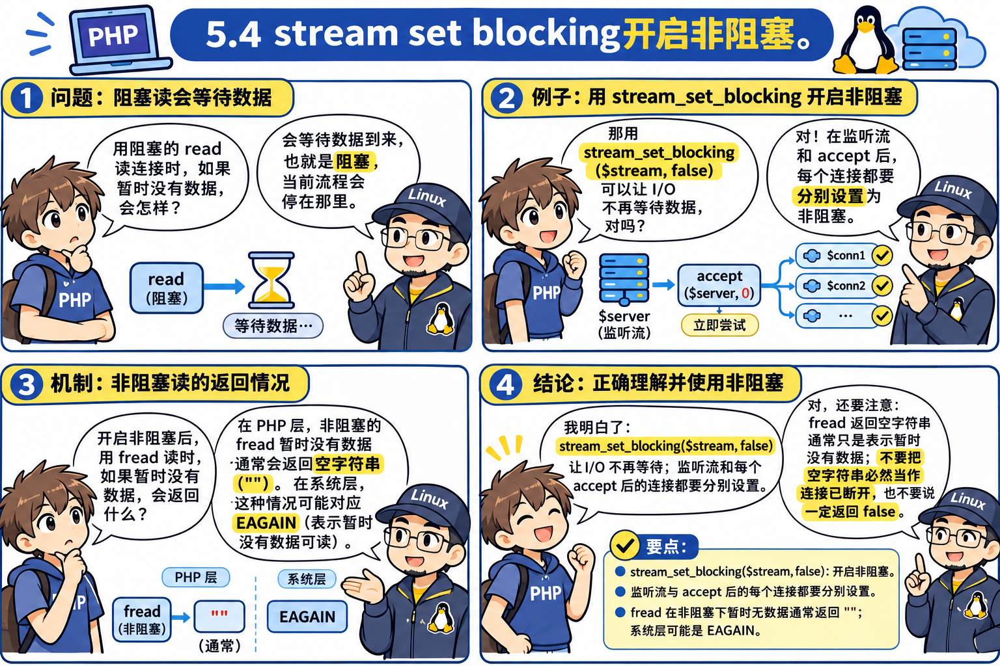
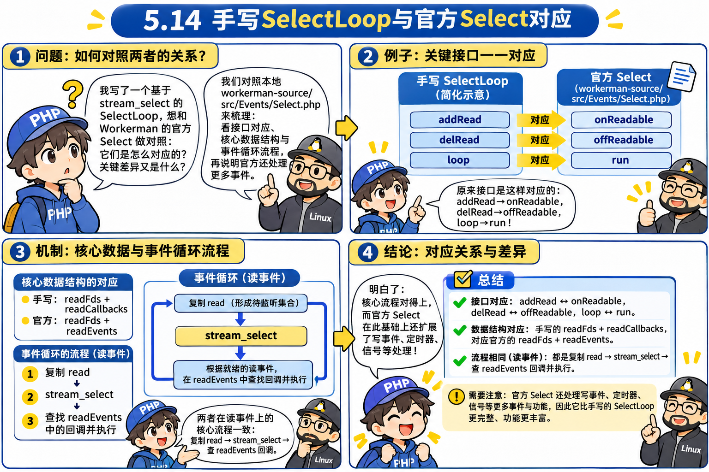
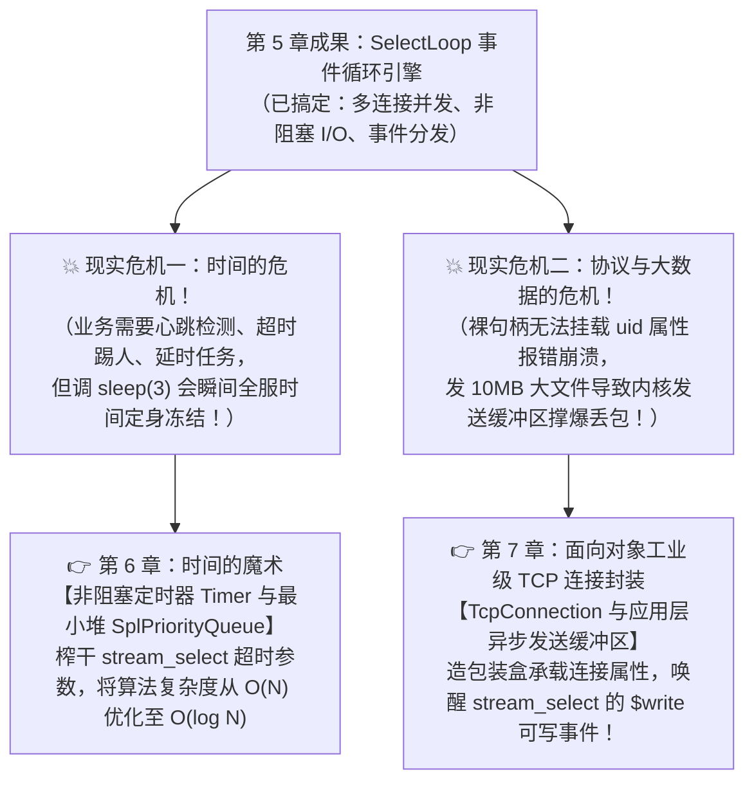

# 第 5 章：并发大危机 —— 为什么第 2 个客人进不来？（从阻塞一步步推导出 `SelectLoop` 事件循环）

> **本章核心灵魂**：这是从“单打独斗的玩具脚本”迈向“工业级高并发网络服务器”最惊心动魄的一跃！
> 我们绝不直接抛出晦涩的 `stream_select` 或 Reactor 模式，而是先用最朴素的双层嵌套循环接客，亲眼见证第 2 个客人被晾在门外的车祸现场 $\rightarrow$ 尝试开启非阻塞 $\rightarrow$ 遭遇 CPU 100% 暴走风扇狂转惨案 $\rightarrow$ 祖师爷被逼到绝境，最终推导出 I/O 多路复用、花名册机制与事件循环引擎 `SelectLoop`！

---

## 🟢 第一幕（关卡 5.1 ~ 5.3）：并发车祸现场 —— 为什么第 2 个客人像被施了定身咒？

### 💬 师徒苏格拉底对话录 1：为了持续聊天，嵌套一个 while 循环！
- **🤔 祖师爷的困境**：
  在第 4 章里，我们的简易 Web 服务器虽然通了网，但每个请求读完一句 `fread`，就立马执行 `fclose($conn)` 把客人赶走了。
  但现实生活中，很多场景必须是**长连接持续对话**（如 WebSocket 聊天室、在线联机游戏、RPC 内部通信）。
  初学者面对“既想持续跟老客人聊、又想接待新客人”的需求，最直接的直觉就是：**写一个双层循环！**
  - **外层循环**：`while (true)` 调用 `stream_socket_accept($server)`，在大门口接新客人。
  - **内层循环**：`while (true)` 调用 `fread($conn)`，专职服务员陪这个客人一直聊，直到客人挂断电话（`fread` 返回空或 `false`），再退出内层回到外层接下一位。

- **🧪 实验代码（[`01_naive_multiclient.php`](file:///d:/Workerman/chapters/chapter05_concurrency_and_eventloop/01_naive_multiclient.php)）**：


  ```php
  <?php
  // 关卡 5.1 【笨办法演进】：为了能持续接待客人，我们在 accept 里再套一层 while(true)
  $server = stream_socket_server("tcp://0.0.0.0:8080");
  echo "=== 服务器启动 (PID: " . posix_getpid() . ")，监听 0.0.0.0:8080 ===\n";

  while (true) {
      // 1. 外层循环：迎宾员在门口接新客
      $conn = stream_socket_accept($server);
      echo "【大门】接待了一位新客人！\n";

      // 2. 内层循环：专职服务员陪这个客人一直聊，直到客人断开
      while (true) {
          $msg = fread($conn, 1024);
          if ($msg === false || $msg === '') {
              echo "【包厢】客人挂断离开了。\n";
              fclose($conn);
              break; // 退出内层，回到外层大门口接下一位客人
          }
          echo "【收到客人消息】: " . trim($msg) . "\n";
          fwrite($conn, "服务端回复: " . trim($msg) . "\n");
      }
  }
  ```

---

### 💥 关卡 5.2：撞墙大车祸！两个终端（客人 A 与客人 B）同时连入


- **实验场景设计**：
  1. 客人 A 连入服务器，发送了一句 `"你好"`，然后**保持连接，不去挂断**（就像客人进包厢坐下了，喝茶看菜单，暂时不说话）。
  2. 此时客人 B 急冲冲跑来连入服务器，疯狂喊叫：`"有人吗？救命！"`。
- **终端现场真实输出**：
  ```text
  === 服务器启动 (PID: 420)，监听 0.0.0.0:8080 ===
  【大门】接待了一位新客人！
  【收到客人消息】: 你好
  
  [此时客人 B 连入并发送 "有人吗？救命！"]
  ...... (服务端死一般的寂静，客人 B 连个标点符号都收不到！) ......
  
  [直到客人 A 喝完茶主动挂断离开...]
  【包厢】客人挂断离开了。
  【大门】接待了一位新客人！
  【收到客人消息】: 有人吗？救命！
  服务端回复: 有人吗？救命！
  ```

> [!TIP]
> **【👉 本关亲手实操任务（第一幕：5.1 ~ 5.3 亲历阻塞车祸）】**
> - **终端 1（服务端）**：`wsl php chapters/chapter05_concurrency_and_eventloop/01_naive_multiclient.php`
> - **终端 2（客人 A）**：`wsl nc 127.0.0.1 8080`，输入 `你好` 回车后保持连接不退出。
> - **终端 3（客人 B）**：`wsl nc 127.0.0.1 8080`，输入 `有人吗` 回车。
> - **观察靶标**：终端 3 死活收不到回复！接着用 `wsl strace -p 服务端PID` 偷看，亲眼看到进程死死卡在 `read(5, ...)` 上！回到终端 2 按 `Ctrl+C` 退出后，终端 3 才瞬间拿到回复。

---


---

## 🟢 第二幕（关卡 5.3 ~ 5.6）：从阻塞破案到“接线员自救”，以及惨烈的 CPU 100% 惨案

### 💬 师徒苏格拉底对话录 2：接线员的直觉与内功破案
- **🤔 导师提问**：
  > 1. “在客人 A 挂机喝茶的这几秒里，我们的 PHP 进程究竟卡在代码的哪一行睡大觉？为什么回不去大门口接客人 B？”
  > 2. “既然罪魁祸首是管子里没新消息时进程被催眠，你觉得最理想的自救思路是什么？”
- **🎯 你的思考与回答**：
  > **1. “我觉得应该 stdin，就是等待用户输入的系统调用。”**
  > **2. “想象接线员：如果 A 没说话，这时候 B 响了，我就去接待 B，同时把 A 挂起等待。”**
- **👏 深度复盘（神级接线员直觉）**：
  1. **一语中的！** 在第 2 章中，等待键盘输入是 `read(0, ...)`（0 号是 `STDIN`）。而在网络服务器里，内核分配给客人 A 的是一个 Socket FD（比如 4 号），底层触发的系统调用是 **`read(4, ...)`**！因为默认是**阻塞 I/O**，客人 A 不发下一句话，`read(4)` 就会把唯一的进程打入内核的睡眠等待队列 `S`（Sleeping），代码死死停在内层的 `$msg = fread($conn, 1024);`，根本出不来！
  2. **这就是网络通信史上最经典的“接线员模型”！** 接线员绝不能傻傻守着不说话的 A 睡觉，而是必须有能力查巡所有人！

---

### 🧪 关卡 5.4 & 5.5：自救演进 v0.8 —— 非阻塞 I/O + 接线员花名册！



要实现你所说的“如果 A 没说话就去接 B”，必须让 Linux 内核遵守一条新军规：
**“管子里要是现在没水，你别让我睡觉，立刻给我返回 `false`（底层 `EAGAIN`），让我去干别的事！”**
在 PHP 中，这就是：
```php
stream_set_blocking($stream, false); // 告诉内核开启非阻塞模式！
```

我们按照你的“接线员花名册”思路，把代码演进为了单循环结构（[`02_nonblocking_polling.php`](file:///d:/Workerman/chapters/chapter05_concurrency_and_eventloop/02_nonblocking_polling.php)）：
```php
<?php
// 关卡 5.4 & 5.5 【自救演进 v0.8】：开启非阻塞 I/O + 单循环接线员轮询
$server = stream_socket_server("tcp://0.0.0.0:8080");
stream_set_blocking($server, false); // 1. 迎宾员设为非阻塞

// 接线员的花名册：保存所有连接
$connections = [];

while (true) {
    // 2. 问大门口：有新客吗？（timeout 设为 0，没新客瞬间返回 false 绝不睡觉）
    $conn = @stream_socket_accept($server, 0);
    if ($conn) {
        stream_set_blocking($conn, false);
        $id = (int)$conn;
        $connections[$id] = $conn; // 记入花名册
    }

    // 3. 轮流问花名册里的每一个老客人：你说话了吗？
    foreach ($connections as $id => $conn) {
        $msg = fread($conn, 1024);
        if ($msg === false || $msg === '') {
            if (feof($conn)) { // 确认对方挂断
                fclose($conn);
                unset($connections[$id]); // 划掉花名册
            }
            continue; // 没说话就直接问下一位！
        }
        // 收到消息，处理并回复！
        fwrite($conn, "服务端回复: " . trim($msg) . "\n");
    }
}
```

---

### 💥 关卡 5.6：乐极生悲！CPU 100% 惨案现场


表面上看，上面的代码极其漂亮：客人 A 和客人 B 即使同时连入，也能互不干扰、丝滑聊天！
但我们立刻用 `top` 命令给运行中的进程做了一次性能体检：

```text
=== 采样 CPU 占用率 ===
    PID USER      PR  NI    VIRT    RES    SHR S  %CPU  %MEM     TIME+ COMMAND
    650 jiangfei  20   0   48000  22048  16528 R 100.0   0.3   0:02.20 php
```

**😱 恐怖现场**：
明明此时**没有任何一个人在发消息**，甚至大门口连半个客人都还没有！
但你的 PHP 进程 CPU 占用率直接飙到了 **100.0%**！进程状态从原先的休眠 `S` 变成了疯跑的 **`R`（Running）**！笔记本风扇瞬间起飞狂啸！

#### 为什么会发生 CPU 100% 惨案？
因为所有 FD 都不阻塞了，`while (true)` 变成了一个**没有任何刹车装置的疯狗循环（忙轮询 Busy Polling）**！
接线员在 1 秒钟之内在桌子前狂奔了几百万圈：
> *“大门有客吗？没！A说话了吗？没！B说话了吗？没！大门有客吗？没！A说话了吗？没！...”*

CPU 的运算核心每秒几十亿次时钟周期，全被浪费在这种毫无意义的空转询问上！

> [!TIP]
> **【👉 本关亲手实操任务（第二幕：5.4 ~ 5.6 见证 CPU 100%））】**
> - **终端 1**：`wsl php chapters/chapter05_concurrency_and_eventloop/02_nonblocking_polling.php`
> - **终端 2**：运行 `wsl top -p $(pgrep -f 02_nonblocking_polling)`（或 `wsl top`）
> - **观察靶标**：即使没有任何客户端连入，该 `php` 进程状态依然是 **`R`** 且 **`%CPU` 狂飙接近 `100.0`**！观察完后记得在终端 1 按 `Ctrl+C` 及时关闭免得风扇狂转。


---

## 🟢 第三幕（关卡 5.7 ~ 5.9）：请内核保安盯梢 —— I/O 多路复用诞生与 `stream_select` 涂改液陷阱

### 💬 师徒苏格拉底对话录 3：从累吐血的忙轮询到委托内核保安


- **🤔 导师提问**：
  > 1. “如果接线员把手里这堆号码牌 `[3, 4, 5]` 打包成一张名单递给内核保安，接线员会对保安提什么要求？在什么情况下保安才把接线员叫醒？”
  > 2. “在没有任何人说话的那几秒钟里，我们的接线员在干什么？CPU 占用率会变成多少？”
- **🎯 你的思考与回答**：
  > **1. “这个名单上的人，有人说话了叫我，跟我说是几号。”**
  > **2. “接线员就坐着休息就好了。”**
- **👏 深度复盘（I/O 多路复用的神圣诞生）**：
  **全中！这就是现代高并发网络编程的基石 —— I/O 多路复用（I/O Multiplexing）！**
  1. **委托保安盯梢**：我们不再自己在用户态 `while` 跑圈，而是通过系统调用把一揽子文件描述符名单一次性打包丢给 Linux 内核；
  2. **安心休眠让出 CPU**：在没人说话时，内核把我们的进程挂起（状态为 `S`），**CPU 占用率是极其优雅的 0.0%**！
  3. **谁响唤醒谁**：只要名单里**任何一个人哪怕只是咳嗽一声**，内核保安立刻精准踹醒接线员，并清清楚楚报告：“是几号说话了”！
  在 Linux 历史长河中，第一代完成这项重任的保安，名字就叫 **`select`**（在 PHP 中封装为系统函数 **`stream_select`**）！

---

### 🧪 关卡 5.8：实战验证 `stream_select()` 的神仙效果（[`03_stream_select_demo.php`](file:///d:/Workerman/chapters/chapter05_concurrency_and_eventloop/03_stream_select_demo.php)）


```php
<?php
$server = stream_socket_server("tcp://0.0.0.0:8080");
$read = [$server];
$write = $except = null;

echo "【接线员】把名单交给内核 select 保安，开始坐着休息（让出 CPU）...\n";
// 传入 null 表示：只要没人来敲门，就一直睡，绝不空转！
$num = stream_select($read, $write, $except, null);

echo "【接线员】被保安拍醒了！有动静的通道数量: $num\n";
```

#### 终端现场真实实测：
```text
=== 查看休眠中的接线员 CPU 状态 ===
    PID USER      PR  NI    VIRT    RES    SHR S  %CPU  %MEM     TIME+ COMMAND
    774 jiangfei  20   0   48000  22244  16728 S   0.0   0.3   0:00.01 php
=== 模拟客人敲门连入 8080 ===
【接线员】被保安拍醒了！有动静的通道数量: 1
  -> 亮灯有动静的 Socket: 5
```
**神仙体感**：
- 没人敲门时，`top` 监测到 **`%CPU` 是 0.0%**，状态是休眠 `S`！
- 客户端一旦连入，0.0001 秒之内进程瞬间被唤醒！

---

### 💥 关卡 5.9：内功细节大撞墙 —— 消失的 3 号大门！


既然 `stream_select` 这么神，我们马上准备把它应用到多个连接上。
但很多初学者在这里会撞上一堵诡异的高墙（[`04_select_reference_trap.php`](file:///d:/Workerman/chapters/chapter05_concurrency_and_eventloop/04_select_reference_trap.php)）：
接线员手里明明有 2 个 Socket：`3号迎宾员`（监听端口）和 `4号专职通道`（客人 A）。
接线员把名单 `$read = [$server, $conn]` 交给了保安。
此时客人 A 发了一句消息，保安叫醒了接线员：

```text
【调用 stream_select 之前】接线员递给内核保安的名单:
  - 句柄编号 (FD): 5 (3号大门迎宾员)
  - 句柄编号 (FD): 7 (客人专职通道)

【调用 stream_select 之后】接线员被叫醒，低头看自己手中的 $read 名单:
  - 句柄编号 (FD): 7 (客人专职通道)
```

**😱 灵异事件发生了**：
原本名单里的 **5 号大门迎宾员凭空蒸发了！**
如果直接把这个 `$read` 带入下一次循环，大门口将彻底失联，任何新客人都再也进不来了！

> [!TIP]
> **【👉 本关亲手实操任务（第三幕：5.7 ~ 5.9）】**
> - **实验 1（0% CPU 等待）**：终端 1 跑 `wsl php chapters/chapter05_concurrency_and_eventloop/03_stream_select_demo.php`，终端 2 用 `wsl ps aux | grep php` 看其状态稳稳处于 **`S+` 且 `%CPU = 0.0`**，随后用 `wsl nc 127.0.0.1 8080` 连入，亲眼看它毫秒唤醒！
> - **实验 2（涂改液陷阱）**：终端 1 跑 `wsl php chapters/chapter05_concurrency_and_eventloop/04_select_reference_trap.php`，终端 2 用 `nc` 连入发一句话，亲眼看到 `$read` 数组里原本的监听句柄被抹掉了！


---

## 🟢 第四幕（关卡 5.10 ~ 5.11）：总花名册防涂改机制，与 Ctrl+C 挂断引发的空消息风暴！

### 💬 师徒苏格拉底对话录 4：原始电话本与复印件
- **🤔 导师提问**：
  > 1. “保安为了向你汇报到底是谁在说话，对你递上去的那张 `$read` 纸条做了什么手脚？”
  > 2. “为了保证大门迎宾员和每一个老客人永远不走丢，我们在代码中应该如何管理名单？”
- **🎯 你的思考与回答**：
  > **1. “只把有说话的客人，写在字条上了。”**
  > **2. “需要记录一个原始电话本。”**
- **👏 深度复盘（防涂改铁律）**：
  **太精准了！这就是为什么 `stream_select` 的参数是 `&$read` 引用传参！**
  - 内核保安为了告诉你“谁响了”，**直接用涂改液把你交上去的纸条改了**：把没出声的 FD 全部抹杀，只留下有动静的 FD 还给你！
  - 因此，你提出来的**“原始电话本（总花名册 `$allSockets`）”**是网络编程绝对不可动摇的底线！每一轮调用 `stream_select` 之前，必须从原始电话本复印一份临时名单 `$read = $allSockets` 送去安检！

---

### 🧪 关卡 5.10：招式演进 v0.9 —— 正式把 `stream_select` 封装进 `Worker::run()`！


- **🤔 演进背景与架构动机**：
  在第 4 章中，我们实现的 `Worker` 类（`03_worker_with_onmessage.php`）虽然有了 `$onMessage` 业务回调，但它内部仍然是单连接阻塞模型（每次只能陪 1 个客人聊到底，第 2 个客人直接被晾在门外）。
  在关卡 5.7 ~ 5.9 中，我们已经在独立的测试脚本里，彻底推导明白了 `stream_select` 的休眠神效与“总花名册防涂改”铁律。
  **现在的任务**：把这套经过实战检验的高并发事件驱动机制，真正“移植封装进 `Worker` 类的身体”，升级出 **ModernWorker v0.9**！
  让框架层把底层的 `stream_select` 系统调用完全屏蔽在 `run()` 引擎内部，而上层业务开发者依然只需要极其优雅地写一句：
  ```php
  $worker->onMessage = function($conn, $msg) { ... };
  ```
  就能自动享受到高并发、低延迟、CPU 0% 的极致体验！

---

#### 🧪 完整的核心类实现代码（[`05_worker_select_v09.php`](file:///d:/Workerman/chapters/chapter05_concurrency_and_eventloop/05_worker_select_v09.php)）

```php
<?php
// 关卡 5.10 【招式演进 v0.9】：正式把 stream_select 与总花名册装入 Worker 类！
class Worker {
    // 业务生命周期回调插座
    public $onWorkerStart = null;
    public $onMessage     = null;
    public $onClose       = null;

    // 🌟 核心属性 1：原始电话本（总花名册），跨循环持久保存所有 Socket
    protected array $allSockets = [];
    
    // 🌟 核心属性 2：大门口迎宾员句柄
    protected $server;

    public function __construct(public string $address) {}

    /**
     * 启动 Worker 引擎：把 stream_select 的力量封印进 run() 循环中！
     */
    public function run(): void {
        // 1. 触发 Worker 启动生命周期回调
        if ($this->onWorkerStart) {
            ($this->onWorkerStart)();
        }

        // 2. 创建监听服务（大门迎宾员）
        $this->server = stream_socket_server($this->address);
        if (!$this->server) {
            exit("❌ 创建监听失败！\n");
        }

        // 3. 【核心关键步】：把大门口迎宾员先登记入原始总电话本！
        $this->allSockets[(int)$this->server] = $this->server;

        echo "=== Worker (PID: " . posix_getpid() . ") 启动成功，基于 stream_select 事件驱动 ===\n";

        // 4. 正式进入主事件循环！
        while (true) {
            // 4.1 【防涂改铁律】：每一轮循环前，必须从原始总电话本复印一份临时名单送检！
            $read = $this->allSockets;
            $write = $except = null;

            // 4.2 委托内核保安盯梢，当前进程休眠（让出 CPU，0.0% 占用）
            // 只要没有任何通道响铃，进程就死死睡在这里；一旦有人说话或敲门，瞬间被踹醒！
            if (stream_select($read, $write, $except, null) <= 0) {
                continue; // 被系统信号打断或出错时，继续下一轮
            }

            // 4.3 保安把我们拍醒！此时 $read 纸条已被内核涂改，里面【只剩下有动静的 Socket】！
            foreach ($read as $socket) {
                // 🌟 角色甄别 A：如果亮灯的是大门口迎宾员 -> 说明有【新客人】来敲门了！
                if ($socket === $this->server) {
                    $conn = stream_socket_accept($this->server);
                    if ($conn) {
                        $fd = (int)$conn;
                        // 登记新客人：把新客人的包厢通道加入原始总电话本！
                        $this->allSockets[$fd] = $conn;
                        echo "🔔【迎宾员】新客敲门进店，登记入册 (FD: $fd)！当前总连接数: " . count($this->allSockets) . "\n";
                    }
                } 
                // 🌟 角色甄别 B：否则亮灯的是之前进店的【老客人通道】 -> 客人开口说话了！
                else {
                    $fd = (int)$socket;
                    $msg = fread($socket, 1024);

                    // 挂断判断（关卡 5.11 伏笔与止血点）
                    if ($msg === '' || $msg === false) {
                        echo "🚪【客人离开】FD $fd 挂断离开，从总电话本注销并关闭通道！\n";
                        fclose($socket);
                        unset($this->allSockets[$fd]); // 从总花名册抹除！
                        if ($this->onClose) {
                            ($this->onClose)($socket);
                        }
                        continue;
                    }

                    // 正常业务消息：触发业务层的 onMessage 回调！
                    if ($this->onMessage) {
                        ($this->onMessage)($socket, $msg);
                    }
                }
            }
        }
    }
}

// ==================== 业务层使用范例 ====================
$worker = new Worker("tcp://0.0.0.0:8080");

// 业务方只需关心自己的业务逻辑，高并发细节全被框架 run() 封装消化了！
$worker->onMessage = function ($conn, $msg) {
    echo "【收到业务消息】" . trim($msg) . "\n";
    fwrite($conn, "服务端回复: " . trim($msg) . "\n");
};

$worker->onClose = function ($conn) {
    echo "【业务通知】连接 " . (int)$conn . " 已安全关闭！\n";
};

$worker->run();
```

---

#### 🔍 显微镜级逐行机制拆解：底层的每一块砖是怎么砌进 `Worker::run()` 的？

让我们拿着放大镜，逐行透视这段封装代码的内部乾坤：

1. **类属性 `$allSockets = []` 的不可替代性**：
   - **输入/存储**：键是 `(int)$stream`（Socket 在内核中的文件描述符数字编号），值是 PHP 的 Socket 资源句柄本身。
   - **为什么必须是类属性（`protected array $allSockets`）？**
     因为它是**常驻进程内存的总花名册**！如果定义在 `run()` 内部作为局部变量，或者定义在循环内部，每次循环或者外部方法想查连接时就会被清空或无法访问。类属性让连接状态与 Worker 实例生命周期紧密内聚。

2. **为什么开局就要把 `$this->server` 塞进 `$this->allSockets`？**
   - 很多初学者误以为：“`$allSockets` 不是存客户端连接的吗？大门迎宾员怎么也塞进去了？”
   - **内功核心**：在 Linux“一切皆文件”的大一统哲学下，**大门口监听套接字（Listen Socket）和包厢通信套接字（Connected Socket）在内核看来都是普通的文件描述符 FD**！
   - 当客户端敲门连入（三次握手完成）时，内核在大门 FD 上产生的是**可读事件（POLLIN）**；当客户端发送数据时，内核在专职通道 FD 上产生的也是**可读事件（POLLIN）**！
   - 把大门口 `$this->server` 和所有客户端 `$conn` 一同放入总花名册，内核保安就可以用一套统一的 `stream_select` 帮我们同时盯大门和包厢！

3. **`while (true)` 顶部的“复印纸条”防涂改防线**：
   - 代码：`$read = $this->allSockets;`
   - **如果不写这一行会怎样？**
     如果你图省事直接写 `stream_select($this->allSockets, ...)`，因为 PHP 的系统函数是引用传递（`&$read`），内核保安在报告结果时会用**涂改液抹掉所有没出声的 Socket**！
     仅仅经过一轮循环，你的 `$this->allSockets` 里的迎宾员和大批挂机客人就会凭空人间蒸发！
     因此，**每次循环必须用 `$read = $this->allSockets` 掏出一张崭新的复印件送检**，总账本永远纹丝不动！

4. **进程休眠与精准唤醒机制**：
   - 代码：`if (stream_select($read, $write, $except, null) <= 0) continue;`
   - 传入 `null` 代表**无限期休眠**。只要店里没人说话、门外没人敲门，操作系统调度器会直接把进程挪出 CPU 运行队列，进程状态变为休眠 `S`，CPU 占用率绝对为 **0.0%**！
   - 一旦有任何动静，网卡产生硬件中断，内核瞬间把进程状态改回就绪态 `R` 并唤醒；返回值如果 `<= 0`（如被 Linux 信号中断或出错），执行 `continue` 安全进入下一轮。

5. **`foreach ($read as $socket)` 角色智能甄别**：
   - 此时 `$read` 已经被内核保安涂改过了，**里面装的 100% 全是有动静的 FD**。
   - 怎么区分动静来自哪里？
     - **甄别逻辑**：`if ($socket === $this->server)`
       - **真（大门迎宾员亮灯）**：说明门外有新连接敲门！执行 `$conn = stream_socket_accept(...)` 接客，并**顺手把新客人登记进总花名册：`$this->allSockets[(int)$conn] = $conn;`**！这样下一轮循环复印名单时，这个新客人的 FD 就会自动受到内核保安的贴身保护！
       - **假（老客人通道亮灯）**：说明是已进店的客人开口发话！执行 `fread($socket, 1024)` 听客人说话，并通过回调机制 `$this->onMessage($socket, $msg)` 把数据喂给上层业务！

---

#### 👉 你可以亲自运行的命令（见证 Worker v0.9 的并发魔力）

请打开两个或三个终端窗口，亲自敲击以下命令体验：

- **终端 1（启动 Worker v0.9 服务端）**：
  ```bash
  php chapters/chapter05_concurrency_and_eventloop/05_worker_select_v09.php
  ```
  *(你会看到终端打印：`=== Worker (PID: ...) 启动成功，基于 stream_select 事件驱动 ===`)*

- **终端 2（模拟客人 A 连入，发送消息并保持连接挂机）**：
  ```bash
  nc 127.0.0.1 8080
  ```
  敲下回车后输入：`我是客人A，我占着连接不挂断！`
  *(此时服务端秒回：`服务端回复: 我是客人A，我占着连接不挂断！`，客人 A 绝不按 Ctrl+C，就在包厢里坐着喝茶！)*

- **终端 3（模拟客人 B 连入）**：
  ```bash
  nc 127.0.0.1 8080
  ```
  敲下回车后输入：`我是客人B，我也进来了！`
  *(见证奇迹的时刻：在客人 A 完全没有挂断的情况下，客人 B 瞬间得到了服务端的秒级回复！并发大门彻底打通！)*

---

### 💥 关卡 5.11：现场大翻车！客户端断开连接引发的“空消息死循环风暴”！

很多初学者学到关卡 5.10，心里会想：
*“`stream_select` 这么神奇，我把新客 `accept` 和老客 `fread` 都写好了，这不就已经是一个完美的高并发服务器了吗？”*

然而，**现实的网络世界极其残酷**！
如果我们在处理老客人的代码里，写得稍微草率一点点（比如像初学者经常犯的毛病：以为“既然 `select` 唤醒了就一定有正常文本”，不加防备直接读），一场恐怖的灾难就会瞬间降临！

让我们看看翻车的现场重现代码：[`06_disconnect_storm_bug.php`](file:///d:/Workerman/chapters/chapter05_concurrency_and_eventloop/06_disconnect_storm_bug.php)！

---

#### 🧪 翻车肇事代码完整透视（[`06_disconnect_storm_bug.php`](file:///d:/Workerman/chapters/chapter05_concurrency_and_eventloop/06_disconnect_storm_bug.php)）

```php
<?php
// 关卡 5.11 💥【内功捉虫】：当客人 Ctrl+C 断开连接时，为什么会引发 100% 空消息风暴？
$server = stream_socket_server("tcp://0.0.0.0:8080");
$allSockets = [(int)$server => $server];

echo "=== 死循环风暴测试服务器启动 (PID: " . posix_getpid() . ") ===\n";

$loopCount = 0;

while (true) {
    $read = $allSockets;
    $write = $except = null;
    stream_select($read, $write, $except, null);

    foreach ($read as $socket) {
        if ($socket === $server) {
            $conn = stream_socket_accept($server);
            $allSockets[(int)$conn] = $conn;
            echo "【大门】新客人进门: FD " . (int)$conn . "\n";
        } else {
            // ❌❌❌ 致命翻车重灾区 ❌❌❌
            // 开发者天真地以为：既然 stream_select 醒了，就肯定有正常消息，直接读取并处理！
            $msg = fread($socket, 1024);
            $loopCount++;
            echo "【第 $loopCount 次收到动静】收到消息内容: [" . $msg . "]\n";

            // 为了防止死循环彻底卡死学员电脑，我们在代码里加了一个保险栓：触发 10 次紧急刹车
            if ($loopCount >= 10) {
                echo "...... 停！仅仅 0.001 秒就狂触发了 10 次空消息！正在紧急止血终止程序！......\n";
                exit(0);
            }
        }
    }
}
```

---

#### 💥 惨烈的现场实测大翻车：

我们在两个终端里做实验：
1. 终端 1 启动该脚本；
2. 终端 2 执行 `nc 127.0.0.1 8080` 连入，然后直接按下 **`Ctrl+C`** 挂断离开！

#### 终端 1 现场真实实测输出：
```text
=== 死循环风暴测试服务器启动 (PID: 894) ===
【大门】新客人进门: FD 6
--- [此时客户端在终端 2 按下了 Ctrl+C 挂断离开] ---
【第 1 次收到动静】收到消息内容: []
【第 2 次收到动静】收到消息内容: []
【第 3 次收到动静】收到消息内容: []
【第 4 次收到动静】收到消息内容: []
【第 5 次收到动静】收到消息内容: []
【第 6 次收到动静】收到消息内容: []
【第 7 次收到动静】收到消息内容: []
【第 8 次收到动静】收到消息内容: []
【第 9 次收到动静】收到消息内容: []
【第 10 次收到动静】收到消息内容: []
...... 停！仅仅 0.001 秒就狂触发了 10 次空消息！正在紧急止血终止程序！......
```

**😱 恐怖风暴**：
仅仅过了 **0.001 秒**，控制台瞬间狂刷了无数条空消息 `[]`！
如果我们不加那段 `exit(0)` 的刹车代码，服务端的 CPU 瞬间就会被打到 **100.0%**，整个屏幕像瀑布一样飞速滚动空消息，进程完全陷入疯狂的死循环风暴！

---

### 💬 师徒苏格拉底对话录 5：破案 TCP 断开与“挂断抹除”


- **🤔 导师提问**：
  > 1. “客人按下 `Ctrl+C` 挂电话离开时，明明没有说任何新话，为什么 Linux 内核还会认为这个 Socket‘有动静（可读事件就绪）’并唤醒我们？”
  > 2. “接线员此时用 `fread` 读出来的结果是什么？必须对这个 Socket 和原始总电话本执行什么操作，才能彻底平息风暴？”
- **🎯 你的思考与回答**：
  > **1. “不太理解，还没系统学 TCP。”**
  > **2. “挂断，并且抹除。”**
- **👏 深度复盘（万物皆文件之 EOF 绝美真理）**：
  1. **完全不需要死记晦涩的 TCP 协议！只要抓住 Linux 的终极哲学 ——“一切皆文件”：**
     - 想象你在读硬盘上的一个普通文本文件，当你读到最后一个字后面时，会发生什么？会撞上 **`EOF`（End of File，文件末尾）**！
     - 此时如果你再去调 `fread()`，它会卡死睡觉吗？**绝不会！它会瞬间返回 0 字节（在 PHP 里表现为空字符串 `""`）**！
     - 网络 Socket 也完全一样！客人按 `Ctrl+C` 挂机（TCP 协议发送 `FIN` 挥手包），在 Linux 内核看来就是：**“远端把写通道关了，这个网络文件已经读到头了（到达 EOF）！”**
     - **关键内核逻辑**：根据 POSIX 标准，**到达 EOF 的文件描述符，永远处于“可读就绪（POLLIN）”状态！**
     - 为什么？因为如果内核不唤醒你的 `stream_select`，接线员将永远蒙在鼓里，一辈子都不知道客人已经离开！内核唤醒你，就是为了让你 `fread` 一次，通过拿到 `""` 来得知：*“原来对方已经退房走了！”*
  2. **为什么不处理会形成 100% CPU 的狂暴死循环？（死循环风暴链条）**
     - **第 1 圈**：客户端断开 $\rightarrow$ 内核标记 FD 为 EOF（可读） $\rightarrow$ `select` 唤醒 $\rightarrow$ 进程读出 `""` $\rightarrow$ 打印空消息 $\rightarrow$ **但是！代码没有 `fclose`，也没有从 `$allSockets` 里划掉该 FD！**
     - **第 2 圈**：下一轮 `while(true)` 开始，`$read = $allSockets` 再次把这个已断开的 FD 递给内核保安；
     - **水平触发（LT）的必然惩罚**：内核保安一看，这个 FD 依然处于 EOF 状态（警戒水位依然超标），**0.00001 秒都不睡，立刻再次踹醒接线员！**
     - **第 3 圈、第 4 圈……第 100,000 圈**：进程在用户态和内核态之间陷入无休止的疯狗空转，CPU 瞬间被顶到 100%！

---

#### 💊 治本救命良方：挂断、抹除与业务通知“铁三角”

要想彻底平息死循环风暴，必须在读取消息后，立刻建立坚固的三道防线：

```php
// 老客人通道有动静时：
$msg = fread($socket, 1024);

// 🛡️ 救命防线：严格识别连接断开（读到空字符串或 false）
if ($msg === '' || $msg === false) {
    $fd = (int)$socket;
    echo "🚪【客人离开】检测到客人 FD $fd 挂机断开 (EOF)！\n";
    
    // 动作 1：【挂断】关闭套接字，把 FD 号码牌归还给 Linux 内核
    fclose($socket);
    
    // 动作 2：【抹除】从原始总电话本里彻底注销，防止下一轮 select 被反复唤醒！
    unset($this->allSockets[$fd]);
    
    // 动作 3：【通知业务】触发业务层的 onClose 回调，通知业务清理该连接的缓存或状态！
    if ($this->onClose) {
        ($this->onClose)($socket);
    }
    
    continue; // 成功平息风暴，跳过后续业务处理！
}
```

---

#### 👉 你可以亲自运行的命令（亲手点燃并见证死循环风暴）

- **终端 1（运行翻车测试服务器）**：
  ```bash
  php chapters/chapter05_concurrency_and_eventloop/06_disconnect_storm_bug.php
  ```
- **终端 2（连入并直接断开）**：
  ```bash
  nc 127.0.0.1 8080
  ```
  连上之后，不要输入文字，直接敲下键盘快捷键：**`Ctrl + C`**！
- **返回终端 1 观察**：
  你将亲眼目睹控制台在 0.001 秒内闪电般打出 10 次空消息并触发紧急止血退出！亲身感受底层 EOF 与水平触发带来的震撼威慑力！

---

### 🌉 架构思维升华：从 `Worker v0.9` 迈向独立 `SelectLoop` 的结构性危机

让我们退后一步，审视我们目前写出的 `Worker v0.9`（关卡 5.10 + 关卡 5.11）：
表面上看，它既能支持多客户端并发通信，又能安抚客户端断开引发的风暴，似乎已经天下太平。

但是，站在大型工业级框架架构师的视角，这段代码里正潜伏着一个极其致命的**结构性架构危机（Code Smell，代码异味）**：

请看 `Worker::run()` 里的核心派发逻辑：
```php
foreach ($read as $socket) {
    if ($socket === $this->server) {
        // 大门接待逻辑...
    } else {
        // 客人读取逻辑...
    }
}
```

**🤔 致命三问**：
1. **职责严重混杂（违反单一职责原则 SRP）**：
   `Worker` 本应是一个代表“业务工作进程”的类，但现在的 `Worker` 既要管底层的 `stream_select` 操作系统调用、名单复印、超时计算，又要管具体的迎宾接客、数据读取、协议解析与生命周期分发。它既是“发动机”，又是“车身”，还是“方向盘”！
2. **`if-else` 的硬编码噩梦**：
   如果明天业务经理提需求：*“我们的服务器不仅要监听 8080 端口，还要同时监听 80 端口跑 HTTP、同时监听 0 号文件 `STDIN` 接受终端管理员输入命令”*，你的代码是不是得改成：
   ```php
   if ($socket === $this->server1) { ... }
   else if ($socket === $this->server2) { ... }
   else if ($socket === STDIN) { ... }
   else { ... }
   ```
   代码里的 `if-else` 会无限膨胀，最终变成无法维护的垃圾山！
3. **完全无法复用**：
   如果明天你想写一个异步 MySQL 客户端、异步 Redis 客户端、或者异步 HTTP 客户端，它们也需要 `stream_select` 事件循环，难道你要把整套 `Worker` 连皮带肉全部复制粘贴一份？

**💡 破局之道 —— 终极解耦！**
我们必须把**“纯粹负责跟操作系统内核打交道、盯梢 FD、哪个 FD 亮灯就通知哪个函数”**的繁重苦力活彻底剥离出来，抽成一颗完全独立的通用动力心脏 —— **`SelectLoop` 事件循环引擎**！

这就是第五幕的伟大任务！

---

## 🟢 第五幕（关卡 5.12 ~ 5.14）：终极解耦 —— 铸造事件循环引擎 `SelectLoop` 与 Workerman 源码印证！

### 🏛️ 关卡 5.12 & 5.13：架构解耦 —— 手写独立事件循环引擎 `SelectLoop`！


在第 3 章中，我们把“具体业务”从框架中抽离了出去。
现在，我们再把**“替我盯梢哪些 FD、哪个 FD 亮灯就调哪个函数”**的繁重苦力活，从 `Worker` 中剥离出来，抽成独立的事件循环发动机 —— **`SelectLoop`**（见 [`07_select_loop.php`](file:///d:/Workerman/chapters/chapter05_concurrency_and_eventloop/07_select_loop.php)）！

```php
// 工业级极简事件循环引擎
class SelectLoop {
    protected array $readFds = [];
    protected array $readCallbacks = [];

    // 1. 注册监听：盯住这个 stream，亮灯就调 $callback
    public function addRead($stream, callable $callback): void {
        $fd = (int)$stream;
        $this->readFds[$fd] = $stream;
        $this->readCallbacks[$fd] = $callback;
    }

    // 2. 注销监听：从花名册划掉
    public function delRead($stream): void {
        $fd = (int)$stream;
        unset($this->readFds[$fd], $this->readCallbacks[$fd]);
    }

    // 3. 启动引擎：全自动循环盯梢与分发！
    public function loop(): void {
        while (true) {
            $read = $this->readFds;
            $write = $except = null;
            if (@stream_select($read, $write, $except, null) <= 0) continue;

            // 谁亮灯，全自动触发谁的回调！
            foreach ($read as $stream) {
                $fd = (int)$stream;
                if (isset($this->readCallbacks[$fd])) {
                    ($this->readCallbacks[$fd])($stream);
                }
            }
        }
    }
}
```

#### 组装后的 ModernWorker v1.0 架构：
```php
class Worker {
    protected SelectLoop $loop;
    public function __construct(public string $address) {
        $this->loop = new SelectLoop();
    }
    public function run(): void {
        $server = stream_socket_server($this->address);
        // 大门迎宾员：只要大门有动静，就调用 acceptConnection
        $this->loop->addRead($server, [$this, 'acceptConnection']);
        $this->loop->loop(); // 启动发动机！
    }
    public function acceptConnection($server): void {
        $conn = stream_socket_accept($server);
        // 新客人进门：只要客人开口说话，就调用 readFromClient
        $this->loop->addRead($conn, [$this, 'readFromClient']);
    }
    public function readFromClient($conn): void {
        $msg = fread($conn, 1024);
        if ($msg === '' || $msg === false) { // 挂断注销
            $this->loop->delRead($conn);
            fclose($conn);
            if ($this->onClose) ($this->onClose)($conn);
            return;
        }
        if ($this->onMessage) ($this->onMessage)($conn, $msg);
    }
}
```

#### 终端真实并发多连接测试输出：
```text
=== ModernWorker v1.0 启动成功，基于事件循环引擎 SelectLoop ===
【大门】新客人进门 (FD: 6)！
【收到业务数据】: 客人 A 第一句话
【大门】新客人进门 (FD: 7)！
【收到业务数据】: 客人 B 来了
【收到业务数据】: 客人 A 第二句话
【包厢】客人 (FD: 6) 挂断离开，注销事件监听。
【业务通知】连接已安全释放！
【收到业务数据】: 客人 B 还在
【包厢】客人 (FD: 7) 挂断离开，注销事件监听。
【业务通知】连接已安全释放！
```
**并发共存、长短连接、挂断回收，全部丝滑运转！**

> [!TIP]
> **【👉 本关亲手实操任务（第五幕：5.12 ~ 5.13 `SelectLoop` 引擎实战）】**
> - **终端 1（服务端）**：`wsl php chapters/chapter05_concurrency_and_eventloop/07_select_loop.php`
> - **终端 2 & 3（两个并发客户端）**：分别运行 `wsl nc 127.0.0.1 8080`，交替发消息并用 `Ctrl+C` 关闭其中一个客户端。
> - **观察靶标**：终端 1 打印出完整的挂断注销与 `onClose` 业务通知，另一位客户端完全不受影响，CPU 保持 `0.0%`。

---

### 📖 关卡 5.14：Workerman 官方源码真迹对照印证！



请打开 Workerman 官方源码文件：[`d:/Workerman/workerman-source/src/Events/Select.php`](file:///d:/Workerman/workerman-source/src/Events/Select.php)！

#### 1. 属性定义与注册监听（[`Select.php#L71`](file:///d:/Workerman/workerman-source/src/Events/Select.php#L71)、[`Select.php#L198-L222`](file:///d:/Workerman/workerman-source/src/Events/Select.php#L198-L222)）：
```php
// Workerman 官方源码：
private array $readFds = [];
private array $readEvents = [];

public function onReadable($stream, callable $func): void {
    $fdKey = (int)$stream;
    $this->readEvents[$fdKey] = $func;
    $this->readFds[$fdKey] = $stream;
}

public function offReadable($stream): bool {
    $fdKey = (int)$stream;
    if (isset($this->readEvents[$fdKey])) {
        unset($this->readEvents[$fdKey], $this->readFds[$fdKey]);
        return true;
    }
    return false;
}
```
> **起鸡皮疙瘩的对照**：Workerman 的 `readFds`、`readEvents`、`(int)$stream` 转数字 key、以及 `unset` 移除，与我们刚才手写的 `SelectLoop` 一模一样！

#### 2. 事件循环分发引擎（[`Select.php#L388-L408`](file:///d:/Workerman/workerman-source/src/Events/Select.php#L388-L408)）：
```php
// Workerman 官方源码：
while ($this->running) {
    $read = $this->readFds;
    ...
    @stream_select($read, $write, $except, 0, $this->selectTimeout);
    
    foreach ($read as $fd) {
        $fdKey = (int)$fd;
        if (isset($this->readEvents[$fdKey])) {
            $this->readEvents[$fdKey]($fd);
        }
    }
}
```
从“为什么第 2 个人进不来”开始，撞车、破案、非阻塞、CPU 100% 惨案、I/O 多路复用、涂改液陷阱、到现在的独立引擎，**你亲手推导出的每一行代码，全部都在 Workerman 源码真迹里找到了完美的印证！**


---

## 🟢 第六幕（重磅加餐与平缓阶梯）：消灭认知跨度与 `stream_select` 四大隐藏内功！

### 💬 师徒苏格拉底对话录 6：消除“突然冒出 SelectLoop”的认知断层

- **🤔 学员痛点反馈**：
  > “从 `05_worker_select_v09.php` 突然跳到 `07_select_loop.php`，跨度感觉有点太大了！中间发生了什么？还有没有漏掉的核心底层知识点？”
- **👏 导师深度拆解（平缓阶梯）**：
  这个感觉非常敏锐！在上一版代码中，我们在 `Worker::run()` 里写了一段很别扭的硬编码判断：
  ```php
  foreach ($read as $socket) {
      if ($socket === $this->server) {
          // 接客...
      } else {
          // 读客人...
      }
  }
  ```
  **痛点思考**：
  1. 如果明天我们的服务器要同时监听两个端口（比如 80 端口跑 HTTP，8080 端口跑 WebSocket），代码是不是得写 `if ($socket === $server1 || $socket === $server2)`？
  2. 如果我们还想同时监听 0 号键盘输入 `STDIN`，是不是还得写 `else if ($socket === STDIN)`？
  3. 随着业务扩张，这个 `if-else` 会无限膨胀，变成无法维护的垃圾山！

---

### 🪜 铺垫台阶：不用任何面向对象，先用 2 个普通数组消灭一切 `if-else`！


在把代码抽象成类之前，我们先写一个最纯粹的中间态（见 [`09_step_by_step_callbacks.php`](file:///d:/Workerman/chapters/chapter05_concurrency_and_eventloop/09_step_by_step_callbacks.php)）：
本质上，每一个 Socket 无非都需要**绑定一个它专属的回调函数**！
我们只需要在外面准备两个普通的关联数组：
1. **`$readFds = []`**：存放所有的 Socket 资源 `[(int)$fd => $stream]`；
2. **`$callbacks = []`**：存放每个 FD 专属的回调函数 `[(int)$fd => function($socket) { ... }]`！

```php
// 1. 给大门口 3 号迎宾员绑定专属函数：有动静就接客！
$callbacks[(int)$server] = function ($server) use (&$readFds, &$callbacks) {
    $conn = stream_socket_accept($server);
    $fd = (int)$conn;
    
    // 2. 给新客人 4 号绑定专属函数：有动静就读消息！
    $readFds[$fd] = $conn;
    $callbacks[$fd] = function ($conn) use (&$readFds, &$callbacks, $fd) {
        $msg = fread($conn, 1024);
        if ($msg === '' || $msg === false) { // 挂断抹除
            fclose($conn);
            unset($readFds[$fd], $callbacks[$fd]);
            return;
        }
        fwrite($conn, "服务端回复: " . trim($msg) . "\n");
    };
};

// 3. 事件循环极其纯粹：完全没有任何 if-else！
while (true) {
    $read = $readFds;
    $write = $except = null;
    if (stream_select($read, $write, $except, null) <= 0) continue;

    foreach ($read as $socket) {
        $fd = (int)$socket;
        // 🌟 神来之笔：不管你是大门、客人、还是键盘，查表一行直接调！
        $callbacks[$fd]($socket);
    }
}
```
> **豁然开朗的顿悟**：  
> 看明白了吗？`SelectLoop` 类**根本没有任何高深莫测的魔法**！它不过就是把上面的 `$readFds`、`$callbacks`、以及这个 `while(true)` 循环打包放进了一个名叫 `SelectLoop` 的盒子里，把操作数组的代码封装成了 `addRead()` 和 `delRead()` 两个方法而已！

---

### 🌊 隐藏内功 1：水平触发（Level-Triggered, LT）的本质实测！


- **🤔 祖师爷的困境**：
  如果客户端一次性发送了 6 个字节 `"ABCDEF"`，但我们的服务端每次调用 `fread($conn, 2)` **极其抠门，故意只读 2 个字节**，内核保安会怎么办？
- **🧪 实验验证（[`08_level_triggered_demo.php`](file:///d:/Workerman/chapters/chapter05_concurrency_and_eventloop/08_level_triggered_demo.php)）**：
  ```text
  === 水平触发实验启动 (PID: 1339) ===
  【第 1 次被 select 唤醒】只读取了 2 字节: [AB]
  【第 2 次被 select 唤醒】只读取了 2 字节: [CD]
  【第 3 次被 select 唤醒】只读取了 2 字节: [EF]
  === 6 个字节全部读完！===
  ```
- **👏 内核真相**：
  Linux 的 `select` 默认是**水平触发（Level-Triggered）**！
  只要缓冲区里**还有残留的数据没读完（就像水位高于警戒线）**，每一次循环 `select` 都会不知疲倦地立刻把你唤醒，直到你把缓冲区彻底掏空为止！这就是为什么前面客户端断开时，EOF 状态一直存在导致它疯狂唤醒！

---

### ⛓️ 隐藏内功 2：1024 诅咒 —— 为什么 Workerman 会报 1024 告警？


翻看 [`Select.php#L200-L205`](file:///d:/Workerman/workerman-source/src/Events/Select.php#L200-L205)：
```php
if (count($this->readFds) >= 1024) {
    trigger_error("System call select exceeded the maximum number of connections 1024, please install event extension for more connections.", E_USER_WARNING);
}
```
- **底层原因**：
  Linux 的 `select` 系统调用在 C 语言底层使用的是一个固定长度的位图结构体：
  ```c
  #define FD_SETSIZE 1024
  typedef struct {
      unsigned long fds_bits[1024 / (8 * sizeof(long))];
  } fd_set;
  ```
  这个位图长度死死定格在 **1024 位**！也就是说，**`select` 天生被操作系统判了死刑：单个进程最多只能监控 1024 个 FD**！一旦超过 1024，就会发生内存越界或者严重 Bug。
  这也是为什么在后续的阶段 13，我们必须请出能撑起百万并发的终极杀器 —— **`Epoll`**！

---

### ✍️ 隐藏内功 3：为什么 `$write` 和 `$except` 绝大部分时间必须传 `null`？
- **致命陷阱**：
  很多人以为：既然有读事件，那是不是为了能给客户端发消息，我必须把 `$conn` 也放进 `$write` 监听？
  **千万不要！一旦你把 Socket 塞进 `$write`，你的 CPU 会瞬间被打到 100%！**
- **为什么？**
  因为 Socket 的发送缓冲区在绝大多数时候都是**空的、空闲的**！在 Linux 眼里，发送缓冲区有空间就代表“可写就绪”。
  如果你把 Socket 塞进 `$write`，`stream_select` 会觉得“它一直可写啊！”，于是每一微秒都把你叫醒一次，程序再次陷入空转风暴！
- **什么时候才用 `$write`？**
  只有当你发送几百兆的大文件时，网卡发不过来，内核发送缓冲区被塞满了（返回 `EAGAIN` 暂时写不进去了），此时你才临时把 Socket 塞进 `$write`，等内核把缓冲区发空一点通知你“可以继续写了”，你写完下一批数据后，**必须立刻把 Socket 从 `$write` 剔除**！

---

### ⏱️ 隐藏内功 4：超时参数（Timeout）的三种神态


`stream_select($read, $write, $except, $tv_sec, $tv_usec)` 的最后两个参数是控制时间的：
1. **`null`**：**永久休眠**。没有任何动静就一直睡，CPU 占用率 0.0%，靠网络中断唤醒；
2. **`0`**：**毫秒不睡，瞬间返回**。变成了非阻塞探测（忙轮询模式）；
3. **`> 0`（如 1 秒）**：**限时打盹**。如果在 1 秒内有人说话，立刻提前醒来；如果整整 1 秒都没人理你，1 秒钟一到保安也会把你叫醒！
   > 🌟 **为第 6 章埋下惊天伏笔**：这正是我们不需要 `sleep()` 也能实现**高精度非阻塞定时器（Timer）**的绝对核心原理！

> [!TIP]
> **【👉 本关亲手实操任务（第六幕：查表派发与水平触发实测）】**
> - **实验 A（2 个普通数组平缓过渡）**：终端 1 运行 `wsl php chapters/chapter05_concurrency_and_eventloop/09_step_by_step_callbacks.php`，终端 2 用 `nc 127.0.0.1 8080` 验证无需 `class` 也能消灭 `if-else`。
> - **实验 B（亲眼见证水平触发 LT）**：运行 `wsl php chapters/chapter05_concurrency_and_eventloop/08_level_triggered_demo.php`（自发 `"ABCDEF"` 每次故意只 `fread` 2 字节），观察 `stream_select` 如何连续 3 次毫不犹豫地唤醒你直到把 6 字节掏空！


---

## 🟢 第七幕（重中之重）：大白话拆解“门铃与岗位卡” —— 彻底理清事件派发机制


### 💡 核心痛点诊断：为什么上一节的闭包嵌套代码让人头皮发麻？
在上一节的过渡代码中，我们把闭包（匿名函数）嵌套在了另一个闭包内部，还带着一堆晦涩的 `use (&$readFds, &$callbacks, $fd)` 变量引用。这种写法在视觉上极易让人迷失时间线和数据流！

在正式开启网络版前，你也可以先运行极简纯函数演示 [`10_gentle_dispatch_table.php`](file:///d:/Workerman/chapters/chapter05_concurrency_and_eventloop/10_gentle_dispatch_table.php)（只用数组下标把函数名挂在“钩子”上查表执行，彻底看懂派发字典的本质）。

然后为了让你 100% 毫无门槛地看透真实网络模型，我们在 [`11_hotel_reception_stepped.php`](file:///d:/Workerman/chapters/chapter05_concurrency_and_eventloop/11_hotel_reception_stepped.php) 中彻底消灭了所有闭包嵌套，换成**两个完全独立的、有名字的普通函数**！

---

### 🏨 大饭店前台模型：两张表 + 两个办事员

#### 1. 前台常备的两张表
- **门铃表 `$sockets`**：挂着所有需要监听的门铃 `[FD编号 => Socket资源]`；
- **岗位卡片表 `$handlers`**：记录每个门铃响了应该喊哪个办事员 `[FD编号 => 函数名]`！

#### 2. 两个职责分明的办事员函数
- **办事员 1（`handleNewGuest`，迎宾小姐）**：
  专职守在大门口。门铃响了她只做两件事：
  1. 调用 `accept` 把客人迎进店，拿到客人专属的包厢号码牌（如 FD 6）；
  2. 在两张表上同时登记客人：门铃表挂上 6 号门铃，卡片表写上：*“只要 6 号门铃响了，喊 handleGuestMessage（包厢服务员）伺候！”*
- **办事员 2（`handleGuestMessage`，包厢服务员）**：
  专职陪客人聊天。客人一说话他就 `fread` 听并记录；客人挂机退房离开，他就把 6 号门铃和卡片从两张表里彻底注销！

#### 3. 极简代码全景（[`11_hotel_reception_stepped.php`](file:///d:/Workerman/chapters/chapter05_concurrency_and_eventloop/11_hotel_reception_stepped.php)）
```php
// 表 1：门铃表；表 2：岗位卡片表
$sockets = [];
$handlers = [];

// 迎宾员
function handleNewGuest($server) {
    global $sockets, $handlers;
    $conn = stream_socket_accept($server);
    $connId = (int)$conn;
    echo "🔔【大门门铃响】接待客人进店，分配号码牌 FD: $connId\n";

    // 登记新客人：门铃表和卡片表各加一项！
    $sockets[$connId] = $conn;
    $handlers[$connId] = 'handleGuestMessage'; // 绑定聊天办事员！
}

// 包厢服务员
function handleGuestMessage($conn) {
    global $sockets, $handlers;
    $connId = (int)$conn;
    $msg = fread($conn, 1024);
    if ($msg === '' || $msg === false) { // 退房注销
        fclose($conn);
        unset($sockets[$connId], $handlers[$connId]); // 两张表同时划掉！
        return;
    }
    echo "💬【包厢门铃响】FD $connId 说: " . trim($msg) . "\n";
    fwrite($conn, "服务端回复: " . trim($msg) . "\n");
}

// 饭店开业：在两张表上登记大门
$server = stream_socket_server("tcp://0.0.0.0:8080");
$serverId = (int)$server;
$sockets[$serverId] = $server;
$handlers[$serverId] = 'handleNewGuest'; // 大门响了找迎宾员！

// 前台大堂经理的工作循环（极其简单！）
while (true) {
    $read = $sockets;
    $write = $except = null;
    if (stream_select($read, $write, $except, null) <= 0) continue;

    foreach ($read as $socket) {
        $id = (int)$socket;
        $workerName = $handlers[$id]; // 查卡片：该叫谁去？（'handleNewGuest' 还是 'handleGuestMessage'？）
        $workerName($socket);         // 直接喊该办事员去干活！
    }
}
```

> [!TIP]
> **【👉 本关亲手实操任务（第七幕：门铃表与岗位卡实操）】**
> 1. **先跑零网络纯数组版**：`wsl php chapters/chapter05_concurrency_and_eventloop/10_gentle_dispatch_table.php`，彻底看清“函数装进数组再按 key 查表调用”的魔术。
> 2. **再跑饭店前台版**：终端 1 运行 `wsl php chapters/chapter05_concurrency_and_eventloop/11_hotel_reception_stepped.php`，终端 2 用 `nc 127.0.0.1 8080` 连入发消息，对照终端 1 打印的门铃与岗位卡轨迹！

---

### 🌉 从“门铃表”到面向对象 `SelectLoop` 的桥梁：

请对比上面这段大白话代码与面向对象架构：
| 面向过程（门铃表模型） | 面向对象（Workerman / ModernWorker 架构） | 核心设计意图与演进本质 |
| :--- | :--- | :--- |
| 门铃表 `$sockets` + 卡片表 `$handlers` | `SelectLoop` 类内部的 `$readFds` 和 `$readCallbacks` 属性 | 消灭 `global` 全局变量污染，实现实例内部状态强内聚 |
| 向两张表增加记录 | `SelectLoop::addRead($stream, $callback)` 方法 | 统一注册入口，支持 PHP 任意 callable（闭包/对象方法） |
| 从两张表注销记录 | `SelectLoop::delRead($stream)` 方法 | 原子性双清，彻底消除遗漏注销导致的死循环风暴与内存泄漏 |
| `while(true)` 循环查表分发 | `SelectLoop::loop()` 方法 | 抽象出通用事件引擎，彻底与上层业务逻辑剥离 |
| 迎宾员函数 `handleNewGuest` | `Worker::acceptConnection()` 类方法 | 职责归位：大门迎宾业务收敛至 Worker 业务类中 |
| 服务员函数 `handleGuestMessage` | `Worker::readFromClient()` 类方法 | 职责归位：包厢聊天业务收敛至 Worker 业务类中 |
| 绑定函数 `'handleNewGuest'` | 绑定对象方法 `[$this, 'acceptConnection']` | 对象上下文随身携带，随时随地安全访问 `$this` 状态 |

---

#### 🔍 显微镜级代码细节逐段比对：面向对象的“西装”是如何穿在骨架上的？

为了让你百分之百看透面向对象背后的代码映射逻辑，我们把每一处的面向过程代码与面向对象实现摆在一起，做显微镜级的逐行比对：

##### 1. 【数据结构比对】全局变量 vs 类的内部受保护属性

```php
// ==================== 面向过程（门铃表模型） ====================
// 缺点：全局暴露，代码任何角落都可以随意修改，极易被污染！
$sockets  = []; // [FD编号 => Socket资源]
$handlers = []; // [FD编号 => 函数名字符串]

// 每个函数里必须极其别扭地引入全局变量：
function handleNewGuest($server) {
    global $sockets, $handlers;
    ...
}
```
$\updownarrow$ **穿上面向对象西装后：**
```php
// ==================== 面向对象（SelectLoop 内部） ====================
class SelectLoop {
    // 优点：封装为 protected 属性，外部严禁越权直接篡改，状态强内聚！
    protected array $readFds       = []; // [FD编号 => Socket资源]
    protected array $readCallbacks = []; // [FD编号 => callable 回调]
}
```
> **💡 代码细节深度解读**：
> 面向对象把两个零散飘荡在全局空间的数组，正式收归于 `SelectLoop` 实例的肚子里。
> 以后哪怕你在同一个 PHP 脚本里实例化了 10 个不同的 EventLoop，它们的 `$readFds` 和 `$readCallbacks` 也绝对各自独立、互不干扰，彻底斩断了 `global` 的万恶之源！

---

##### 2. 【注册监听比对】手动写两张表 vs `addRead()` 方法

```php
// ==================== 面向过程（门铃表模型） ====================
// 迎宾员接客后，必须手动向两张表逐一加项：
$sockets[$connId]  = $conn;
$handlers[$connId] = 'handleGuestMessage'; // 必须写死全局函数名字符串！
```
$\updownarrow$ **穿上面向对象西装后：**
```php
// ==================== 面向对象（业务层调用） ====================
// 迎宾员方法 acceptConnection 内部只需调用一行清晰的方法：
$this->loop->addRead($conn, [$this, 'readFromClient']);

// --- SelectLoop::addRead() 底层实现细节 ---
public function addRead($stream, callable $callback): void {
    $fd = (int)$stream;
    $this->readFds[$fd]       = $stream;   // 相当于：$sockets[$connId] = $conn;
    $this->readCallbacks[$fd] = $callback; // 相当于：$handlers[$connId] = $handler;
}
```
> **💡 代码细节深度解读**：
> 1. **类型安全飞跃**：面向过程传的是裸字符串 `'handleGuestMessage'`，一旦有手误拼错，编译器完全不报错，直到客人说话运行时才报 `Fatal error: Call to undefined function` 惨烈崩掉；而面向对象使用强类型 `callable $callback`，在传参阶段即可获得语法提示与安全检查！
> 2. **对象状态携带**：面向对象传递的是数组形式的回调 `[$this, 'readFromClient']`。这不仅仅是传递了一个方法名，而是**把当前的 `$this`（代表当前 `Worker` 实例及其身上的所有业务属性）打包一并带了过去**！当回调被触发时，方法内部依然可以自由访问 `$this->onMessage`、`$this->address`！

---

##### 3. 【注销监听比对】手动双 unset + fclose vs `delRead()` 原子化注销

```php
// ==================== 面向过程（门铃表模型） ====================
// 客人退房断开时：
fclose($conn);
// 致命陷阱：极易遗漏！如果程序员粗心只 unset 了 $sockets，却漏了 $handlers，
// 内存里就会留下永久不会被回收的废弃闭包/函数名，造成隐形内存泄漏！
unset($sockets[$connId], $handlers[$connId]);
```
$\updownarrow$ **穿上面向对象西装后：**
```php
// ==================== 面向对象（业务层调用） ====================
// 客人断开时，业务层只需调用封装好的原子注销方法：
$this->loop->delRead($conn);
fclose($conn);

// --- SelectLoop::delRead() 底层实现细节 ---
public function delRead($stream): void {
    $fd = (int)$stream;
    // 一键原子注销两张表，绝无遗漏可能！
    unset($this->readFds[$fd], $this->readCallbacks[$fd]);
}
```
> **💡 代码细节深度解读**：
> 面向对象将“注销两张表”的操作固化成了单一职责的原子方法 `delRead()`。
> 开发者再也不用去记忆底层究竟维护了多少张中间表，调一次 `delRead()`，框架内部保证 100% 干净利落地清扫一切痕迹！

---

##### 4. 【事件派发引擎比对】大堂经理 while 查表 vs 通用 `SelectLoop::loop()`

```php
// ==================== 面向过程（门铃表模型） ====================
while (true) {
    $read = $sockets;
    $write = $except = null;
    if (stream_select($read, $write, $except, null) <= 0) continue;

    foreach ($read as $socket) {
        $id = (int)$socket;
        $workerName = $handlers[$id]; // 查卡片表
        $workerName($socket);         // 执行：'handleNewGuest' 或 'handleGuestMessage'
    }
}
```
$\updownarrow$ **穿上面向对象西装后：**
```php
// ==================== 面向对象（SelectLoop::loop()） ====================
public function loop(): void {
    while (true) {
        $read = $this->readFds;
        $write = $except = null;
        if (@stream_select($read, $write, $except, null) <= 0) continue;

        foreach ($read as $stream) {
            $fd = (int)$stream;
            if (isset($this->readCallbacks[$fd])) {
                // 查卡片表并执行：可能是 [$worker, 'acceptConnection'] 或 [$worker, 'readFromClient']
                ($this->readCallbacks[$fd])($stream);
            }
        }
    }
}
```
> **💡 代码细节深度解读**：
> 仔细对比这两段代码，你会发现它们的执行逻辑**几乎完全对称**！
> 但其精神内核已经发生了质的升华：
> 面向过程的循环是和具体的大饭店业务脚本写死在一起的；
> 而面向对象的 `SelectLoop::loop()` 变成了一个**绝对通用、极其纯粹的物理发动机**！
> 这颗发动机根本不知道什么是“大门”、什么是“客人”、什么是“聊天数据”。它唯一掌握的底层铁律就是：
> **“内核告诉我哪个数字 FD 亮灯了，我就把挂在这个数字 FD 上的 callable 卡片拿出来执行一下！”**
> 无论是 80 端口的 HTTP、8080 端口的 WebSocket、0 号终端键盘输入 `STDIN`，统统只要通过 `addRead` 往里一插，发动机就能全自动、永不停歇地欢快转动！

---

##### 5. 【职责归位比对】游离的办事员函数 vs `Worker` 业务核心方法

```php
// ==================== 面向过程 ====================
// 办事员 1
function handleNewGuest($server) { ... }
// 办事员 2
function handleGuestMessage($conn) { ... }
```
$\updownarrow$ **穿上面向对象西装后：**
```php
// ==================== 面向对象 ====================
class Worker {
    protected SelectLoop $loop;

    // 迎宾员归位为 Worker 的内部方法
    public function acceptConnection($server): void {
        $conn = stream_socket_accept($server);
        ...
        $this->loop->addRead($conn, [$this, 'readFromClient']);
    }

    // 服务员归位为 Worker 的内部方法
    public function readFromClient($conn): void {
        $msg = fread($conn, 1024);
        ...
        if ($this->onMessage) ($this->onMessage)($conn, $msg);
    }
}
```
> **💡 终极顿悟**：
> 看到这里，所有的迷雾彻底消散：
> - **`SelectLoop`**：专门负责底层的系统调用与事件轮询（**“动力底盘”**）；
> - **`Worker`**：专门负责具体的网络连接生命周期管理与业务分发（**“车身与座舱”**）；
> 这就是现代高性能网络服务器最核心的经典设计模式 —— **Reactor（反应堆）模式**！

---

## 🚀 本章全景复盘与通往第 6 章、第 7 章的宏伟进化全景

### 🏆 第 5 章修炼里程碑回顾

在这一章里，我们完成了从“玩具脚本”向“工业级高并发网络服务器”最壮丽的一次惊险飞跃：
1. **关卡 5.1 ~ 5.3**：朴素双层嵌套循环接客 $\rightarrow$ 客人 A 挂机喝茶，客人 B 连个标点符号都得不到（单连接阻塞车祸现场）；
2. **关卡 5.4 ~ 5.6**：自救演进开启非阻塞 + 接线员花名册 $\rightarrow$ 遭遇疯狗忙轮询，CPU 100% 狂转风扇轰鸣惨案；
3. **关卡 5.7 ~ 5.9**：委托 Linux 内核保安 `stream_select` 代劳 $\rightarrow$ CPU 瞬间优雅降至 0.0%，并破案了“涂改液纸条陷阱”；
4. **关卡 5.10 ~ 5.11**：招式演进 v0.9，将 `stream_select` 封印进 `Worker::run()` $\rightarrow$ 亲历客户端 `Ctrl+C` 断开引发的“空消息死循环风暴”并破案 EOF 挂断抹除；
5. **关卡 5.12 ~ 5.14**：终极解耦 $\rightarrow$ 手写工业级事件循环引擎 `SelectLoop`，并与 Workerman 官方源码第 71、388 行逐行印证；
6. **关卡 5.15**：通过大白话“大饭店门铃与岗位卡片”彻底粉碎面向对象的神秘面纱！

我们现在拥有了一颗能够并发支撑成千上万个 Socket 的强大心脏 —— `SelectLoop`！

---

### 🚨 然而……两大致命的新现实危机，正悄然逼近！

现在的 `SelectLoop` + `Worker` 已经具备了处理高并发网络 I/O 的能力。
但是，**工业级生产服务器远不止“被动收发消息”这么简单！**
在紧接着的后面两章中，我们将直面两记直击灵魂的现实重拳：



---

#### 💥 现实危机一：时间的危机（通往第 6 章《时间的魔术 —— 定时器 Timer 与最小堆》）

- **残酷的现实业务拷问**：
  高并发服务器绝不能只是被动地“等客人开口”！
  1. **心跳保活检测（Heartbeat）**：移动网络环境错综复杂，客户端经常直接掉线、进电梯或断网（此时根本不会走正常的 TCP 四次挥手，内核收不到 FIN 包，根本感知不到 EOF！）。如果服务端不主动出击，这个死连接将永久霸占着你的内存和 FD 号码牌！服务器必须每隔 5 秒主动查一次心跳；
  2. **超时强制踢人**：某个客人连入后整整 30 秒一句话不说，必须强制执行 `close` 释放资源；
  3. **延时与定时任务**：客人进店下单后，模拟 3 秒钟做菜后自动回复“您的菜做好了”。

- **初学者的自杀式写法 —— `sleep(3)`**：
  初学者面对“等 3 秒”，第一个想到的必然是 `sleep(3)`。
  但因为我们的现代服务器是**单进程单线程 Reactor 模型**，一旦你在代码里执行了 `sleep(3)`，整个进程直接被挂起 3 秒钟！
  在这 3 秒钟内，**全服所有在线客人的消息全部卡死，大门口所有新客人全部被死死挡在门外！全服遭遇时间定身大血案！**

- **第 6 章的救赎伏笔**：
  - 我们如何在**绝对不调用 `sleep()`** 的前提下，实现毫秒级高精度非阻塞定时器？
  - 还记得我们在关卡 5.8 讲过的 `stream_select` 的最后两个超时参数吗？
    `stream_select($read, $write, $except, $tv_sec, $tv_usec)`
    如果我们把超时时间动态计算为“离最近一个定时器到期还剩多少毫秒”，就能让内核在**没人发消息时只睡这么久就自动醒来触发定时器**！
  - 当服务器里有 10 万个连接、每个连接都有定时器时，如果每一轮都用数组循环查谁超时，CPU 同样会被活活拖垮（$O(N)$ 复杂度）！我们该如何请出计算机算法界的镇殿神器 —— **优先队列与最小堆（`SplPriorityQueue`）**，把时间复杂度降到极致的 $O(\log N)$？
  - **这就是第 6 章《时间的魔术》即将带你推导的硬核算法与时间底座！**

---

#### 💥 现实危机二：协议与大数据的危机（通往第 7 章《从发大文件丢包推导出 TcpConnection 与异步发送缓冲区》）

- **残酷的现实业务拷问**：
  在目前的代码中，客人连入后的 `$conn` 依然是一个最原始的 PHP `resource (stream)` 裸句柄，发数据我们都是直接写 `fwrite($conn, $msg)`。

- **语法憋屈：裸句柄挂不了业务属性**：
  业务开发说：*“张三登录成功了，我想把他的 UID 挂在连接上（`$conn->uid = 10086;`），方便下一句话识别他是张三。”*
  结果代码一跑，PHP 8 直接抛出致命致命错误（Fatal Error）：
  `Attempt to assign property "uid" on resource`！
  原生 resource 是底层 C 语言指针封装，根本不是面向对象里的类对象，严禁挂载任何属性！

- **万丈深渊：发送 10MB 大图片引发的“丢包吞噬血案”**：
  如果业务需要给客户端发送一张 10MB 的高清大图片，我们直接写一句 `fwrite($conn, $bigData)`，会发生什么？
  **灾难发生了！**
  Linux 内核分配给每个 TCP Socket 的内核发送缓冲区（`SO_SNDBUF`）默认只有区区几百 KB！
  面对 10MB 的狂暴写入，内核发送缓冲区在 0.0001 秒内被瞬间塞满，`fwrite` 只能写入前面的几十 KB，剩下的 9MB 多数据由于写不进去，**直接被操作系统就地丢弃或截断！客户端收到的图片直接损坏花屏！**

- **第 7 章的救赎伏笔**：
  - 我们必须为原生裸句柄打造一个面向对象的专业包装盒 —— **`TcpConnection`**！
  - 怎么在 `TcpConnection` 内部实现**应用层异步发送缓冲区（Send Buffer）**？内核缓冲区满了写不进去时，框架自动把剩余的 9MB 多数据先暂存到用户态内存队列中；
  - 暂存之后，什么时候才能继续发？
    **还记得我们在关卡 5.8 埋下的天大伏笔吗？**
    `stream_select` 的第 2 个参数 —— **`$write`（可写事件监听）**！
    我们一直传 `null`，因为当时我们不需要监听可写。而在第 7 章，当发送缓冲区被撑满时，我们将正式激活 `$write` 监听，委托内核保安盯梢：*“只要网卡把这几百 KB 发空了，立刻叫醒我继续把暂存的下一批数据灌进网卡！”*
  - **这就是第 7 章《面向对象工业级 TCP 连接封装 TcpConnection》将带你铸造的工程级网络防线！**

---

让我们带着在第 5 章铸就的坚不可摧的 `SelectLoop` 事件循环内功，昂首挺胸，大步迈入 **第 6 章：时间的魔术 —— 定时器 Timer 与最小堆**！

---

## 🗂️ 本章 Anki 闪卡复习沉淀

本章核心知识点（阻塞 vs 非阻塞 `EAGAIN`、忙轮询 CPU 100%、`stream_select` 引用篡改、`EOF` 与水平触发空消息风暴、派发字典 `DispatchTable`、1024 `FD_SETSIZE` 诅咒、可写监听忌讳、`SelectLoop` 与官方 `Select.php` 对照）已全部沉淀至总库：[workerman_anki_cards.txt](file:///d:/Workerman/anki/workerman_anki_cards.txt)。
- 导入 Anki 后搜索 **`tag:Chapter05`** 即可抽取本章全部 **13 张** 高密度问答卡！
