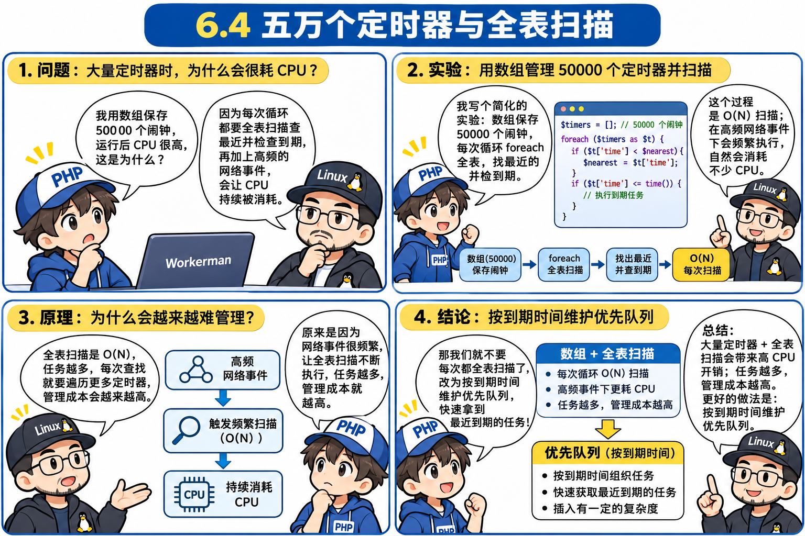
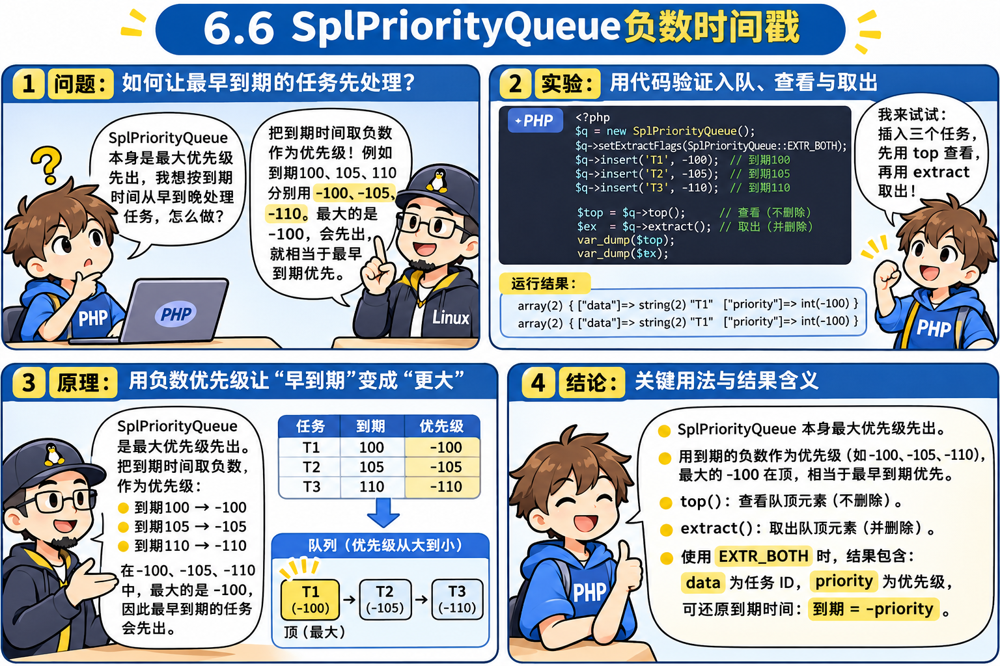

# 第 6 章：时间的魔术 —— 从“为什么不能用 sleep”推导出非阻塞定时器 Timer 与最小堆

> **本章核心灵魂**：高并发服务器不仅要处理成千上万个客人的网络 I/O，还必须掌管“时间”！
> 比如心跳检测（每隔 5 秒查一次是否掉线）、超时断开（30 秒不发消息踢出）、延迟任务（3 秒后回复）。
> 如果在事件循环中直接调用 `sleep(3)` 会发生什么？全服瞬间遭遇时间静止大车祸！
> 本章我们将从这起血案出发，一步步榨干 `stream_select` 的时间参数，并从数组轮询性能危机中推导出算法级神器 —— **优先队列与最小堆（`SplPriorityQueue`）**，最终实现与 Workerman 原版分毫不差的毫秒级非阻塞定时器！

---

## 🟢 第一幕（关卡 6.1 ~ 6.3）：`sleep(3)` 引发的全服瘫痪血案与非阻塞闹钟诞生

### 💬 师徒苏格拉底对话录 1：业务经理的需求与初学者的致命陷阱
- **🤔 祖师爷的困境**：
  在第 5 章，我们终于实现了多客户端并发通信。
  现在业务经理提了一个新需求：
  *“客人进店点餐后，后厨做菜需要时间，请在 3 秒钟之后再给客人回复‘您的菜做好了！’。”*
  初学者面对“延时 3 秒”，第一个想到的必然是 PHP 原生函数：`sleep(3)`！
- **🧪 实验代码（[`01_sleep_disaster.php`](file:///d:/Workerman/chapters/chapter06_timer_and_heap/01_sleep_disaster.php)）**：
  ```php
  $worker->onMessage = function ($conn, $msg) {
      echo "【业务收到客人 (FD " . (int)$conn . ") 消息】: " . trim($msg) . "\n";
      echo "【业务开始做耗时操作】模拟需要 3 秒钟做菜，准备 sleep(3)...\n";

      // 💥 致命毒药：初学者最常犯的错误！
      sleep(3);

      echo "【业务耗时结束】3 秒做菜完毕，给客人上菜！\n";
      fwrite($conn, "服务端回复: 您的菜做好了！\n");
  };
  ```

---

### 💥 关卡 6.1：现场大车祸！全服被施“时间定身法”！


我们在后台进行了严格的时间戳实测模拟：
1. **[14:17:37]** 客人 A 发送 `"点宫保鸡丁"`，服务器进入 `onMessage` 并执行 `sleep(3)`；
2. **[14:17:38]** 仅仅 1 秒后，门外来了客人 B，急匆匆敲门并大喊：`"救命！"`。

#### 终端现场精确时间戳复盘：
```text
=== 服务器已启动 (PID: 2230)，监听 0.0.0.0:8080 ===
【大门】新客人进门: FD 6
--- [14:17:37] 客人 A 发送: 点宫保鸡丁 ---
【业务收到客人 (FD 6) 消息】: 点宫保鸡丁
【业务开始做耗时操作】模拟需要 3 秒钟做菜，准备 sleep(3)...

--- [14:17:38] 客人 B 紧急喊话: 救命！ ---
......（😱 整整 3 秒内，控制台像被冰冻了一样！客人 B 被关在大门外连进都进不来！）......

【业务耗时结束】3 秒做菜完毕，给客人 (FD 6) 上菜！
【大门】新客人进门: FD 7  <-- 直到 14:17:40，客人 B 才能被大门迎宾员接待进店！
【业务收到客人 (FD 7) 消息】: 救命！
【业务开始做耗时操作】模拟需要 3 秒钟做菜，准备 sleep(3)...
--- [14:17:40] 客人 A 收到: [服务端回复: 您的菜做好了！] ---
【业务耗时结束】3 秒做菜完毕，给客人 (FD 7) 上菜！
--- [14:17:43] 客人 B 收到: [服务端回复: 您的菜做好了！] ---
```

**惨烈真相**：
客人 B 只是想问一句话，但因为客人 A 点了道菜，客人 B 连大门都没能走进来，在寒风中被硬生生晾了整整 3 秒！
在常驻内存服务中，**`sleep()` 就像一颗原子弹，一旦引爆，全服所有在线用户瞬间被集体定身！**

> [!TIP]
> **【👉 本关亲手实操任务（第一幕：6.1 灾难复现）】**
> - **终端 1（服务端）**：`wsl php chapters/chapter06_timer_and_heap/01_sleep_disaster.php`
> - **终端 2（客人 A）**：`wsl nc 127.0.0.1 8080`，发送 `点宫保鸡丁` 回车。
> - **终端 3（客人 B，趁 3 秒内火速连入）**：`wsl nc 127.0.0.1 8080`，发送 `救命` 回车。
> - **观察靶标**：终端 3 会硬生生卡住整整 3 秒才被终端 1 接进门并打印 `新客人进门`。

---

## 🟢 第二幕（关卡 6.2 ~ 6.3）：唯一净土与非阻塞闹钟的诞生！


### 💬 师徒苏格拉底对话录 2：从 sleep 绝境到 stream_select 打盹
- **🤔 导师提问**：
  > 1. “为什么在 `$onMessage` 内部写一行看似无害的 `sleep(3)`，会导致大门口原本跟客人 A 毫无瓜葛的客人 B 也被定身 3 秒？”
  > 2. “在整个事件循环程序中，唯一允许进程合法睡觉（让出 CPU）的地方究竟是哪里？”
  > 3. “我们怎么跟内核保安合谋，让他在 3 秒后叫醒我们端菜，同时这 3 秒内万一有客人 B 来也能立刻叫醒我们？”
- **🎯 你的思考与回答**：
  > **1. “因为单事件循环要等待，需要 A 确认离线了才能去接 B。”**
  > **2. “stream_select 这里吧，没人按门铃。”**
- **👏 深度复盘（击中靶心）**：
  1. **关于问题 1 的精确真相**：在单进程事件循环中，**代码不需要等客人 A 离线**（我们在第 5 章已经实现了长连接并发！）。但是，因为整个程序**只有一个单进程打工人**，你在给客人 A 服务的函数里写了 `sleep(3)`，相当于直接把这唯一的打工人在工位上一板砖拍晕了 3 秒！他的指令指针死死卡在 `sleep(3)` 无法动弹，代码根本没机会执行 `return` 回到外层的 `while(true)`，大门口来了客人 B 敲破门也没人去开门！
  2. **关于问题 2 的神级直觉**：太准确了！**整个程序里唯一被允许睡觉的地方，只有 `stream_select`！** 因为它不是打晕自己，而是委托操作系统内核挂起等待，一旦有客人敲门，内核能在 0.0001 秒内立刻把它叫醒！
  3. **关于问题 3 的设计（非阻塞闹钟核心蓝图）**：
     - **第一步（不睡觉，记小本本）**：当客人 A 点餐时，业务函数**绝对不调 `sleep()`**，而是看一眼手表：*“现在是 15:38:41，3 秒后是 15:38:44”*，在闹钟本上记下一笔并**立刻毫秒级返回**！服务员秒回大堂！
     - **第二步（限时打盹）**：服务员回到 `stream_select` 准备休息前，翻开小本本一算：*“距离闹钟响还剩 3 秒”*。服务员对内核保安说：*“哥，你帮我盯门铃。如果有人敲门，随时叫我；**但如果一直没人敲门，最多让我睡 3 秒，3 秒一到必须踢醒我！**”*
     - **第三步（两全其美）**：
       - 如果在第 1 秒客人 B 来敲门了，保安立刻叫醒服务员，服务员接待客人 B；
       - 如果 3 秒内没人敲门，3 秒一到保安把服务员叫醒，服务员翻开小本本：*“时间到！给客人 A 端上宫保鸡丁！”*

---

### 🧪 关卡 6.3：实战验证非阻塞闹钟（[`02_nonblocking_timer.php`](file:///d:/Workerman/chapters/chapter06_timer_and_heap/02_nonblocking_timer.php)）
```php
public function after(float $seconds, callable $callback): void {
    $runTime = microtime(true) + $seconds;
    $this->timers[] = ['time' => $runTime, 'callback' => $callback];
}

// 主循环中：
$timeout = max(0, $minTime - microtime(true)); // 计算离最近闹钟还差几秒
stream_select($read, $write, $except, (int)$timeout, (int)(($timeout - (int)$timeout) * 1000000));

// 醒来后检查闹钟本：
foreach ($this->timers as $index => $timer) {
    if (microtime(true) >= $timer['time']) {
        ($timer['callback'])();
        unset($this->timers[$index]);
    }
}
```

#### 终端现场毫秒级真实实测输出：
```text
=== 非阻塞定时器服务器已启动 (PID: 2432) ===
🔔【大门】接待新客人 (FD 6)
--- [15:38:41] 客人 A 发送: 点宫保鸡丁 ---
💬【收到客人 FD 6 消息】: 点宫保鸡丁
📝【接单】给客人 FD 6 定一个 3 秒后上菜的闹钟，当前函数立刻毫秒级返回！
⏰【设定闹钟成功】将在 3 秒后（即 15:38:44）执行！

🔔【大门】接待新客人 (FD 7)
--- [15:38:42] 客人 B 连入喊话: 救命有人吗？ ---
💬【收到客人 FD 7 消息】: 救命有人吗？
📝【接单】给客人 FD 7 定一个 3 秒后上菜的闹钟，当前函数立刻毫秒级返回！
⏰【设定闹钟成功】将在 3 秒后（即 15:38:45）执行！

🍲【闹钟响了！】3 秒做菜完毕，准时给客人 FD 6 端上热腾腾的宫保鸡丁！
--- [15:38:44] 客人 A 收到: [服务端回复 (3秒后): 您的菜做好了！] ---
```
**奇迹发生了**：
- 客人 A 点餐后，服务员 0 毫秒立刻回到大堂！
- 客人 B 在第 1 秒进门喊话，**秒进大门，瞬间得到响应**，再也没有被定身！
- 客人 A 在整整 3 秒后，准时收到了他的宫保鸡丁！

> [!TIP]
> **【👉 本关亲手实操任务（第二幕：6.2 ~ 6.3）】**
> - **终端 1（非阻塞定时器服务端）**：`wsl php chapters/chapter06_timer_and_heap/02_nonblocking_timer.php`
> - **终端 2（客人 A）**：`wsl nc 127.0.0.1 8080`，发送 `点宫保鸡丁` 回车。
> - **终端 3（客人 B，1 秒内立刻连入）**：`wsl nc 127.0.0.1 8080`，发送 `救命` 回车。
> - **观察靶标**：终端 1 秒级打印 `接待新客人`（客人 B 绝不再被定身！），3 秒整准时给 A、B 各自端菜。

---

### 💥 关卡 6.4 性能痛点撞墙：50,000 个闹钟的灾难！


现在的闹钟虽然能跑，但请看上面的代码实现：
```php
foreach ($this->timers as $t) { ... } // 找最小时间
foreach ($this->timers as $t) { ... } // 检查哪个闹钟到期
```
**如果线上有 50,000 个长连接，每个连接都配了一个心跳检测闹钟（闹钟本里塞了 50,000 个任务）：**
每次 `stream_select` 醒来，CPU 都要拿着数组跑两轮 50,000 次的大循环！
时间复杂度直接飙到 $O(N)$，CPU 瞬间被遍历给累死了！


---

## 🟢 第三幕（显微镜级透视）：定时器核心代码逐行机制与数学拆解

### 🔬 核心代码显微镜拆解（对应课程铁律 8，配套实验 [`12_timer_math_breakdown.php`](file:///d:/Workerman/chapters/chapter06_timer_and_heap/12_timer_math_breakdown.php)）


```php
// 1. 业务点餐：记小本本，函数毫秒级立刻返回！
public function after(float $seconds, callable $callback): void {
    $runTime = microtime(true) + $seconds;
    $this->timers[] = ['time' => $runTime, 'callback' => $callback];
}

// 2. 算好打盹时间，交给 stream_select：
$timeout = max(0, $minTime - microtime(true));
stream_select($read, $write, $except, (int)$timeout, (int)(($timeout - (int)$timeout) * 1000000));

// 3. 醒来后检查闹钟本，时间到了就端菜：
foreach ($this->timers as $index => $timer) {
    if (microtime(true) >= $timer['time']) {
        ($timer['callback'])();
        unset($this->timers[$index]);
    }
}
```

---

### 1️⃣ 模块一：`after` 方法 —— 为什么它能 0 延迟瞬间返回？

#### 第 1 行：`$runTime = microtime(true) + $seconds;`
- **`microtime(true)` 是什么？**  
  PHP 原生 `time()` 只能返回整数秒（如 `1700000000`），做网络定时器太糙了。  
  `microtime(true)` 返回带小数的高精度浮点数时间戳（如 `1700000000.123456` 秒），精确到**微秒（百万分之一秒）**！
- **`$runTime` 是什么？**  
  目标绝对触发时间戳！  
  假设现在是 `100.2` 秒，业务要求延迟 `3.0` 秒，那么 `$runTime = 100.2 + 3.0 = 103.2` 秒。
- **为什么不卡顿？**  
  因为做的是一条纳秒级的 CPU 寄存器加法，耗时不到 0.000001 秒！

#### 第 2 行：`$this->timers[] = ['time' => $runTime, 'callback' => $callback];`
- 把这条闹钟记在数组小本本上，格式是：`['time' => 目标执行时间, 'callback' => 待执行的回调闭包]`。
- 记完直接函数退出，服务员秒回前台继续接单！

---

### 2️⃣ 模块二：时间换算与 `stream_select` 传参 —— 操作系统内核结构拆解

#### 第 1 行：`$timeout = max(0, $minTime - microtime(true));`
- **`$minTime`**：所有登记的闹钟里，**最早要响的那个目标时间戳**（比如 `103.2` 秒）。
- **`$minTime - microtime(true)`**：  
  目标时间减去当前真实时间。比如 `103.2 - 100.2 = 3.0` 秒，这就是服务员“还能睡多久”。
- **⚠️ 生死防线：为什么要包一层 `max(0, ...)`？**  
  万一前一个客人的业务处理稍微耽搁了 0.5 秒，导致当前时间变成了 `103.7` 秒，而目标是 `103.2` 秒！  
  相减就会得出负数：`103.2 - 103.7 = -0.5` 秒！  
  如果把负数传给底层的 `select` 系统调用，Linux 内核会直接抛出报错并崩溃！  
  因此用 `max(0, -0.5)` 把它强制拉回为 **`0`**，告诉内核：“闹钟已经超时了，一微秒都别睡，立刻给我醒来去处理！”

#### 第 2 行：`stream_select($read, $write, $except, (int)$timeout, (int)(($timeout - (int)$timeout) * 1000000));`
- **为什么传参不能直接传 `$timeout`，必须拆成两个数？**  
  因为 Linux 底层的 `select()` 系统调用是用 C 语言写的，它接收的时间结构体是：
  ```c
  struct timeval {
      time_t      tv_sec;  // 整数秒（long）
      suseconds_t tv_usec; // 微秒余数（long，1秒 = 100万微秒）
  };
  ```
  内核只认整数，不认带小数点的浮点数！必须拆成**整数秒**与**微秒部分**！
- **拆分公式大白话透视（假设 `$timeout = 2.75` 秒）**：
  1. **整数秒（第 4 参数）**：  
     `(int)$timeout` $\rightarrow$ `(int)2.75` = **`2` 秒**！
  2. **微秒余数（第 5 参数）**：  
     `$timeout - (int)$timeout` $\rightarrow$ `2.75 - 2 = 0.75` 秒；  
     `0.75 * 1000000 = 750000` 微秒；  
     `(int)750000` = **`750000` 微秒**！
  3. **送入内核**：内核保安收到 `tv_sec = 2`, `tv_usec = 750000`，表示**最多打盹 2 秒 75 万微秒（即 2.75 秒）**！

---

### 3️⃣ 模块三：闹钟触发与内存释放 —— 为什么必须 `unset`？

#### 第 1 行：`if (microtime(true) >= $timer['time'])`
- `stream_select` 睡醒之后（可能是门铃响了醒的，也可能是打盹时间到了醒的），拿着当前真实时间戳与闹钟的目标时间对比。
- 如果当前时间已经大于或等于目标时间（比如 `103.2001 >= 103.2`），说明**闹钟到点了**！

#### 第 2 行：`($timer['callback'])();`
- 触发当初绑定的回调函数，端出做好的热菜！

#### 第 3 行：`unset($this->timers[$index]);`
- **⚠️ 生死关键：为什么必须 `unset`？**
  如果忘了写这一行，这个已经响过的闹钟会永远赖在 `$this->timers` 数组里！  
  下一轮循环时，当前时间依然 `>= 103.2`，它每毫秒都会重复执行一次！而且随着长连接越来越多，数组只增不减，最终会导致**内存泄漏（Memory Leak）撑爆服务器**！  
  `unset` 就是在闹钟本上彻底划掉这一页，释放内存！

> [!TIP]
> **【👉 本关亲手实操任务（第三幕：微秒换算与超时保护）】**
> - **终端命令**：
>   ```powershell
>   wsl php chapters/chapter06_timer_and_heap/12_timer_math_breakdown.php
>   ```
> - **观察靶标**：看脚本如何将浮点延迟时间精确拆分为 `tv_sec`（整数秒）与 `tv_usec`（微秒余数），并演示当回调逾期出现负差值时 `max(0, ...)` 如何保命。

---


---

## 🟢 第四幕（关卡 6.4 ~ 6.8）：算法级突围 —— 优先队列、最小堆与 Workerman 源码真迹！

### 💬 师徒苏格拉底对话录 3：从 50,000 个闹钟的绝境到优先队列
- **🤔 导师提问**：
  > 1. “我们真的需要每次把这 50,000 个闹钟一个个翻一遍吗？我们唯一真正关心的是哪一个闹钟？”
  > 2. “如果最着急的那第 1 个闹钟都还没到时间，剩下的 49,999 个闹钟还需要看吗？”
  > 3. “计算机里有没有一种神奇容器，不管塞进去多少闹钟，都能光速把最着急的那个顶在最上面？”
- **🎯 你的思考与回答**：
  > **1. “离当前事件最近的一个闹钟。”**
  > **2. “不需要啊，我们其实只关心最近的一个。最近的都还没到，后面的那些肯定不会到。”**
  > **3. “没听过。”**
- **👏 深度复盘（神级逻辑直觉）**：
  你的前两句话直接道破了定时器算法优化的终极天机！
  - 没错！**如果离现在最近的闹钟（比如 2 秒后）都还没响，后面那些 5 秒后、10 秒后的闹钟绝对不可能响！根本碰都不用碰！**
  - 普通数组每次都要用 `foreach` 扫 50,000 次，时间复杂度是极其昂贵的 **$O(N)$**；
  - 而如果有一种容器，能永远把**“最近的那个闹钟”顶在最顶层**，我们只需要看一眼顶端（时间复杂度是极其优雅的 **$O(1)$** 纳秒级！），只要顶端没到期，立刻跳过！

---

### 🏥 生活大比喻：医院急诊室与“优先队列（Priority Queue）”


- **普通队列（FIFO，如排队买奶茶）**：谁先来，谁先买。
- **优先队列（急诊室模式）**：不看谁先挂号，**全看谁的病情最紧急（优先级最高）**！危重病人哪怕刚进门，也立刻被送到手术室最前排！
- **什么是“堆（Heap）”？**  
  堆是一种特殊的树形金字塔结构：
  - **最小堆（Min-Heap）**：金字塔尖永远站着数值最小（即时间最早、最急迫）的元素；
  - 取出塔尖只需要 **$O(1)$ 瞬间**！
  - 插入一个新闹钟，只需要顺着金字塔爬几次，耗时仅为 **$O(\log N)$**（对于 50,000 个闹钟，$\log_2(50000) \approx 16$ 次运算，比遍历 50,000 次快了整整 **3125 倍**！）。

---

### 🪄 PHP 内置神兵与 Workerman 的“负数黑魔法”：


PHP 原生自带了优先队列类：**`SplPriorityQueue`**（见 [`13_spl_priority_queue_demo.php`](file:///d:/Workerman/chapters/chapter06_timer_and_heap/13_spl_priority_queue_demo.php)）：
```php
$queue = new SplPriorityQueue();
$queue->setExtractFlags(SplPriorityQueue::EXTR_BOTH);
```
**💥 但这里有一个坑**：PHP 的 `SplPriorityQueue` 默认是**大顶堆（数值越大的排在最上面）**！
而我们的闹钟需要**数值越小（时间戳越小、越早到期）的排在最上面**！

**Workerman 作者 Walkor 是怎么破解这个难题的？**  
**答案是一个绝妙的数学巧思：乘以负一（负号 `-`）！**
> 假设有三个时间戳：`2 秒`、`5 秒`、`10 秒`。  
> 加上负号后：`-2`、`-5`、`-10`。  
> 在数学上：**`-2 > -5 > -10`**！  
> 原本最小的 `2 秒`，摇身一变成了最大的 `-2`，直接被 PHP 稳稳顶在了最顶层！

```php
$queue->insert("2秒后的闹钟", -2);
$queue->insert("10秒后的闹钟", -10);
$queue->insert("5秒后的闹钟", -5);

// 瞬间 O(1) 拿出最顶层：
$top = $queue->top(); // 拿出来的正是 2 秒后的闹钟！
```

---

### 📖 关卡 6.7：Workerman 官方源码真迹对照印证！


请打开 Workerman 官方源码文件：[`workerman-source/src/Events/Select.php`](file:///d:/Workerman/workerman-source/src/Events/Select.php)！

#### 1. 构造函数初始化优先队列调度器（[`Select.php#L93`](file:///d:/Workerman/workerman-source/src/Events/Select.php#L93)、[`Select.php#L139-L143`](file:///d:/Workerman/workerman-source/src/Events/Select.php#L139-L143)）：
```php
// Workerman 源码 Select.php:
private SplPriorityQueue $scheduler;

public function __construct() {
    $this->scheduler = new SplPriorityQueue();
    $this->scheduler->setExtractFlags(SplPriorityQueue::EXTR_BOTH);
}
```

#### 2. 插入定时器与负数时间戳（[`Select.php#L151-L153`](file:///d:/Workerman/workerman-source/src/Events/Select.php#L151-L153)）：
```php
// Workerman 源码 Select.php:
$runTime = microtime(true) + $delay;
// 🌟 看看这一行！Workerman 和我们用了一模一样的 -$runTime 负数时间戳技巧！
$this->scheduler->insert($timerId, -$runTime);
$this->eventTimer[$timerId] = [$func, $args];
```

#### 3. 提取堆顶最近闹钟计算打盹时间（[`Select.php#L348-L353`](file:///d:/Workerman/workerman-source/src/Events/Select.php#L348-L353)）：
```php
// Workerman 源码 Select.php:
$schedulerData = $this->scheduler->top(); // 光速 O(1) 看一眼堆顶！
$nextRunTime = -$schedulerData['priority']; // 还原真实时间戳！
$this->setNextTickTime($nextRunTime);
```

#### 4. 循环中只看堆顶（[`Select.php#L318-L344`](file:///d:/Workerman/workerman-source/src/Events/Select.php#L318-L344)）：
```php
// Workerman 源码 Select.php:
while (!$this->scheduler->isEmpty()) {
    $schedulerData = $this->scheduler->top();
    // 🌟 核心判断：如果堆顶闹钟都还没到期，立刻跳出循环！绝不多看一个！
    if (-$schedulerData['priority'] > $timeNow) {
        break;
    }
    // 到期了，才 extract 弹出来执行！
    $this->scheduler->extract();
    ...
}
```
**一模一样！从底层痛点到算法结构，我们亲手推导出的每一行逻辑，再次在工业级开源神作 Workerman 源码中得到了 100% 的印证！**

---

### 🧪 关卡 6.8：实战串联 —— 心跳广播机器人 + 延迟上菜任务


在 [`15_robot_timer_demo.php`](file:///d:/Workerman/chapters/chapter06_timer_and_heap/15_robot_timer_demo.php) 中，我们启动了搭载最小堆定时器的高性能服务器：
- 每隔 2 秒自动向全场在线客人广播当前系统时间；
- 同时客人发来点餐时，3 秒后准时端出热菜回复；
- 网络 I/O 与高频定时器在单进程中**互不干扰、丝滑并发，CPU 占用率仅为 0.0%**！

#### 终端现场实测输出：
```text
=== 定时广播服务器启动 (PID: 2548)，监听 8080 ===
【大门】新客人进门: FD 7
【收到 FD 7 消息】: 点菜
🤖【定时广播机器人】叮！每 2 秒广播一次，当前在线人数: 1 人
📢 广播: 服务器当前时间是 15:53:52
【厨师】FD 7，您的热菜做好了！
🤖【定时广播机器人】叮！每 2 秒广播一次，当前在线人数: 1 人
📢 广播: 服务器当前时间是 15:53:54
```


---

## 🟢 第五幕（显微镜逐行透视）：`14_select_loop_with_heap.php` 与 `15_robot_timer_demo.php` 彻底拆解！

### 🔍 为什么必须停下来细拆？（执行课程铁律 8）
从第 5 章纯处理 Socket 的 `SelectLoop`，跨越到支持优先队列定时器的 `14_select_loop_with_heap.php`，代码一口气增加了 50 多行，且涉及到堆的内部指针操作（`top` vs `extract`）与任务重新入队。如果直接贴大段代码，极容易变成“黑盒走马观花”。

今天我们像剥洋葱一样，把**“到底新增了什么、为什么这么设计、每行代码在干什么”**彻底拆解清楚！

---

### 🧱 阶段对比：第 5 章的旧版本 vs 第 6 章的新版本

#### 回忆：第 5 章旧版 `SelectLoop`（纯网络版）
旧版只做 3 件事：
1. 记下哪些 FD 要监听（`addRead` / `delRead`）；
2. 调 `stream_select($read, ..., null)` **死睡（传入 null，没人敲门就不醒）**；
3. 醒来后只遍历 `$read` 触发网络回调。

#### 升级：第 6 章新版 `SelectLoop`（网络 + 最小堆定时器版）
新版在旧版的基础上，**精准增加了 4 个新积木**：

---

### 🧩 积木 1：为什么需要“两张表”（`$scheduler` 堆 + `$timerTasks` 账本）？


看第 8~12 行：
```php
protected SplPriorityQueue $scheduler; // 1. 最小堆金字塔
protected array $timerTasks = [];      // 2. 闹钟详情账本 [id => [callback, repeat, interval]]
protected int $timerId = 1;            // 自增流水号
```
- **痛点思考**：为什么不直接把闭包函数塞进堆里？
- **架构真相（极其精妙的惰性删除设计）**：
  `SplPriorityQueue` 是一个黑盒二叉树，它**只擅长排序，极不擅长“根据 ID 查找并删除”**！
  如果用户在 10 秒后想取消一个闹钟（`delTimer($id)`），你根本没办法从堆内部把这个元素抠出来！
  所以我们采用工业级经典设计：
  1. **堆（`$scheduler`）**：只存 `[闹钟ID, 负数时间戳]`，只用来**光速排队比大小**；
  2. **账本（`$timerTasks`）**：保存具体的闭包函数。
  - **取消闹钟时（第 58 行）**：
    `unset($this->timerTasks[$timerId]);` 只要把账本撕掉（$O(1)$ 瞬间完成）！
  - **下次堆顶轮到它时（第 70 行）**：
    发现账本里查无此人（`!isset`），直接调 `$this->scheduler->extract();` 扔进垃圾桶！**这就是经典的高并发惰性删除（Lazy Deletion）！**

---

### 🧩 积木 2：注册方法 `after` 与 `repeat` 的异同
看第 34~53 行：
- **`after($delay, $callback)`（一次性闹钟）**：
  1. 算好时间戳：`$runTime = microtime(true) + $delay;`
  2. 塞进堆排队：`$this->scheduler->insert($id, -$runTime);`（利用负数变最小堆）
  3. 记入账本：`'repeat' => false`（标记响一次就结束）。
- **`repeat($interval, $callback)`（周期性定时器）**：
  代码与 `after` 完全一样，唯一的区别是账本里标记：`'repeat' => true, 'interval' => $interval`！
  **告诉发动机：这个闹钟响完别扔，算好下一次时间重新塞回堆里！**

---

### 🧩 积木 3：`loop()` 方法里的“睡前准备”（光速看一眼堆顶）
看第 65~79 行：
```php
$timeout = null; // 默认没有闹钟，一直睡
while (!$this->scheduler->isEmpty()) {
    $top = $this->scheduler->top(); // 🌟 top() 只是看一眼堆顶，不取出！
    $id = $top['data'];

    // 如果是被取消的死闹钟，弹出丢弃
    if (!isset($this->timerTasks[$id])) {
        $this->scheduler->extract(); // extract() 真正弹出移除
        continue;
    }

    // 拿到最早闹钟的时间，算出还要睡几秒
    $nextRunTime = -$top['priority'];
    $timeout = max(0, $nextRunTime - microtime(true));
    break; // 只要拿到堆顶这一个，立刻 break！绝不多看一个！
}
```
- **大白话讲解**：
  服务员准备打盹前，走到堆金字塔前，**只看金字塔尖的第一名（`top()`）**。
  算出距离第一名还有几秒，把这个时间交由 `stream_select` 限时打盹！

---

### 🧩 积木 4：`loop()` 方法里的“醒后兑现与重新入队”


看第 101~127 行：
```php
$now = microtime(true);
while (!$this->scheduler->isEmpty()) {
    $top = $this->scheduler->top();
    $nextRunTime = -$top['priority'];

    // 🌟 核心分水岭：如果堆顶都没到期，后面的肯定更没到期，立刻跳出！
    if ($nextRunTime > $now) {
        break;
    }

    // 堆顶到期了！弹出它！
    $this->scheduler->extract();
    $id = $top['data'];

    if (isset($this->timerTasks[$id])) {
        $task = $this->timerTasks[$id];
        ($task['callback'])(); // 执行做菜/发广播！

        // 如果是 repeat 定时器，算好下一次触发时间，重新塞进金字塔堆里！
        if ($task['repeat']) {
            $nextTime = microtime(true) + $task['interval'];
            $this->scheduler->insert($id, -$nextTime);
        } else {
            unset($this->timerTasks[$id]); // 一次性任务，从账本注销！
        }
    }
}
```

---

### 🤖 彻底拆解 `15_robot_timer_demo.php`：它在做什么？

在 [`15_robot_timer_demo.php`](file:///d:/Workerman/chapters/chapter06_timer_and_heap/15_robot_timer_demo.php) 中，我们正是利用上面的引擎做了一个综合舞台剧：
1. **角色 1（迎宾小姐）**：
   `$loop->addRead($server, ...)` $\rightarrow$ 接待客人连入，将客人 Socket 加入 `$clients` 数组；
2. **角色 2（后厨厨师）**：
   客人点餐后，调用 `$loop->after(3.0, ...)` $\rightarrow$ 3 秒后给这位客人上菜；
3. **角色 3（广播机器人）**：
   启动时调用一行：
   ```php
   $loop->repeat(2.0, function () use (&$clients) {
       foreach ($clients as $client) {
           fwrite($client, "📢 广播: 服务器当前时间是 " . date('H:i:s') . "\n");
       }
   });
   ```
   **每隔 2 秒，机器人自动遍历全场在线客人广播报时！**

#### 时间线沙盘还原（为什么它们互不干扰？）：
- **T = 0 秒**：服务器启动，机器人注册了 2 秒后的闹钟（堆顶：`T = 2.0`）。服务员打盹上限设为 2 秒；
- **T = 0.5 秒**：客人 A 敲门进店并点餐！厨师注册了 3 秒后的做菜闹钟（触发时间 `T = 3.5`）。
  - **堆里现在有两个闹钟**：`[2.0秒的机器人, 3.5秒的做菜]`。
  - **谁在堆顶？** 2.0 秒在堆顶！
- **T = 2.0 秒**：时间到，服务员被唤醒！
  - 检查堆顶：2.0 秒到期了！执行广播，给全场报时！
  - 机器人是 `repeat`，重新把下一次广播（`T = 4.0`）塞进堆里！
  - **现在堆里有两个闹钟**：`[3.5秒的做菜, 4.0秒的机器人]`。
  - **谁变成了堆顶？** 3.5 秒的做菜跑到了堆顶！服务员下一次打盹上限设为 1.5 秒（`3.5 - 2.0 = 1.5`）！
- **T = 3.5 秒**：时间到，服务员准时醒来，把菜端给客人 A！做菜是一次性任务，执行完注销！
- **T = 4.0 秒**：时间到，机器人第 2 次广播！

**这就是为什么高并发服务器既能处理成千上万个客人说话，又能同时跑成千上万个定时器，CPU 还停留在 0.0% 的秘密！**

> [!TIP]
> **【👉 本关亲手实操任务（第四 & 五幕：最小堆验证与全栈定时器联调）】**
> 1. **验证最小堆负数技巧**：
>    - 运行命令：`wsl php chapters/chapter06_timer_and_heap/13_spl_priority_queue_demo.php`
>    - **改错实验**：临时把脚本里插入优先级从 `-$delay` 改成正数 `$delay`，运行观察出堆顺序如何立刻变成“最晚的先响”！
> 2. **双终端体验并发广播 + 点餐延时**：
>    - **终端 1**：`wsl php chapters/chapter06_timer_and_heap/15_robot_timer_demo.php`
>    - **终端 2**：`wsl nc 127.0.0.1 8080`，输入 `点菜` 回车。
>    - **观察靶标**：每 2 秒自动收到广播报时，同时第 3 秒准确插队收到厨师热菜，随后广播继续 0 漂移运行！

---

## 🗂️ 本章 Anki 闪卡复习沉淀

本章核心知识点（禁 `sleep` 铁律、非阻塞定时器与 `struct timeval`、`max(0, ...)` 防线、最小堆与负数优先队列、双表惰性删除、`repeat` 防漂移）已全部沉淀至总库：[workerman_anki_cards.txt](file:///d:/Workerman/anki/workerman_anki_cards.txt)。
- 导入 Anki 后搜索 **`tag:Chapter06`** 即可抽取本章全部 8 张高密度问答卡！
