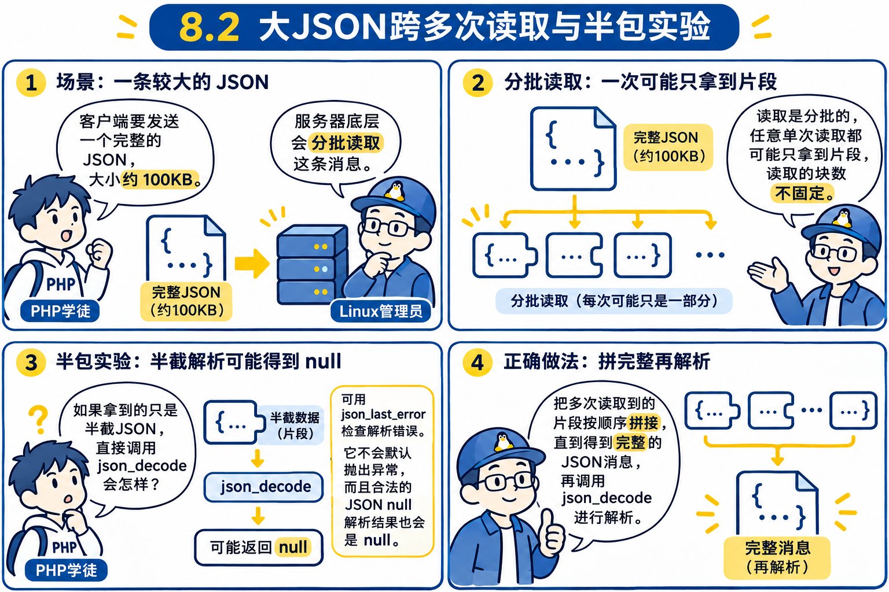
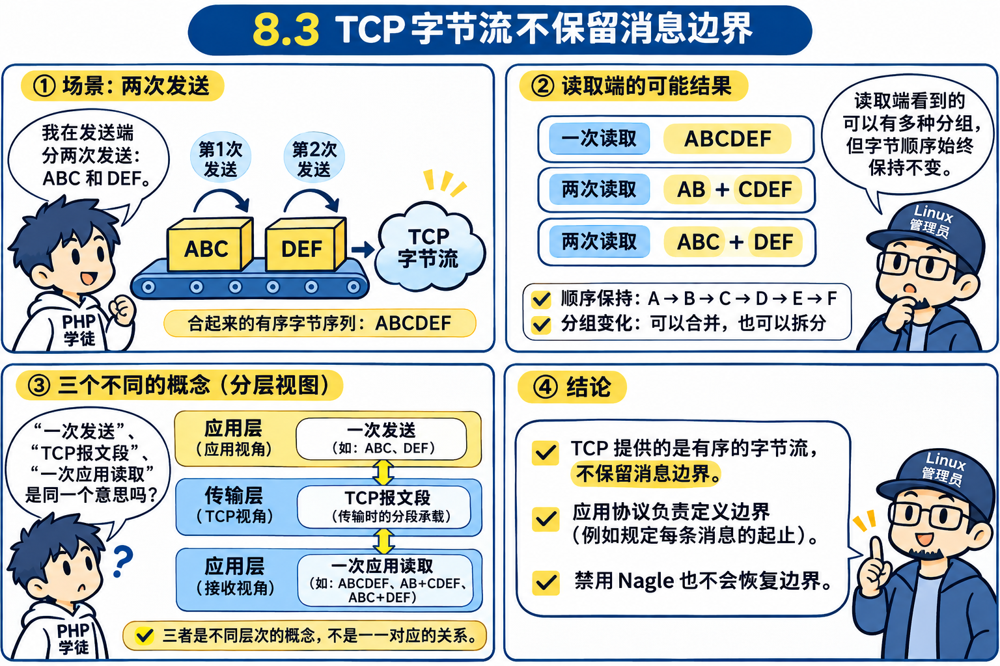
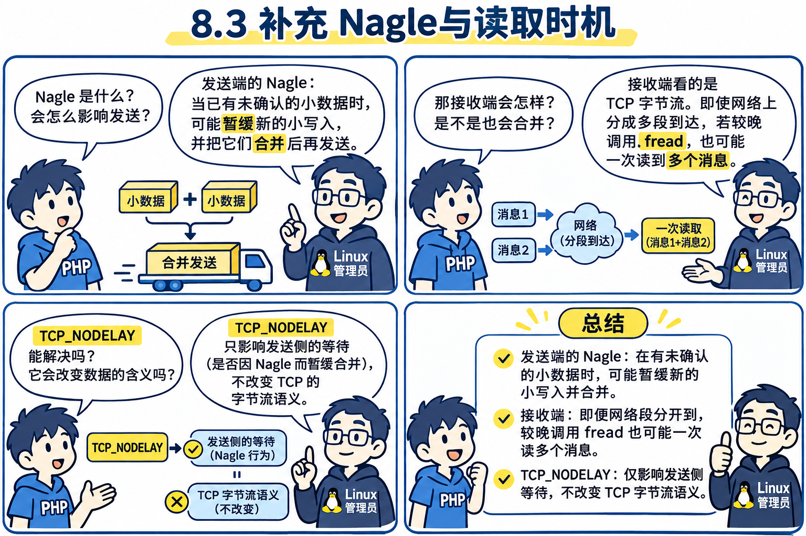
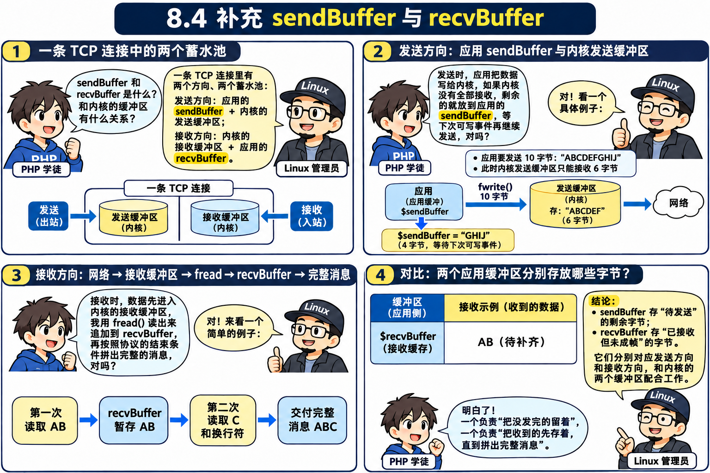
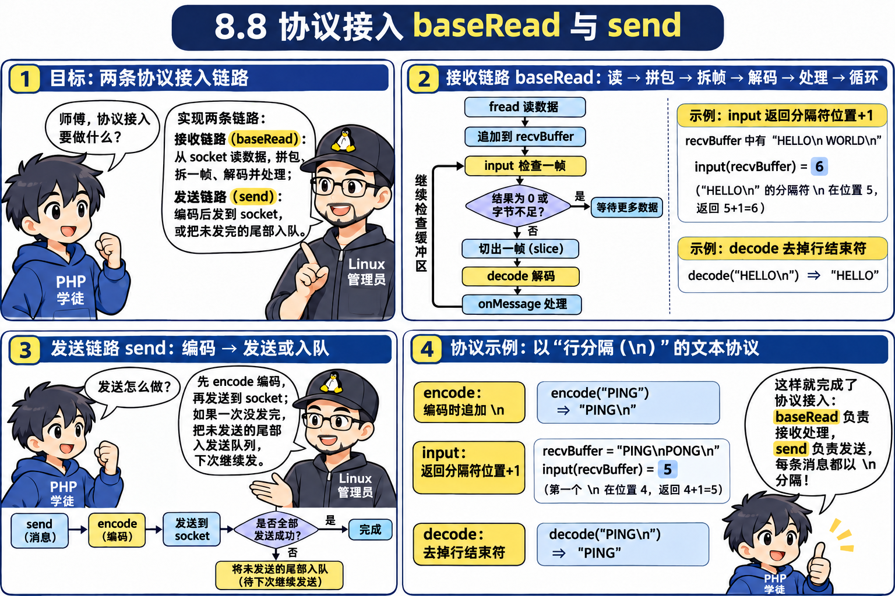
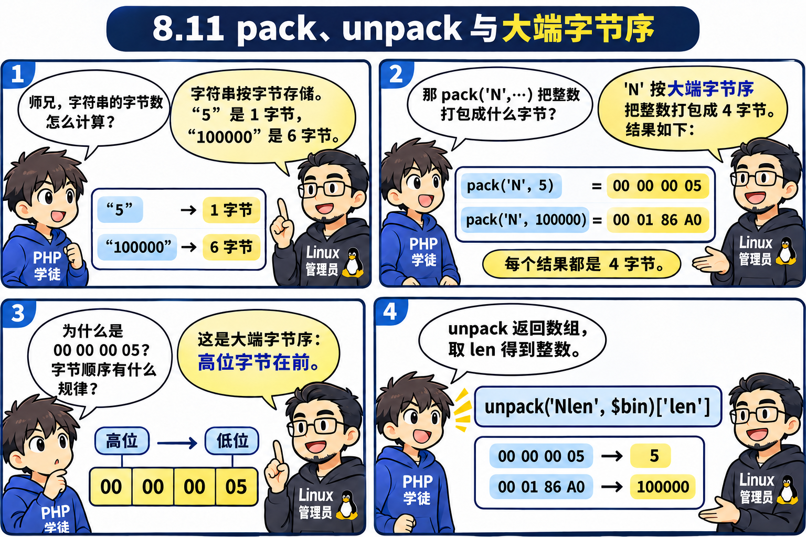

# 第 8 章：二进制与字节流 —— 从“消息粘成一坨”推导出 `ProtocolInterface` 协议插槽

> **本章核心灵魂**：
> 为什么在前面的章节里，我们在黑窗口里用键盘敲 `nc` 测试一切正常，而一旦让程序用 `for` 循环高速发消息，整个系统瞬间陷入崩溃？
> 这一章我们将亲历网络编程中最著名、让无数新手痛不欲生的两大案发现场：**TCP 粘包（Sticky Packet）** 与 **TCP 半包/拆包（Packet Fragmentation）**！
> 随后，我们将一步步穿透 Linux TCP 字节流本质、Nagle 算法与 MTU/MSS，最终亲手推导出应用层接收蓄水池（`$recvBuffer`）与 Workerman 的协议插槽王牌 —— **`ProtocolInterface`**！

---

## 🟢 第一幕（关卡 8.1 ~ 8.3）：双重大车祸 —— 粘包与半包的血案现场

### 💬 师徒苏格拉底对话录 1：为什么机器发消息和人敲键盘不一样？
- **🤔 祖师爷的困惑**：
  在前面的第 5、6、7 章中，我们测试服务端用的都是这种方式：
  打开终端输入 `nc 127.0.0.1 8080`，手敲 `"hello"` 按回车，服务端正好触发一次 `$onMessage`，收到 `"hello"`。一切岁月静好。
  **但是，工业级真实机器之间的通信，从来不是人坐在键盘前慢悠悠敲字！**
  业务场景：
  1. 客人一口气连续发了 10 条弹幕；
  2. 客户端向服务端上报一条 100KB 大小的订单 JSON。

- **💥 惨案 1（关卡 8.1 TCP 粘包实测）：10 句话被焊死成一坨！**


  客户端写了个紧凑循环：
  ```php
  for ($i = 1; $i <= 10; $i++) {
      fwrite($client, "hello"); // 连续调用 10 次！
  }
  ```
  - **业务预期的美好画面**：服务端 `$onMessage` 应该被触发 10 次，每次处理一个独立的 `"hello"`；
  - **残酷的现实输出**：
    ```text
    🚨 [服务端 onMessage 触发第 1 次] 收到长度: 50 字节
       内容原文: "hellohellohellohellohellohellohellohellohellohello"
    ```
    服务端只触发了 **1 次**！10 句话被暴力焊死成了 50 字节的一长坨！

- **💥 惨案 2（关卡 8.2 TCP 半包/拆包实测）：1 条完整 JSON 被五马分尸！**


  客户端调用 1 次 `fwrite`，发送一个合法的 100KB JSON 字符串：
  ```php
  $bigJson = json_encode(['data' => str_repeat('X', 100000)]);
  fwrite($client, $bigJson); // 1 次性发 100011 字节
  ```
  - **业务预期的美好画面**：服务端 `$onMessage` 触发 1 次，拿到完整字符串并调用 `json_decode($msg)` 解析成功；
  - **残酷的现实输出**：
    ```text
    🚨 [服务端 onMessage 触发第 2 次] 收到长度: 8192 字节
       ❌ 致命解析失败！json_decode 返回 null (语法错误：只有半截 JSON！)
    🚨 [服务端 onMessage 触发第 3 次] 收到长度: 8192 字节
       ❌ 致命解析失败！json_decode 返回 null
    ...
    🚨 [服务端 onMessage 触发第 14 次] 收到长度: 1707 字节
    ```
    服务端竟然被疯狂触发了 **13 次**！前 12 次每次都只分到了残缺的 8192 字节，最后一次分到了 1707 字节。
    **每次传给业务层的都是破损的半句话，`json_decode` 全军覆没，返回 `null` 抛出致命异常！**

---

### 🌊 关卡 8.3 内功破案：为什么 TCP 这么“不讲武德”？

为什么 TCP 既把我们分开发的小短句焊成一坨，又把我们一次发的大句子大卸八块？

#### 核心真相：TCP 是自来水管（Byte Stream 字节流），不是顺丰快递盒！



```text
【业务层的幻想：顺丰快递盒模型（Datagram）】
  [快递盒 1: "hello"]  [快递盒 2: "hello"]  [快递盒 3: "hello"]
  每个包裹都有明确的硬纸板箱边界，互不干扰！

【TCP 协议栈的真相：自来水管模型（Stream）】
  ══════════════════════════════════════════════════════════
  >>> 水龙头持续放水: h-e-l-l-o-h-e-l-l-o-h-e-l-l-o-h-e-l-l-o >>>
  ══════════════════════════════════════════════════════════
  水分子之间没有任何纸板箱边界！水管里流淌的只是一连串无始无终的 0 和 1（二进制字节水流）！
```

#### 1. 为什么会“粘包”？


- **操作系统内核的 Nagle 算法**：
  在网络传输中，每个 TCP 报文都要包裹 20 字节 IP 头 + 20 字节 TCP 头（共 40 字节报头）。
  如果你发一个 5 字节的 `"hello"`，网卡就要背上 45 字节的包裹，有效载荷只有 11%！
  因此，操作系统内核的 **Nagle 算法** 会默认开启：如果发现你发的是微小短句，内核不会傻傻地立刻发上网线，而是**攒一攒**，把短时间内连续灌进来的多条短消息合并打包成一个大的网络报文一起飞过去！
- **服务端读取的时机差**：
  即使客户端分开发的，但服务端事件循环稍微晚了 0.001 秒才调 `fread`，内核接收池子里早已经积攒了 10 条消息，`fread($socket, 65535)` 一勺子舀上来，直接就是一整坨！

#### 2. 为什么会“半包/拆包”？


- **物理网线的胃口限制：MTU 与 MSS**：
  在以太网网线上，一次最多允许传输的物理帧大小是 **MTU = 1500 字节**。
  扣除 40 字节 TCP/IP 报头后，TCP 一次最大允许装载的数据净荷叫 **MSS（Maximum Segment Size，最大报文段长度，约 1460 字节）**！
- 当你调用 `fwrite` 发送 100KB 数据时，网卡根本不可能一口吃下！
  内核协议栈**必须在底层强行将其切成 70 多个小碎片（TCP 分段）**，像连珠炮一样分批飞过路由器和网线！
- 而服务端的 `fread($socket, 65535)` 只要一感知到网卡到了哪怕一小片碎片，就会立即唤醒返回，绝不可能等你 100KB 全齐才返回！

---

### 🧪 关卡 8.1 & 8.2 实战验证：亲身体验粘包与半包（[`01_sticky_packet_disaster.php`](file:///d:/Workerman/chapters/chapter08_protocols/01_sticky_packet_disaster.php)）

```bash
wsl php chapters/chapter08_protocols/01_sticky_packet_disaster.php
```
```text
=== 关卡 8.1 & 8.2 TCP 粘包与拆包车祸现场 (PID: 24292) ===

1. [客户端] 连续调用 10 次 fwrite($client, 'hello')...
   -> 客户端 10 次 fwrite 发送完毕！期待服务端 onMessage 触发 10 次！

🚨 [服务端 onMessage 触发第 1 次] 收到长度: 50 字节
   内容原文: "hellohellohellohellohellohellohellohellohellohello"

2. [客户端] 调用 1 次 fwrite 发送一条 100KB 的完整 JSON 数据...
   -> 客户端 1 次性发出了 100011 字节！期待服务端完整解析！

🚨 [服务端 onMessage 触发第 2 次] 收到长度: 8192 字节
   [尝试 JSON 解析 100KB 数据]...
   ❌ 致命解析失败！json_decode 返回 null (语法错误：只有半截 JSON！)
...
```

> [!TIP]
> **【👉 本关亲手实操任务（第一幕：8.1 ~ 8.3）】**
> - **终端命令**：`wsl php chapters/chapter08_protocols/01_sticky_packet_disaster.php`
> - **观察靶标**：亲眼确认第 1 次 `onMessage` 把 10 个 `'hello'` 粘成 50 字节，后面 100KB JSON 被 `fread($socket, 8192)` 切得支离破碎（`json_decode` 返回 `null`）。
> - **对比实验**：打开 `01_sticky_packet_disaster.php` 把 10 次写入间加上 `usleep(50000)` 暂停 50ms，看看粘包是否缓解（但 100KB 半包绝对无法靠延迟解决！改完记得恢复）。

---

## 🟢 第二幕（关卡 8.4 ~ 8.5）：推导应用层接收蓄水池 `$recvBuffer` 与定界符切包

### 💬 师徒苏格拉底对话录 2：双向蓄水池与定界符切包法
- **🤔 祖师爷的困境**：
  既然 `fread($socket, 65535)` 舀上来的可能是一坨粘包（三句话半），也可能是半截残缺碎片，我们绝不能在 `baseRead()` 里一拿到数据就急着调 `$onMessage`！
- **💡 破局 1：辨析 `sendBuffer` 与 `recvBuffer`**：



  - **`sendBuffer`（出口大水库）**：我们要往外倒水，但内核池子小，只能把没发完的尾巴暂存起来，等可写事件异步往外倒；
  - **`recvBuffer`（入口大水库）**：客人往里倒水，碎片陆陆续续送到了，我们必须在应用层准备一个专门的收纳大水盆，先把碎片全部倒进去：`$this->recvBuffer .= $data;`！
  - **Workerman 工业级映射**：在 `TcpConnection` 中，两个水库并驾齐驱：
    ```php
    protected string $sendBuffer = ''; // 出口蓄水池
    protected string $recvBuffer = ''; // 入口蓄水池
    ```

- **💡 破局 2：定界符协议（换行符 `\n`）**：


  怎么从大水盆里把真正的一句话捞出来？
  最朴素的规矩就是约定分隔符：**每一句话末尾必须打一个换行符 `\n`！**
  ```php
  while (($pos = strpos($this->recvBuffer, "\n")) !== false) {
      // 1. 舀出完整一句话
      $oneMessage = substr($this->recvBuffer, 0, $pos);
      // 2. 从水盆里裁掉这句话和换行符
      $this->recvBuffer = substr($this->recvBuffer, $pos + 1);
      // 3. 安全交给业务层！
      ($this->onMessage)($this, $oneMessage);
  }
  ```
  - **遇到半包时**：`strpos` 返回 `false`，循环根本不进，数据安安静静躺在 `$recvBuffer` 里等下一波网络数据补齐；
  - **遇到粘包时**：`while` 循环连续转动，一次性把连着的 10 句话一句一句切出来，连续触发 10 次 `$onMessage`！

---

### 🧪 关卡 8.4 & 8.5 实战验证：车祸彻底平息（[`02_delimiter_slicing_fixed.php`](file:///d:/Workerman/chapters/chapter08_protocols/02_delimiter_slicing_fixed.php)）


```bash
wsl php chapters/chapter08_protocols/02_delimiter_slicing_fixed.php
```
```text
=== 关卡 8.4 & 8.5 接收蓄水池 $recvBuffer 与精准切包 (PID: 1575) ===

1. [客户端] 连续调用 10 次 fwrite($client, "hello\n")...
   -> 客户端发送完毕！

🎉 [onMessage 触发第 1 次] 收到独立消息: 5 字节
   内容: "hello"
...
🎉 [onMessage 触发第 10 次] 收到独立消息: 5 字节
   内容: "hello"

2. [客户端] 发送 100KB 包含 \n 的大 JSON 数据...
   -> 客户端发送完毕！

🎉 [onMessage 触发第 11 次] 收到独立消息: 100011 字节
   ✨ 100KB JSON 完整拼装并成功解析！内含数据项: 100000 字节！

=== 实验圆满结束 ===
```
**震撼战果**：
- 10 次连发粘包，被 `while` 循环精准切成了 **10 次独立的 `$onMessage`**！
- 100KB JSON 虽然被物理网卡切成了 13 块碎片分批飞来，但在 `$recvBuffer` 中默默积蓄，直到最后一滴水拼齐后，**精准触发 1 次 `$onMessage`，`json_decode` 100% 成功！**

> [!TIP]
> **【👉 本关亲手实操任务（第二幕：8.4 ~ 8.5）】**
> - **终端命令**：`wsl php chapters/chapter08_protocols/02_delimiter_slicing_fixed.php`
> - **观察靶标**：10 次连续 `"hello\n"` 精准触发第 1~10 次 `onMessage`，第 11 次触发完整 100011 字节 JSON 解析成功。
> - **改错实验**：临时把 `02_delimiter_slicing_fixed.php` 里的 `while (($pos = strpos(...)) !== false)` 改成 `if (...)`（只切 1 刀），运行看粘在一起的 10 个 `hello` 是不是有 9 个滞留在缓冲盆里发不出来（验证后改回 `while`）！

---

## 🟢 第三幕（关卡 8.6 ~ 8.8）：可插拔协议芯片 —— `ProtocolInterface` 的诞生

### 💬 师徒苏格拉底对话录 3：从“硬编码”到“协议插槽”
- **🤔 祖师爷的困境**：


  在关卡 8.5 中，我们在 `baseRead()` 里写死了 `strpos($this->recvBuffer, "\n")`。
  但生产环境中协议千变万化：
  - 今天是命令行文本协议（以 `\n` 结尾）；
  - 明天是 Web 网页服务（HTTP 协议，以 `\r\n\r\n` 区分头部，并根据 `Content-Length` 切包）；
  - 后天是游戏/金融 RPC 协议（二进制包头包含 4 字节整数长度）；
  - 大后天是 WebSocket / MQTT 物联网协议……
  如果把任何一种切包逻辑硬编码在 `TcpConnection` 里，每次换协议都要把底层连接引擎大卸八块重构一遍，严重违反**开闭原则（Open/Closed Principle）**！

- **💡 苏格拉底的架构破局：USB 协议插槽模型**：
  电脑主板从来不需要知道你插进来的究竟是鼠标、U盘还是键盘。主板只提供一个标准的 **USB 接口规范**！
  同理，`TcpConnection` 只需要向外部协议芯片**连发三问**，定义一套极其纯粹的契约接口 —— **`ProtocolInterface`**！

```text
               ┌────────────────────────────────────────────────────────┐
               │    TcpConnection (纯粹的传输层引擎，只管收发水流)       │
               └───────────────────────────┬────────────────────────────┘
                                           │ 遇到水流，向芯片连发三问
                                           ▼
                 ┌────────────────────────────────────────────────────┐
                 │       ProtocolInterface (标准可插拔协议芯片插槽)    │
                 ├────────────────────────────────────────────────────┤
                 │ 1. input($recvBuffer, $conn): int                  │ 问长度：够一个包吗？长度多少？
                 │ 2. decode($rawPackage, $conn): mixed               │ 问解包：如何把报文剥成业务数据？
                 │ 3. encode($businessData, $conn): string            │ 问打包：如何把业务数据包装成网线报文？
                 └───────┬─────────────────┬──────────────────┬───────┘
                         │                 │                  │
         ┌───────────────┴────┐   ┌────────┴──────────┐   ┌───┴────────────────┐
         │ 芯片 1：Text 协议   │   │ 芯片 2：Json 协议 │   │ 芯片 3：Http 协议   │
         │ 末尾打 \n           │   │ 自动 json_decode  │   │ 解析 Header/Body   │
         └────────────────────┘   └───────────────────┘   └────────────────────┘
```

---

### 🔬 核心代码显微镜拆解（`ProtocolInterface` 三大方法）




打开 Workerman 官方源码 [`ProtocolInterface.php#L24-L55`](file:///d:/Workerman/workerman-source/src/Protocols/ProtocolInterface.php#L24-L55)，全篇源码极其凝练：

```php
interface ProtocolInterface
{
    /**
     * 🌟 第一问：检查完整性并返回包长
     * 返回 0：表示半包，不够一个完整包，事件循环继续等待后续数据；
     * 返回 > 0：表示当前包的总长度（包含包头/分隔符），引擎据此精准切出该长度；
     * 返回 -1 或抛异常：恶意或错误报文，引擎立即切断连接。
     */
    public static function input(string $buffer, ConnectionInterface $connection): int;

    /**
     * 🌟 第二问：解包
     * 将引擎切好的原始字节串转换为业务数据（如 rtrim 换行符、json_decode、或包装为 Request 对象）
     */
    public static function decode(string $buffer, ConnectionInterface $connection): mixed;

    /**
     * 🌟 第三问：打包
     * 业务层调 $conn->send($data) 时，自动套上协议外壳（如追加 \n、json_encode、或生成 HTTP 响应头）
     */
    public static function encode(mixed $data, ConnectionInterface $connection): string;
}
```

---

### 🧪 关卡 8.7 & 8.8 实战验证：插入 `JsonProtocol` 芯片（[`03_protocol_interface_slot.php`](file:///d:/Workerman/chapters/chapter08_protocols/03_protocol_interface_slot.php)）


我们编写了一个万能连接类 `ProtocolConnection`，并给它插上了 `JsonProtocol` 芯片。
客户端一次性发送两条粘在一起的 JSON 报文：
```bash
wsl php chapters/chapter08_protocols/03_protocol_interface_slot.php
```
```text
=== 关卡 8.7 协议插槽 ProtocolInterface 验证 (PID: 3589) ===

1. [客户端] 一次性向服务端发送两条粘在一起的 JSON 报文...

🎉 [业务层 onMessage 收到消息] 类型: array
   自动解析为 PHP 数组内容: {"user":"张三","action":"login"}
   访问数组字段: 用户名=张三, 动作=login

🎉 [业务层 onMessage 收到消息] 类型: array
   自动解析为 PHP 数组内容: {"user":"李四","action":"pay","amount":100}
   访问数组字段: 用户名=李四, 动作=pay

=== 实验圆满成功 ===
```
**不可思议的优雅解耦与底座两道安全防线**：
- `TcpConnection` 内部**没有写任何一行关于 JSON 或换行符的业务代码**！业务层收到的 `$data` 直接就是一个原生的 PHP 关联数组（`type: array`）！
- 同时在 `ProtocolConnection::baseRead()` 中，我们对齐官方源码 [`Text.php#L36-L75`](file:///d:/Workerman/workerman-source/src/Protocols/Text.php#L36-L75) 与切包主循环 [`TcpConnection.php#L759-L791`](file:///d:/Workerman/workerman-source/src/Connection/TcpConnection.php#L759-L791)，补全了两道防线：
  1. **错误包 / 超包即踢**：当 `input()` 返回 `< 0`（如 `-1`）、抛出异常或返回长度超过 `$this->maxPackageSize`（10MB）时，底座立刻 `destroy()` 切断连接；
  2. **已知总长半包拦截**：当 `input()` 已经算出包总长（如 `FrameProtocol` 读出 4 字节头返回 `100`），但当前 `strlen($this->recvBuffer) < $pkgLen` 时，`baseRead()` 立刻 `break` 暂停切包，死等后续碎片凑齐！

> [!TIP]
> **【👉 本关亲手实操任务（第三幕：8.6 ~ 8.8）】**
> - **终端命令**：`wsl php chapters/chapter08_protocols/03_protocol_interface_slot.php`
> - **观察靶标**：业务层 `onMessage` 直接拿到原生 `array`（自动完成 `input()` 嗅探 + `decode()` 反序列化）。
> - **改错/扩展实验**：把 `03_protocol_interface_slot.php` 客户端的合法 JSON 故意改残缺或让 `JsonProtocol::input()` 对超长脏包返回 `-1`，观察引擎如何不伤及业务直接拦截/断开。

---

## 🟢 第四幕（关卡 8.9 ~ 8.12）：万能协议的诞生 —— `FrameProtocol` 与二进制 `pack/unpack`

### 💬 师徒苏格拉底对话录 4：定界符撞车惨案与包头定长法


- **🤔 祖师爷的困境**：
  使用定界符（如换行符 `\n`）有一个无法逃避的物理死穴：**“定界符”与“消息正文”可能撞车！**
  1. 用户在聊天室发一首带换行的诗歌：
     ```text
     床前明月光\n疑是地上霜\n举头望明月\n低头思故乡\n
     ```
     明明只是一条消息，结果被 `TextProtocol` 当场**拦腰砍成 4 段**，触发 4 次 `$onMessage`！
  2. 用户上传一张图片，二进制中天然包含十六进制 `0x0A`（ASCII 就是 `\n`），整张图片被碎尸万段，彻底损坏！

- **💡 苏格拉底的终极启发：不再寻找结束符，改用“长度前缀（Length-Prefix）”！**
  - **核心思维跃迁**：
    快递箱上从来不贴“本箱到此结束”，而是在面单上直接打印：**“本包裹净重/体积：500 字节”**！
    接收端先看面单上的数字，直接数出 500 个字节，咔嚓一刀切下来！管你肚子里有 100 个换行符还是纯二进制 0，一概与切包无关！
  - **新难题**：
    包头记录长度，为什么不能直接写文本数字字符串（如 `'5'`、`'100000'`）？
    因为字符串长度也是不固定的：数字 5 占 1 字节，数字 100000 占 6 字节！如果包头本身的长度都不固定，接收方连该读几字节包头都不知道！
  - **神仙工具：计算机底层二进制整数（32 位无符号整型）**：
    无论数字是 1 还是 40 亿，在计算机底层都可以固定压缩进 **4 个字节（32 bit）**！
    PHP 提供了极其强大的底层函数：
    - **`pack('N', $number)`**：将整数编码为固定的 **4 字节网络大端字节序（Big-Endian）**！
    - **`unpack('Nlen', $bin)`**：从这固定的 4 字节中还原出原始整数！

---

### 🔬 核心代码显微镜拆解（`FrameProtocol`）


打开 Workerman 官方源码 [`Frame.php#L35-L64`](file:///d:/Workerman/workerman-source/src/Protocols/Frame.php#L35-L64)，整篇工业级源码结构精妙绝伦：

```php
class Frame implements ProtocolInterface
{
    // 🌟 1. input：包长嗅探
    public static function input(string $buffer, ConnectionInterface $connection): int
    {
        // 连包头 4 个字节都还没凑齐，半包继续等！
        if (strlen($buffer) < 4) {
            return 0;
        }

        // 用 unpack 解出大端 4 字节记载的总包长（包含 4 字节头部 + 包体）
        $unpackData = unpack('Ntotal_length', $buffer);
        return $unpackData['total_length'];
    }

    // 🌟 2. decode：剥去 4 字节头部
    public static function decode(string $buffer, ConnectionInterface $connection): string
    {
        // 从第 4 个字节开始截取，将干净的包体原貌交付给业务！
        return substr($buffer, 4);
    }

    // 🌟 3. encode：穿上 4 字节包头
    public static function encode(mixed $data, ConnectionInterface $connection): string
    {
        $totalLength = 4 + strlen($data);
        // 在最前面精准压入 4 字节二进制网络序整数！
        return pack('N', $totalLength) . $data;
    }
}
```

---

### 🧪 实验 1：亲历换行符腰斩诗歌惨案（[`04_poem_truncation_disaster.php`](file:///d:/Workerman/chapters/chapter08_protocols/04_poem_truncation_disaster.php)）
```bash
wsl php chapters/chapter08_protocols/04_poem_truncation_disaster.php
```
```text
=== 关卡 8.9 换行符协议撞车惨案 (PID: 9006) ===

1. [客户端] 一次性发送一首完整的 4 行李白诗歌《静夜思》...
🚨 [服务端 onMessage 触发第 1 次] 内容: "床前明月光"
🚨 [服务端 onMessage 触发第 2 次] 内容: "疑是地上霜"
🚨 [服务端 onMessage 触发第 3 次] 内容: "举头望明月"
🚨 [服务端 onMessage 触发第 4 次] 内容: "低头思故乡"
```
**惨案结论**：正文自带 `\n`，一首完整的诗硬生生被砍成了 4 截！

---

### 🧪 实验 2：二进制 `pack` 与 `unpack` 显微镜（[`05_pack_unpack_microscope.php`](file:///d:/Workerman/chapters/chapter08_protocols/05_pack_unpack_microscope.php)）


```bash
wsl php chapters/chapter08_protocols/05_pack_unpack_microscope.php
```
```text
=== 关卡 8.11 显微镜实验：为什么必须用二进制 pack / unpack？ ===

1. 为什么不能用普通的字符串表示长度？
   数字 5 转字符串: '5'，占用 1 个字节
   数字 100000 转字符串: '100000'，占用 6 个字节
   ❌ 痛点：长度本身也是变长的！接收方根本不知道包头占几个字节！

2. 二进制的神仙效果：固定 4 字节（32 位无符号整数）！
   pack('N', 5) 二进制长度: 4 字节 (十六进制: 00000005)
   pack('N', 100000) 二进制长度: 4 字节 (十六进制: 000186a0)
   pack('N', 4000000000) 二进制长度: 4 字节 (十六进制: ee6b2800)
   🎉 奇迹：无论数值多大多小（0 ~ 42亿），在内存中永远死死钉在【4 个字节】！

3. 反向解包 unpack：从固定 4 字节还原真实整数！
   从 4 字节二进制还原数字 1: 5
   从 4 字节二进制还原数字 2: 100000
```

---

### 🧪 实验 3：万能 `FrameProtocol` 实战验证（[`06_frame_protocol_demo.php`](file:///d:/Workerman/chapters/chapter08_protocols/06_frame_protocol_demo.php)）


```bash
wsl php chapters/chapter08_protocols/06_frame_protocol_demo.php
```
```text
=== 关卡 8.10 & 8.12 万能 Frame 协议实测 (PID: 9202) ===

1. [客户端] 一次性连续发送两条极端数据（粘在一起发）：
   数据包 1: 包含多个 \n 换行符的多行诗歌
   数据包 2: 包含纯二进制不可打印字符 (包含 \x00, \x0a 等)

🎉 [服务端 onMessage 触发第 1 次] 收到独立完整数据包 (长度: 63 字节):
----------------------------------------
床前明月光
疑是地上霜
举头望明月
低头思故乡
----------------------------------------

🎉 [服务端 onMessage 触发第 2 次] 收到独立完整数据包 (长度: 24 字节):
----------------------------------------
【二进制流】 ...
----------------------------------------

2. [客户端] 故意拆包发送第 3 个数据包：先发前 10 字节半包...

3. [客户端] 补发第 3 个数据包的剩余字节...

🎉 [服务端 onMessage 触发第 3 次] 收到独立完整数据包 (长度: 84 字节):
----------------------------------------
【半包重拼测试】前半截与后半截跨网络到达，照样完整交付！
----------------------------------------

=== 实验圆满成功 ===
```
**震撼事实**：多行诗歌完整保留、纯二进制乱码完好无损、两条粘连包被拆开，而且第 3 条**被故意切碎成两半先后到达的半包**也在 `$recvBuffer` + `baseRead()` 的 `$pkgLen > strlen($this->recvBuffer)` 守护下完好拼接交付！**万能协议大获全胜！**

> [!TIP]
> **【👉 本关亲手实操任务（第四幕：8.9 ~ 8.12）】**
> - **依次运行 3 个阶梯实验**：
>   ```powershell
>   wsl php chapters/chapter08_protocols/04_poem_truncation_disaster.php
>   wsl php chapters/chapter08_protocols/05_pack_unpack_microscope.php
>   wsl php chapters/chapter08_protocols/06_frame_protocol_demo.php
>   ```
> - **观察靶标**：对比 `04`（《静夜思》被 `\n` 拦腰斩成 4 次回调）与 `06`（整首多行诗、二进制流、以及拆成两次发送的第 3 条半包均完整送达）。
> - **改错/破坏实验**：在 `05_pack_unpack_microscope.php` 中对比 `pack('N', 5)` 与小端序 `pack('V', 5)` 的十六进制字节序（`00000005` vs `05000000`）；在 `06_frame_protocol_demo.php` 中尝试用 `pack('N', 20000000)` 伪造一个 20MB 假包头，亲眼看 `FrameProtocol::input()` 返回 `-1` 后底座如何秒踢恶意连接！

---

## 🏆 阶段 8 巅峰大结语：从“一坨乱麻”到“万能二进制协议”
在这第 8 章的十二重关卡中，我们彻底击碎了网络通信的边界幻象：
1. **穿透流本质**：彻底认清 TCP 是自来水管（Byte Stream），粘包与半包是由于 Nagle 算法与 MTU/MSS 的客观物理存在；
2. **双向水库**：推导出应用层接收蓄水池 `$recvBuffer`，与 `$sendBuffer` 形成进出双驱；
3. **协议解耦**：推导出 Workerman 的灵魂接口 `ProtocolInterface`（input 问长、decode 脱壳、encode 穿衣）；
4. **攻克二进制**：从定界符的局限性突围，推导出工业级万能的 `Frame` 协议（4 字节定长包头 + 变长包体），用 `pack('N')` 与网络大端序征服了一切多行文本与纯二进制传输！

**至此，阶段 8 全部关卡（8.1 ~ 8.12）全线大胜！**

---

## 🗂️ 本章 Anki 闪卡复习沉淀

本章核心知识点（TCP 粘包与半包物理本质、`$recvBuffer` 切包、`ProtocolInterface` 三大契约、`maxPackageSize` 防 OOM、`Frame` 定长包头与 `pack('N')` 网络字节序、常见协议对比）已全部沉淀至总库：[workerman_anki_cards.txt](file:///d:/Workerman/anki/workerman_anki_cards.txt)。
- 导入 Anki 后搜索 **`tag:Chapter08`** 即可抽取本章全部 10 张高密度问答卡！
